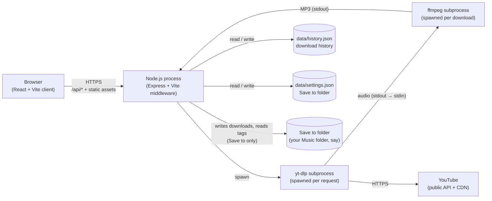
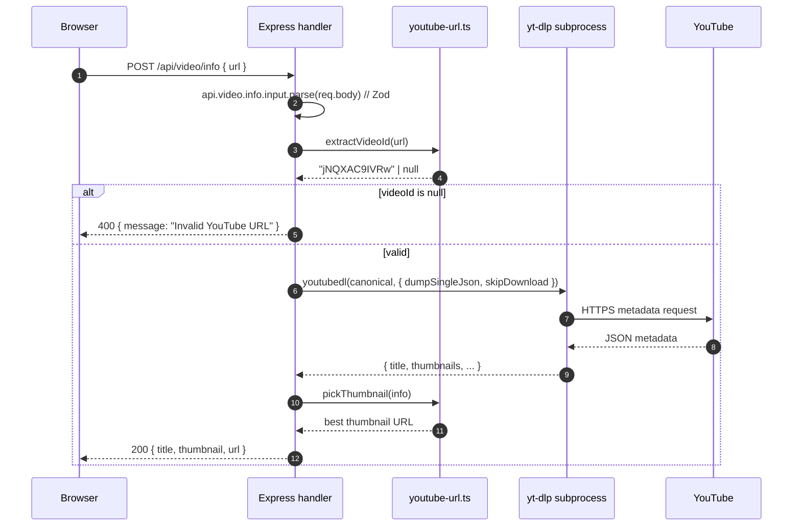
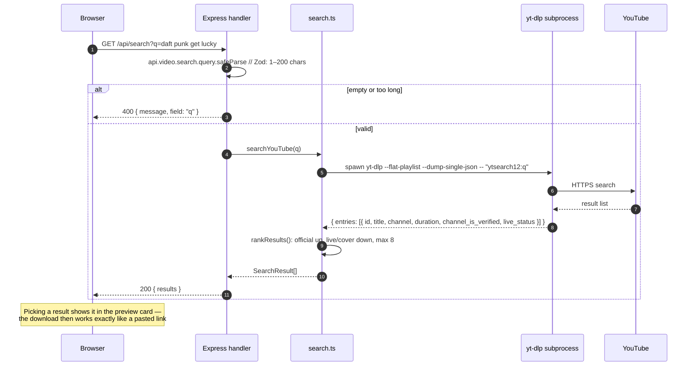
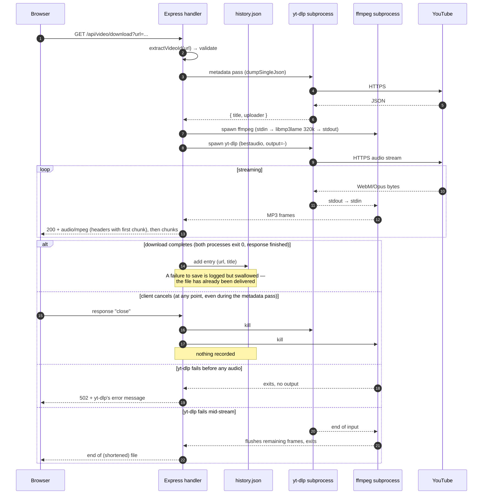
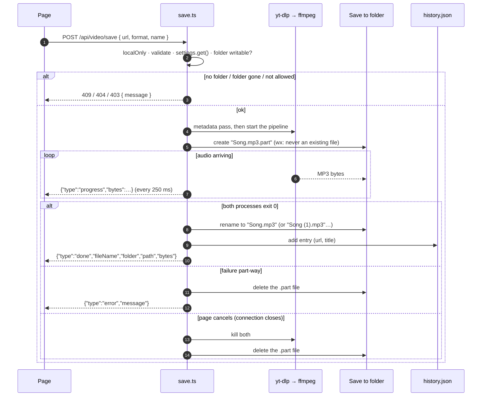
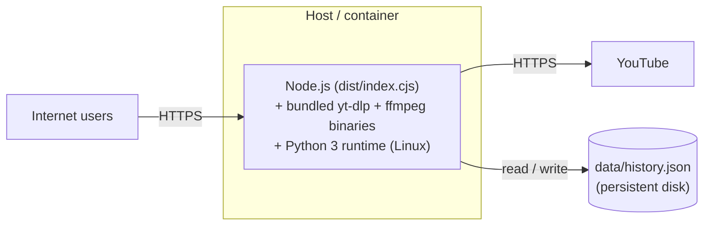

# Technical Documentation & Deployment Guide

This document covers the project's architecture, local development setup, environment configuration, and deployment instructions.

---

## Tech Stack

### Frontend

- **React 18** with TypeScript
- **Vite 7** as the dev server and build tool
- **Wouter** for client-side routing
- **TanStack Query v5** for server-state management and caching
- **Tailwind CSS 3** with shadcn/ui components for styling
- **Framer Motion** for animations
- **Lucide React** for icons

### Backend

- **Node.js** with **Express 5**
- **TypeScript** (executed via `tsx` in development, bundled with `esbuild` in production)
- **youtube-dl-exec** wrapping a bundled **yt-dlp** binary for YouTube video info & audio stream extraction. On Linux/macOS the binary is a Python script and needs Python 3.10+; on Windows it's a standalone `.exe`. yt-dlp is told to use Node (`--js-runtimes node`) as the JavaScript runtime YouTube now requires, so nothing extra needs installing for that.
- **ffmpeg-static** — an ffmpeg binary fetched by `npm install` (any OS, no system install) that converts the audio to MP3 on the fly. Set `FFMPEG_BIN` to use a different ffmpeg.
- **music-metadata** — reads the tags (title, artist, Spotify song) of the audio files in the **Save to** folder, so the playlist panel can tell which songs are there
- **Zod** for request validation

### Storage

- **No database.** The download history is a small JSON file (`data/history.json`), written by `server/storage.ts`. Nothing to install or run.

---

## Project Structure

```
.
├── client/                    # Frontend React application
│   ├── src/
│   │   ├── components/        # UI components (the shadcn/ui ones the app uses, in components/ui)
│   │   ├── hooks/             # Custom React hooks (API calls, remembered choices)
│   │   ├── lib/               # Helpers (queryClient, utils, format: durations + link detection, music: the player's songs)
│   │   ├── pages/             # Route pages (Home, NotFound)
│   │   ├── App.tsx            # Top-level app & router
│   │   ├── main.tsx           # React entry point
│   │   └── index.css          # Global styles & theme variables
│   └── index.html
├── server/                    # Backend Express application
│   ├── index.ts               # App bootstrap, middleware, port binding
│   ├── env.ts                 # Loads .env before anything reads settings
│   ├── host-check.ts          # Refuses requests for unknown host names (DNS rebinding)
│   ├── routes.ts              # API route handlers
│   ├── youtube-url.ts         # Pure URL-parsing / thumbnail helpers
│   ├── search.ts              # Song search: yt-dlp ytsearch + ranking official uploads first
│   ├── spotify.ts             # Spotify song links → title, artists, length (public embed page)
│   ├── library.ts             # Which of a playlist's songs are in the Save to folder (tags + names)
│   ├── music.ts               # The music player: the folder's songs by id, FLAC conversions, covers
│   ├── storage.ts             # Download history (IStorage + FileStorage → data/history.json)
│   ├── audio.ts               # yt-dlp / ffmpeg: arguments, metadata pass, the download pipeline
│   ├── save.ts                # POST /api/video/save — saves a download straight into the Save to folder
│   ├── settings.ts            # App settings (the Save to folder) → data/settings.json
│   ├── folders.ts             # The folder browser: list and make folders, quick links, new files
│   ├── local-only.ts          # Folder routes answer only this computer's own page
│   ├── retry-when-busy.ts     # Retries a rename/delete Windows briefly blocks (antivirus, indexer)
│   ├── vite.ts                # Dev-only Vite middleware integration
│   └── static.ts              # Production static-file serving
├── shared/                    # Code shared between client & server
│   ├── schema.ts              # Zod schemas + types (history, search, settings, folders, save progress)
│   ├── routes.ts              # Typed API route definitions
│   ├── filename.ts            # safeFileName(): download names Windows accepts
│   ├── audio-types.ts         # Audio files by extension: MIME type, what to ask canPlayType()
│   └── spotify-names.ts       # cleanTrackTitle(), spotifyFileName(): "Artist - Title"
├── scripts/
│   ├── build.ts               # Production build (npm run build)
│   └── windows/               # Double-click helpers: start, stop, update-yt-dlp, autostart-on/off (.cmd → app.ps1)
├── docs/
│   └── run/README.md          # Running the app: the scripts, a terminal, from a phone, hosting
├── tailwind.config.ts         # Tailwind theme configuration
├── vite.config.ts             # Vite configuration
├── tests/                     # unit, api (Vitest) and browser (Playwright) tests
├── CLAUDE.md                  # Project notes Claude Code reads automatically
└── package.json
```

---

## Architecture Overview

### Single-port serving

The Express server and the Vite dev server are mounted on a single port (default `5000`). In development, Vite middleware is attached to Express via `server/vite.ts`, so the API and the frontend live on the same origin — no CORS or proxy configuration required. In production, the built client assets are served as static files by `server/static.ts`.

### Data flow

1. The user either pastes a link or searches by song (the **Paste a link / Search by song** switch above the input, remembered in `localStorage`). Whatever the switch says, a link is opened and anything else is searched for (`asLink()` in `client/src/lib/format.ts`).
   - **Link:** the frontend calls `POST /api/video/info`. The backend validates the body with Zod, extracts the canonical video ID (`server/youtube-url.ts`), shells out to `yt-dlp` for metadata, and returns `{ title, thumbnail, url }`.
   - **Spotify song link:** also a search — `GET /api/search?q=<the link>`, see [Spotify song links](#spotify-song-links).
   - **Spotify playlist or album link** (the **Spotify playlist** mode, though any box takes one): opens the playlist panel — `GET /api/spotify/playlist?link=<the link>`, see [Spotify playlists](#spotify-playlists). Picking a song there is a search for that song's link.
   - **Search:** the frontend calls `GET /api/search?q=...`. The backend runs `yt-dlp --flat-playlist --dump-single-json ytsearch12:<query>` (`server/search.ts`), which lists YouTube's top results in a few seconds without opening each video, then ranks them (below) and returns up to 8. Picking a result fills the same preview card with the result's own title and thumbnail — no second `yt-dlp` call. The results' **Close** button hides them (resets the search) and leaves the preview card as it is.
2. Both paths end at the preview card, which links to the download endpoint for that video.
3. When the user clicks **Download Audio**, the browser navigates to `GET /api/video/download?url=...`. The server does a metadata pass (for the filename and ID3 tags), then runs a two-process pipeline (`server/audio.ts`): `yt-dlp` writes the best audio stream YouTube serves without an account (usually Opus at ~130 kbps) to stdout → `ffmpeg` reads it on stdin and writes a 320 kbps constant-bitrate MP3 with title/artist tags to stdout → the HTTP response, with `Content-Type: audio/mpeg` and a `Content-Disposition` header. Nothing touches disk, and the browser's download starts as soon as the first frames are encoded. With `?format=original` (the UI's **Original audio** toggle), ffmpeg doesn't re-encode: it copies YouTube's stream into a proper tagged file — Ogg Opus (`.opus`) for Opus, fragmented MP4 (`.m4a`) for AAC, Matroska (`.mka`) for anything else. The metadata pass requests the same `bestaudio` selection and the stream is pinned to the `format_id` it picked, so the container always matches the audio that arrives.
   The file is named after the video's title, or after `?name=` when you renamed it in the preview card (click the title — `client/src/components/renameable-title.tsx`). Either way the name goes through `safeFileName()` in `shared/filename.ts` — used by the page too, so the name shown is the name saved: characters Windows can't store are replaced (`/` → `-`, `:` and `|` → `-`, `?*"<>` dropped), a typed `.mp3` is dropped, reserved names like `CON` get a `_`, and it's capped at 150 characters. Accents and non-Latin letters are kept: `res.attachment()` sends both an ASCII `filename` and a UTF-8 `filename*` (RFC 6266), which browsers prefer. The ID3 tags and the history keep the video's title.
4. Only when the download has fully succeeded — `yt-dlp` and `ffmpeg` both exited cleanly and the whole file was handed to the browser — does the server add it to the history. A cancelled or failed download is never recorded.
5. Meanwhile the page polls `/api/downloads` every few seconds until the new entry appears, so the Recent Extractions list updates by itself (it gives up after 15 minutes, since a cancelled download never shows up).
6. With a **Save to** folder chosen, step 3 changes: the app saves the file into that folder itself (`POST /api/video/save`) instead of handing it to the browser's download manager — see [Save to a folder](#save-to-a-folder).

The visual versions of these flows live in [System Design](#system-design) below.

### Search ranking

Every YouTube upload of a song tops out at the same free audio quality (~130 kbps Opus), so the real difference between results is what the uploader started from. `rankResults()` in `server/search.ts` therefore keeps YouTube's relevance order, with three adjustments:

- **Official uploads of the song move up** — YouTube's auto-generated `Artist - Topic` channels (made from label releases), verified VEVO channels, and verified channels named after the artist: the title starts with the channel's name (the artist's own channel posting "Artist - Song") or the channel is named in the search ("Queen Official" posting "Bohemian Rhapsody" when you searched "queen bohemian rhapsody"). A verified lyrics channel posting someone else's song, or a TV channel's "… performs Get Lucky | BBC", doesn't count.
- **Results missing part of the search move down** — at least 75% of the search's words (ignoring filler like "official", "lyrics", "the") must appear in the title or channel name. This keeps another artist's song with the same name below the one you meant, and an official upload is only moved up when it matches.
- **Other versions move down** — titles with words like live, performance, concert, cover, remix, karaoke, instrumental, sped up, slowed, nightcore, flashmob or trailer, unless the search asks for that kind of version ("… live" keeps live versions, performances and concerts where they are).

Live streams, upcoming premieres, duplicates and non-video entries are dropped. The query reaches `yt-dlp` as a separate argument after `--`, never through a shell, so nothing typed in the search box can run as a command or be read as a `yt-dlp` option.

### Spotify song links

Spotify's audio is DRM-protected and can't be downloaded, but finding the same recording on YouTube only needs the song's details. `server/spotify.ts` reads them from Spotify's public embed player — `https://open.spotify.com/embed/track/<id>`, the page other websites embed, which needs no account or API key. Its Next.js `__NEXT_DATA__` JSON holds the track's name, artists, length in milliseconds and cover art (`props.pageProps.state.data.entity`).

1. `parseSpotifyLink()` accepts `open.spotify.com/track/<22-character id>` (also with `/intl-xx/` or `/embed/`, and with `?si=` share parameters) and `spotify:track:<id>`. Albums, playlists, artists, podcasts and `spotify.link` short links get a `400` explaining what to paste instead. The id is validated before it goes into the embed URL, so the server can only ever fetch that one Spotify page.
2. `fetchSpotifyTrack()` fetches the embed page (10 s timeout). A deleted song gives `404`; Spotify being unreachable or changing its page gives `502` with a plain message.
3. `spotifySearchQuery()` searches YouTube for "main artist + title + audio" ("audio" brings the artist's "Official Audio" uploads up), with release notes stripped from the title ("Bohemian Rhapsody - Remastered 2011" → "Bohemian Rhapsody", "(feat. …)" removed). Notes that mean a different recording ("- Live", "- Acoustic") are kept.
4. The results are ranked as usual plus the song's length: uploads within 5 seconds of the Spotify length (`SAME_LENGTH_SECONDS` in `shared/schema.ts`) that match the search move to the top — "Official Audio" and label uploads of the same master match to within a few seconds, while music videos add intros and radio edits or extended mixes differ by much more. So a Spotify link to the 6-minute album version of a song finds the album version, not the 4-minute radio edit.

The response adds `spotify: { id, url, title, artists, duration, thumbnail }`; the page shows it above the matches, marks same-length uploads, and picks the best match straight away.

### Spotify playlists

The **Spotify playlist** mode (the third option in the switch above the box) opens a public playlist or album in a panel under the search box, to pick songs from one at a time (`client/src/components/spotify-playlist.tsx`). It needs no Spotify account: Spotify's Web API now only lets an app sign in for someone with Premium (since February 2026, its "Development Mode" requires the app owner to have Premium), so the app reads the same public embed page as for a song.

1. `parseSpotifyLink()` recognises `open.spotify.com/playlist/<id>` and `/album/<id>` (with the same variations as song links). The page also spots them in any box (`isSpotifyPlaylistLink()` in `client/src/lib/format.ts`) and switches to the playlist mode.
2. `fetchSpotifyPlaylist()` fetches `https://open.spotify.com/embed/playlist/<id>` (or `/embed/album/<id>`) — again only a validated 22-character id goes into the URL — and `parsePlaylistPage()` reads its `trackList`: each song's id, title, artists (as one string, the way Spotify shows them), length and explicit flag, plus the name, owner (or album artist) and cover. Podcast episodes and local files in a playlist are left out. A private or deleted playlist comes back as Spotify's "not found" page → `404`, asking to make it public.
3. Spotify's embed page lists at most the first 100 songs of a playlist (`PLAYLIST_EMBED_LIMIT`); with 100, the response says `maybeMore: true` and the panel explains how to get a later song (paste its own link). Albums are always complete.
4. Clicking a song runs the usual search for its link (`/api/search?q=https://open.spotify.com/track/<id>`), so it's matched exactly like a pasted song link: same-length uploads first, and the best match picked straight away.
5. The download remembers the song: the preview card passes `spotifyId=<id>` on the download link (and in the **Save to** request), and the history entry keeps it (`spotifyId` in `shared/schema.ts`). When downloads go to the browser, the panel marks every song whose id is in the history as **Downloaded** and counts them — this only knows about downloads made this way. With a **Save to** folder it looks in the folder instead: see [The playlist and the Save to folder](#the-playlist-and-the-save-to-folder).
6. The open playlist's link is remembered in `localStorage` (`spotify-playlist`), so it reopens on the next visit; **×** forgets it, and the reload button fetches it again (TanStack Query keeps it cached otherwise). The panel filters its songs as you type (`searchableText()` from the history search: every word, any order, accents ignored).

### The playlist and the Save to folder

With a **Save to** folder chosen, the playlist panel compares the playlist with the folder, and downloads what's missing in one go.

1. **What's in the folder:** the page sends the playlist's songs (id, title, artists) to `POST /api/folders/songs`. The server (`server/library.ts`) looks through the **Save to** folder and its subfolders — up to six deep, skipping hidden and system folders and shortcuts, and at most 5,000 audio files (`MAX_SONG_FILES`; the answer says `complete: false` if there were more) — and reads each file's tags with **music-metadata**. Tags are read once per file and kept in memory until the file's size or time changes, so looking again is quick. The route only ever reads the chosen folder (the page sends songs, never a path) and, like the other folder routes, only answers this computer's own page.
2. **Matching** (`findSongs()`): a file is the song when its tags carry the song's Spotify id — which every file this app saves for a Spotify song has: an ID3 `TXXX:spotify_id` frame in an MP3, a `SPOTIFY_ID` comment in an `.opus` or `.mka`, and the song's link as the comment of an `.m4a` (which can't hold a tag of its own); a Spotify song link in any tag counts too. Otherwise, when it has the song's title — without release notes or extras: "Sweet Dreams (Are Made of This) - 2005 Remaster" → "sweet dreams" — and one of its artists, in its tags, its name or the names of the folders it's in ("Queen\Greatest Hits\02 Bohemian Rhapsody.mp3"). Or, last, when it's named exactly like the song and has no artist tag saying it's someone else's ("Forever Young.mp3"). Words are compared without case, accents or punctuation, in any alphabet, and "ACDC" finds "AC/DC". An album folder's name isn't taken for a song's title: "Michael Jackson\Thriller\01 Wanna Be Startin' Somethin'.mp3" isn't "Thriller". The answer is `{ folder, files, complete, found: { <song id>: { file, by } } }`, `by` being `spotify`, `title-artist` or `title`.
3. **The panel** marks each song **In folder** (its file in the tooltip), counts what's there and what's missing, and **Not in folder** lists just the missing ones (plus the songs of the last **Download**, to show how they went). The check runs again when you come back to the page — you may have added or moved files in Explorer — and after every save into the folder (`useSongsInFolder()` in `client/src/hooks/use-songs-in-folder.ts`).
4. **Download** (`useDownloadAll()` in `client/src/hooks/use-download-all.ts`): each missing song has a tick box, all ticked to begin with, and **Download N songs** works through the ticked ones one at a time — one at a time on purpose, so YouTube doesn't see a burst of downloads from one computer. Each song is searched for exactly as if it had been clicked (`/api/search?q=<song link>`) and saved with `POST /api/video/save` only if the best match is the same length as the song on Spotify (`confidentMatch()`: within `SAME_LENGTH_SECONDS`, so almost surely the same recording). Otherwise it's marked **Check** — and unticked — for you to pick an upload yourself; a song whose search or save fails is marked **Failed** and stays ticked to try again. A save the folder itself refuses (gone, off-limits, full) stops the run. **Stop** — or closing the panel or the page, which asks first — cancels the song being saved: its `.part` file is removed, as with any cancelled save. Saved songs are in the folder, so pressing **Download** again carries on with the rest.
5. **Names and tags:** a song found from Spotify — clicked in the panel, saved by **Download**, or from a pasted song link — is saved as "Artists - Title" (`spotifyFileName()` in `shared/spotify-names.ts`): "Queen - Bohemian Rhapsody", not the video's "Queen – Bohemian Rhapsody (Official Video Remastered)". The preview card shows that name, and it can still be renamed. The server tags the file with Spotify's title and artists (`spotifySongTags()` in `server/spotify.ts`, looked up while yt-dlp reads the video's details; if Spotify doesn't answer within 5 seconds, the tags come from YouTube as for any download) and the song's id.

Without a folder, the panel says what choosing one would add.

### Save to a folder

Browsers always put downloads in their own downloads folder, and a web page can't choose another one (only Chrome and Edge have an API for it). But the app runs on your computer, so it saves the file itself — which works the same in every browser:

1. **The setting** sits just below the search box (`client/src/components/save-to-setting.tsx`), always visible, so it can be set before a video is opened and applies to **Redownload** too. It's stored by the app in `data/settings.json` (or wherever `SETTINGS_FILE` points; `server/settings.ts`), so every browser on this computer shares it. `GET /api/settings` returns `{ saveFolder, canSaveToFolder }`.
2. **Choosing the folder:** browsers can't show a folder picker that tells the page a real path, so **Choose folder** opens the app's own folder browser (`client/src/components/folder-picker.tsx`, a native `<dialog>`). `GET /api/folders?path=…` lists a folder's subfolders (hidden and system ones left out) plus quick links — Music, Downloads, Desktop, Documents, Home and, on Windows, each drive (`server/folders.ts`). On Windows the quick links come from the registry (`User Shell Folders`), so a Music folder moved to another drive or into OneDrive is found where it really is. You can click through folders, type or paste a path (Explorer's **Copy as path** quotes are fine), or make a **New folder** (`POST /api/folders`). **Use** sends `PUT /api/settings`, which checks the folder by writing a tiny file there and deleting it — on Windows the permission check alone misses folders only an administrator can change, like `C:\` or Program Files.
3. **Saving:** download clicks are intercepted (`startDownload()` in `Home.tsx`): instead of following the link, the page calls `POST /api/video/save` with `{ url, format, name }` (`saveOnServer()` in `client/src/lib/save-to-folder.ts`). The server (`server/save.ts`) runs the same yt-dlp → ffmpeg pipeline as a download (`startAudioPipeline()` in `server/audio.ts`), but into `<name>.<ext>.part` in the folder — created with the `wx` flag, so the system itself refuses to open an existing file. When both processes have exited cleanly, it's renamed to `<name>.<ext>` — or `<name> (1).<ext>` and so on; an existing file is never replaced (picking the name and renaming happen one save at a time) — and added to the history.
4. **Progress:** once the first audio arrives, the reply is a stream of JSON lines (`application/x-ndjson`, `saveEventSchema` in `shared/schema.ts`): `{"type":"progress","bytes":…}` every quarter-second, then `{"type":"done","fileName","folder","path","bytes"}` or `{"type":"error","message"}`. Problems found before that — no folder chosen (`409`), the folder is gone (`404`) or off-limits (`403`), YouTube refused the video (`502`) — are a normal JSON error. The page reads the stream with `getReader()` (Safari can't loop over it with `for await`) and shows the size on the button.
5. **Cancel** aborts the `fetch`. The server sees the connection close, kills `yt-dlp`/`ffmpeg`, deletes the `.part` file and records nothing — the same as a cancelled browser download. Leaving or reloading the page does the same, so while a save is running the page asks first (`beforeunload`).

**Only a browser on this computer can use it** (`server/local-only.ts`). The folder routes (`PUT /api/settings`, `/api/folders`, `/api/video/save`) answer only requests from a loopback address with no proxy headers (`X-Forwarded-For`, `Forwarded`, `X-Real-IP`), and only from the app's own page: another website's request is labelled `Sec-Fetch-Site: cross-site` (or carries a different `Origin`) and gets a `403`, and changes must be sent as JSON, which a plain HTML form on another site can't do (`415`). With `HOST=0.0.0.0`, a phone on your Wi-Fi gets `canSaveToFolder: false`: the setting is replaced by a note, and its downloads go to the phone as usual.

### The music player

**Your music** (`client/src/components/music-library.tsx`) lists the songs the page can play, and the player bar (`client/src/components/player-bar.tsx`) plays them. One `<audio>` element plays every song (`PlayerProvider` in `client/src/hooks/use-player.tsx`, around the whole app), so music keeps playing while you search and download. A song starts inside the click that asked for it — phones only let a page start sound on a tap — and the same element then moves on to the next song by itself.

1. **The Save to folder's songs** (in a browser on the computer running the app): `GET /api/music` (`server/music.ts`) lists the folder's audio files with their tags — the same scan and tag cache as the playlist check (`readFolderTags()` in `server/library.ts`: up to 5,000 files, six folders deep) — plus each one's length, album and when it arrived (the later of the file's creation and change times, so a copied file counts from when it was copied). An Ogg file (`.opus`, as **Original audio** saves) only says how long it is on its last page, which music-metadata would read the whole file to reach, so `oggDuration()` reads just the file's end. Each song has an id — its place in the folder, hashed (`musicTrackId()`, 22 characters). The page plays `/api/music/<id>`, which the server maps back to a file the scan found (a request never names a path) and sends with `res.sendFile()`, so range requests work and the player can seek. The list is fetched again when you come back to the page and after each save into the folder (`useFolderMusic()`).
2. **Songs a browser can't play:** the page asks `canPlayType()` about each kind of file (`AUDIO_TYPES` in `shared/audio-types.ts`). A folder song the browser says it can't play — or that fails to load anyway — is played from `/api/music/<id>/flac` instead: the server converts it with ffmpeg to FLAC (24-bit for a lossy file's decoded audio, so nothing is lost on top of the file) into a cache folder (`PLAYER_CACHE_DIR`, by default `yt-audio-player` in the system's temp folder) and sends that like any file. Requests for the same song share one conversion; if all of them go away before it's done (the song was skipped), ffmpeg is stopped and its `.part` file deleted. The cache keeps at most 2 GB, deleting the conversions played longest ago. Covers come from `/api/music/<id>/cover`: the front cover in the tags, JPEG/PNG/GIF/WebP/BMP only, sent with `X-Content-Type-Options: nosniff` (`204` when there's none).
3. **Songs on this device** (any browser; on a phone, the only kind): **Choose songs** is a file input (`multiple`, audio types), and **Open a folder** (desktop browsers) the same with `webkitdirectory`. The files never leave the device: their tags and covers are read in the page by music-metadata's browser build (`client/src/lib/device-music.ts`, loaded only once songs are picked — Vite puts it in its own chunks), and they play from `URL.createObjectURL(file)`. A page can't open files again by itself, so they're picked again on the next visit. A song the browser can't play is marked and left out of what plays.
4. **The player:** the play order (`shuffledOrder()`, `nextPosition()`, `previousPosition()` in `client/src/lib/music.ts`, unit-tested); shuffle and repeat (off, all, one), remembered with the volume; Previous restarting a song that has played for 3 seconds; a song that fails skipped after 2 seconds with the reason shown (unless every song failed); and the Media Session API for media keys, Windows' media overlay and phones' lock screens (where the browser has it). Phones get no volume slider: they use their buttons (and iPhones ignore a page's volume).

### Works in every browser

Every feature works in current Chrome, Edge, Firefox and Safari, on computers and phones (Save to only on the computer running the app, as above). The build targets Vite's default baseline — Chrome/Edge 107+, Firefox 104+, Safari 16+ — so:

- The page uses no browser-specific APIs; the one it used to (File System Access, for Save to) was replaced by the app saving the file itself. The folder browser is a native `<dialog>`, which all of them have.
- The music player uses a plain `<audio>` element and asks each browser which files it can play (`canPlayType()`): on the computer running the app, the app converts what a browser can't play; elsewhere, those songs are marked. The Media Session API is used only where the browser has it.
- Syntax that older Safari rejects at run time is kept out, and `tests/unit/browser-support.test.ts` checks the page's code for it: no regular-expression lookbehind (`(?<=…)`, Safari 16.4+ — history highlighting used one, which would have crashed the page in Safari 16.0–16.3) and no `for await` over a stream (Safari can't).
- The Playwright tests run in Chrome (Blink) and WebKit (Safari's engine), and in Firefox (Gecko) when asked — see [Browser end-to-end](#browser-end-to-end-playwright).

### Searching the history

Recent Extractions is searched and filtered entirely in the browser — the whole history (at most 1,000 entries) is already on the page, so there's no search endpoint. The logic is in `client/src/lib/history-filter.ts` (unit-tested); `client/src/components/history-search.tsx` is the search box.

- **Search:** every word typed must appear in the title (or the video's link), in any order, and partial words count, so the list narrows as you type. Case, accents and punctuation are ignored, and non-Latin titles work (the text is compared by Unicode letters and digits).
- **Autocomplete:** matching songs are suggested below the box, each title once with how often it was downloaded — titles starting with what was typed first, then titles where every typed word starts a word, then other matches, newest first among equals. Picking one switches to an exact-title filter (every download of exactly that song). The box follows the ARIA combobox pattern (arrow keys, Enter, Escape; screen readers announce the options).
- **Date filters:** All, Past week (last 7 days), Past month (last 30 days) and Older (more than 30 days ago), combined with the search. An entry with an unreadable date only shows under All.
- The list shows 25 entries at a time with **Show more**, and matched words are highlighted in the titles.

The request log (`server/index.ts`) prints at most 200 characters of each JSON response, since the history is refreshed every few seconds while a download is running.

### Storage abstraction

The download history goes through the `IStorage` interface in `server/storage.ts`; routes only call `storage.getDownloads()` and `storage.createDownload(...)`. The implementation, `FileStorage`, keeps the newest 1,000 entries (about 200 KB) in `data/history.json` (or wherever `HISTORY_FILE` points). Writes are queued one at a time and go through a temp file + rename, so simultaneous downloads can't clobber each other and a crash can't leave half a file. If the file is ever unreadable, it's copied aside as `history.json.broken-<timestamp>` and a fresh list starts — the history is a convenience, so it should never break downloads.

The settings (just the **Save to** folder so far) work the same way in `server/settings.ts`: `data/settings.json` (or `SETTINGS_FILE`), queued writes, temp file + rename; a missing or damaged file simply means the defaults. On Windows, antivirus or the search indexer can hold a brand-new file for a moment, so renames and deletes go through `retryWhenBusy()` (`server/retry-when-busy.ts`).

### Shared types & routes

`shared/schema.ts` defines the Zod schemas for a history entry, a search result, the **Save to** setting, folder listings and save progress events, with their types (`Download`, `SearchResult`, `SaveSettings`, `FolderListing`, `SaveEvent`, …); `shared/routes.ts` defines the API contract (paths, request/response schemas, the `mp3 | original` download formats, and `buildDownloadUrl()`). Both the client and the server import from `@shared/*`, so the contract stays in sync — the client validates `/api/downloads` responses against the same schema the server writes.

---

## System Design

This section is the visual companion to the prose above. All diagrams use [Mermaid](https://mermaid.js.org/), which renders natively on GitHub, VS Code, and most editors with a Markdown plugin.

### Component diagram

The whole system is one Node process and a JSON file, plus two helper binaries run as subprocesses: `yt-dlp` (which calls out to YouTube) and `ffmpeg` (which converts to MP3).



Key things this picture makes obvious:

- **One port, one process.** The client, the API, and (in dev) the Vite dev server all share port 5000. There is no separate API gateway, no reverse proxy in the default setup.
- **`yt-dlp` and `ffmpeg` are subprocesses, not libraries.** Every metadata fetch spawns a fresh `yt-dlp`; every download spawns a `yt-dlp` + `ffmpeg` pair. Those processes are the unit of failure for anything YouTube-related, and the route is responsible for killing both when the download ends or is cancelled.
- **The history file is only on the write path of the download flow** — and even there, a failure to save it does not block the download (see Failure modes).

### Sequence: video info (`POST /api/video/info`)

The cheap, synchronous path the user hits when they paste a URL.



### Sequence: song search (`GET /api/search`)



### Sequence: audio download (`GET /api/video/download`)

The streaming path. Response headers are only flushed with the first chunk of MP3, so a failure **before** any audio (e.g. YouTube refusing the stream) still becomes a clean `502`. Once audio is flowing, a failure can only cut the file short.



### Sequence: saving into the folder (`POST /api/video/save`)

The same pipeline as a download, written to a file in the **Save to** folder instead of the response; the response carries progress.



### Deployment topology

If you ever host it (on a VPS, Render, Fly.io, a Docker container, …), the picture collapses to one server process with a few outbound dependencies.



Notes on this topology:

- The only persistent data is `data/history.json` and `data/settings.json`. In a container, put them on a persistent volume (or point `HISTORY_FILE` / `SETTINGS_FILE` at one), or accept that they reset on redeploy.
- `yt-dlp` and `ffmpeg` are fetched into `node_modules/` at install time (`youtube-dl-exec/bin/`, `ffmpeg-static/`), so nothing is installed at runtime. On Linux we **do** need Python 3.10+ in the container, because the Linux yt-dlp build is a Python script.
- There's no object storage. Audio is streamed from `yt-dlp` through `ffmpeg` to the client and never touches disk on the server — except with **Save to**, which only a browser on the same computer can use.

### Failure modes

The interesting failures are at the boundaries with `yt-dlp`, YouTube, and the history file. The table below is the truth as of the code in `server/routes.ts`:

| Failure                                  | Where surfaced                   | Behavior                                                                                                        | User sees                                                     |
| ---------------------------------------- | -------------------------------- | --------------------------------------------------------------------------------------------------------------- | ------------------------------------------------------------- |
| Invalid / non-YouTube URL                | `extractVideoId` returns `null`  | Short-circuit, no subprocess spawned                                                                            | `400 Invalid YouTube URL`                                     |
| Zod body validation fails (info)         | `api.video.info.input.parse`     | Caught in handler, returns `field` + `message`                                                                  | `400 { message, field }`                                      |
| Empty or too-long search                 | `api.video.search.query`         | Rejected before `yt-dlp` runs                                                                                   | `400 { message, field: "q" }`                                 |
| `yt-dlp` search fails or hangs           | `searchYouTube(...)`             | Non-zero exit → its last error line; killed after 30 s                                                          | `500 { message }`, shown as a toast and inline error          |
| Spotify album/playlist/short link        | `parseSpotifyLink(...)`          | Rejected before any request                                                                                     | `400` explaining that only song links work                    |
| Spotify unreachable or page changed      | `fetchSpotifyTrack(...)`         | 10 s timeout; missing song → `404`, anything else → `502`                                                       | `404` / `502 { message }`, shown as a toast and inline error  |
| `yt-dlp` metadata throws                 | `youtubedl(...)` rejection       | Caught in handler; the message is yt-dlp's own error line (`ytDlpFailure()`), not the command line              | `500 { message }` (info), `500` text (download), `502` (save) |
| Saving the history entry fails           | `storage.createDownload(...)`    | **Swallowed** — logged via `console.error` (the file was already delivered)                                     | Nothing — file still downloads, history just won't show it    |
| `yt-dlp` / `ffmpeg` fails to start       | child process `error` event      | Pipeline stopped; no audio was sent yet                                                                         | `502 Couldn't download the audio: … failed to start`          |
| `yt-dlp` fails before any audio          | `ffmpeg` exits with no output    | Headers not sent yet, so the handler can still answer with an error                                             | `502` with yt-dlp's error message (browser: failed download)  |
| `yt-dlp` exits non-zero mid-stream       | `ytdlp.on("close")`              | stderr logged; `ffmpeg` sees end-of-input, flushes and exits; response ended                                    | Shorter but valid MP3                                         |
| Client cancels the download              | `res.on("close")`                | Watched from the start of the request: nothing is spawned if it's already gone, otherwise both processes killed | n/a (user already left)                                       |
| History file can't be read               | `storage.getDownloads()`         | Unparseable file is copied aside and a fresh list starts; other read errors → caught in handler                 | Empty history, or `500 Failed to fetch downloads`             |
| Save to folder gone or off-limits        | `assertWritableFolder(...)`      | Checked before any work starts; the page reloads the setting                                                    | `404` / `403 { message }`, shown as a toast                   |
| Disk full or write fails mid-save        | `.part` file stream `error`      | Pipeline stopped, `.part` file deleted, nothing recorded                                                        | An `error` line (`507` if it happens before any audio)        |
| Save cancelled, or the page closes       | `res.on("close")` in `save.ts`   | Both processes killed, `.part` file deleted, nothing recorded                                                   | "Download cancelled"                                          |
| A file in the folder isn't audio         | `parseFile(...)` in `library.ts` | Its tags count as empty; it can still be recognised by its name                                                 | Nothing                                                       |
| No upload is surely the same song        | `confidentMatch(...)` (page)     | "Download all" skips it rather than guess                                                                       | **Check** on the song, to pick one yourself                   |
| The folder refuses a "Download all" save | `saveOnServer(...)` (page)       | `403`/`404`/`409`/`507` stops the run (every other song would fail too); the page reloads the setting           | A toast with the reason; saved songs stay saved               |
| YouTube blocks the request               | `yt-dlp` exits non-zero          | Same as the two rows above — that's why we keep `yt-dlp` itself up to date, not roll our own scraping logic     | `502`, or a shortened file if it happens mid-stream           |

The deliberate design choice worth flagging: **a history problem never breaks downloads**. The download history is best-effort, the audio extraction is the product. We chose this over the alternative (fail the download if we can't log it), because the user's download is what they came for.

### Scaling considerations

This stack is designed for a small-to-medium audience. Here's where it would crack and what we'd do about it:

| Bottleneck                     | When it bites                                                                                             | First thing to do                                                                                                 |
| ------------------------------ | --------------------------------------------------------------------------------------------------------- | ----------------------------------------------------------------------------------------------------------------- |
| Single Node process            | Sustained concurrent downloads, since each one occupies an event-loop slot for the duration of the stream | Run multiple Node instances behind a load balancer.                                                               |
| Subprocess fan-out             | Each download runs a `yt-dlp` + `ffmpeg` pair; MP3 encoding is the main CPU cost                          | Add a per-instance concurrency cap (e.g., a small `p-limit` queue around the download pipeline).                  |
| Outbound bandwidth from server | Every byte of audio flows server → client                                                                 | Move to a presigned-URL or proxy-and-cache model, where popular videos hit a CDN instead of `yt-dlp` per request. |
| History in a JSON file         | Multiple server instances, or a history far longer than the 1,000-entry cap                               | Swap `FileStorage` for a database-backed `IStorage` (SQLite or Postgres); routes don't need to change.            |
| `yt-dlp` extractor rot         | YouTube periodically changes its players and `yt-dlp` ships a fix                                         | Bump the `youtube-dl-exec` dependency on a cadence (or pin a specific `yt-dlp` binary release).                   |
| No background job queue        | If a future feature needs work to outlive the request (e.g., batch playlist downloads)                    | Introduce a queue (BullMQ + Redis is the conventional pick) and a worker process.                                 |
| No caching of metadata         | Same URL fetched repeatedly costs a `yt-dlp` spawn each time                                              | Add a short TTL cache (in-memory `lru-cache` or Redis) keyed by canonical video ID.                               |

None of these are problems today. They're listed here so the next person doesn't have to rediscover the ceiling.

---

## History File

`data/history.json` (git-ignored) holds the newest 1,000 downloads, newest first:

```json
[
  {
    "id": 3,
    "url": "https://www.youtube.com/watch?v=fJ9rUzIMcZQ",
    "title": "Queen – Bohemian Rhapsody (Official Video Remastered)",
    "downloadedAt": "2026-09-30T23:12:05.338Z",
    "spotifyId": "4u7EnebtmKWzUH433cf5Qv"
  },
  {
    "id": 2,
    "url": "https://www.youtube.com/watch?v=9DII4peQE7I",
    "title": "Progression - Ocean Green (2004)",
    "downloadedAt": "2026-09-29T22:58:44.009Z"
  }
]
```

`downloadedAt` is an ISO 8601 UTC timestamp. `spotifyId` is there only for a download found from a Spotify song or playlist (see [Spotify playlists](#spotify-playlists)). It's safe to delete the file to clear the history.

---

## API Reference

| Method | Path                    | Purpose                                                                                                                                                                                                                                                                                                                                                                                                                                                |
| ------ | ----------------------- | ------------------------------------------------------------------------------------------------------------------------------------------------------------------------------------------------------------------------------------------------------------------------------------------------------------------------------------------------------------------------------------------------------------------------------------------------------ |
| GET    | `/api/downloads`        | Returns the list of recent downloads, newest first.                                                                                                                                                                                                                                                                                                                                                                                                    |
| GET    | `/api/search`           | Query: `?q=...` (1–200 characters). Returns `{ results: [{ id, url, title, channel, duration, thumbnail, official }] }`, up to 8, official uploads first. `400` for an empty search. If `q` is a Spotify song link, also returns `spotify: { id, url, title, artists, duration, thumbnail }` and ranks same-length uploads first; `400` for other Spotify links, `404` for a song Spotify doesn't have, `502` if Spotify can't be read.                |
| POST   | `/api/video/info`       | Body: `{ url }`. Returns `{ title, thumbnail, url }`.                                                                                                                                                                                                                                                                                                                                                                                                  |
| GET    | `/api/spotify/playlist` | Query: `?link=...` — a public Spotify playlist or album link. Returns `{ kind, id, url, name, by, image, tracks: [{ id, url, title, artists, duration, explicit }], maybeMore }` (the first 100 songs of a playlist). `400` for anything else (a song link says to search for it), `404` for a private or missing playlist, `502` if Spotify can't be read.                                                                                            |
| POST   | `/api/video/save`       | Body: `{ url, format?, name?, spotifyId? }`, as for a download. Saves the audio into the **Save to** folder and streams JSON lines: `progress` (bytes so far), then `done` (`fileName`, `folder`, `path`, `bytes`) or `error` (`message`). `409` if no folder is chosen, `404`/`403` if it's gone or off-limits, `502` if YouTube refuses the video. This computer's own page only.                                                                    |
| GET    | `/api/settings`         | Returns `{ saveFolder, canSaveToFolder }` — the **Save to** folder (or `null` for the browser's downloads), and whether this browser can use one (only on the computer running the app).                                                                                                                                                                                                                                                               |
| PUT    | `/api/settings`         | Body: `{ saveFolder }` — a full folder path, or `null`. The folder must exist and be writable (checked by writing a small file there). This computer's own page only.                                                                                                                                                                                                                                                                                  |
| GET    | `/api/folders`          | Query: `?path=...` (optional; defaults to the **Save to** folder, else Music, else home). Returns `{ path, parent, folders: [{ name, path }], places: [{ name, path }] }`. This computer's own page only.                                                                                                                                                                                                                                              |
| POST   | `/api/folders`          | Body: `{ parent, name }`. Makes a folder (the name cleaned up like a file name); `201 { name, path }`, `409` if it exists. This computer's own page only.                                                                                                                                                                                                                                                                                              |
| POST   | `/api/folders/songs`    | Body: `{ songs: [{ id, title, artists }] }` — a playlist's songs (up to 1,000). Returns `{ folder, files, complete, found: { <id>: { file, by } } }`: which of them are in the **Save to** folder or its subfolders, as which file (its path inside the folder), and how they were recognised (`spotify`, `title-artist` or `title`). `409` if no folder is chosen, `404`/`403` if it's gone or off-limits. This computer's own page only.             |
| GET    | `/api/music`            | The songs in the **Save to** folder and its subfolders, for the music player: `{ folder, complete, tracks: [{ id, path, title, artist, album, duration, addedAt, size }] }`. `409` if no folder is chosen, `404`/`403` if it's gone or off-limits. This computer's own page only.                                                                                                                                                                      |
| GET    | `/api/music/:id`        | One of those songs, as it is (range requests work). `404` if it isn't in the folder any more, `400` for a malformed id. This computer's own page only.                                                                                                                                                                                                                                                                                                 |
| GET    | `/api/music/:id/flac`   | The song converted to FLAC (lossless), for a browser that can't play the file itself; converted once and kept in the cache. This computer's own page only.                                                                                                                                                                                                                                                                                             |
| GET    | `/api/music/:id/cover`  | The song's cover picture from its tags, or `204` if it has none. This computer's own page only.                                                                                                                                                                                                                                                                                                                                                        |
| GET    | `/api/video/download`   | Query: `?url=...&format=mp3\|original&name=...` (`mp3` is the default; `name` is an optional file name without extension, otherwise the video's title). Streams a 320 kbps MP3, or YouTube's original audio unconverted (`.opus` / `.m4a` / `.mka`), as a download. `spotifyId` (optional) is the Spotify song it's for: kept in the history, and the file is tagged with that song's id and Spotify's title and artists. `400` for an unknown format. |

All JSON errors follow the shape `{ message: string, field?: string }`.

---

## Environment Variables

| Variable           | Required | Description                                                                                                               |
| ------------------ | -------- | ------------------------------------------------------------------------------------------------------------------------- |
| `NODE_ENV`         | No       | `development` (default) or `production`. Controls Vite vs static serving.                                                 |
| `PORT`             | No       | Port to bind (default `5000`).                                                                                            |
| `HOST`             | No       | Interface to listen on (default `127.0.0.1`; use `0.0.0.0` in a container).                                               |
| `ALLOWED_HOSTS`    | No       | Extra host names to answer to, comma-separated (e.g. a Tailscale name). `localhost` and IP addresses always work.         |
| `HISTORY_FILE`     | No       | Where to keep the download history (default `data/history.json`).                                                         |
| `SETTINGS_FILE`    | No       | Where to keep the app's settings — the **Save to** folder (default `data/settings.json`).                                 |
| `FFMPEG_BIN`       | No       | Use this ffmpeg instead of the one `ffmpeg-static` downloads.                                                             |
| `PLAYER_CACHE_DIR` | No       | Where the music player keeps songs converted to FLAC (default `yt-audio-player` in the system's temp folder; up to 2 GB). |

None are required. To set any, put them in a `.env` file in the project root (copy `.env.example`); `server/env.ts` loads it on startup. Variables already set in your shell or hosting platform take priority over the file.

---

## Local Development Setup

### Prerequisites

- **Node.js 20** or newer
- **npm** (bundled with Node)
- **Python 3.10+** on `PATH` (Linux/macOS only — Windows uses the standalone `yt-dlp.exe`) — required by `yt-dlp`, which the download endpoint shells out to. Without it, `/api/video/download` will fail at runtime with `python3: No such file or directory`.
  - macOS: `brew install python@3.11`
  - Debian/Ubuntu: `sudo apt install python3`
  - Fedora/RHEL: `sudo dnf install python3`
  - Verify with `python3 --version` (should be 3.10+).

### Steps

1. **Clone the repository**

   ```bash
   git clone <your-repo-url>
   cd <project-directory>
   ```

2. **Install dependencies**

   ```bash
   npm install
   ```

3. **Start the dev server**
   ```bash
   npm run dev
   ```
   The app is available at `http://localhost:5000`. The frontend hot-reloads via Vite; restart the command after changing server files. No configuration is needed — `.env` is optional (see [Environment Variables](#environment-variables)).

---

## Local Development on Windows

The app runs natively on Windows — no WSL or Git Bash needed. The npm scripts are cross-platform (`cross-env`), the server reads `.env` itself, and the Windows build of yt-dlp is a standalone `.exe`, so **Python is not required**.

To just use the app, double-click `scripts\windows\start.cmd`: it checks for Node.js, runs the install below when needed (the first time, or when `package-lock.json` has changed since), starts `npm run dev` and opens the browser. `stop.cmd`, `update-yt-dlp.cmd` and `autostart-on.cmd`/`autostart-off.cmd` sit next to it — see [Running the app](docs/run/README.md). The logic is in `scripts/windows/app.ps1`, written for Windows PowerShell 5.1 and kept plain ASCII (5.1 reads a script without a byte-order mark in the system code page); `.gitattributes` keeps the `.cmd` and `.ps1` files' Windows line endings.

### Prerequisites — install once

```powershell
winget install -e --id OpenJS.NodeJS.LTS         # Node 20+ and npm
```

Close and reopen your terminal so the new programs are on `PATH`, then check `node --version` (v20.x or newer).

> **PowerShell tip:** if `npm` fails with "npm.ps1 cannot be loaded because running scripts is disabled", either type `npm.cmd` instead of `npm`, or allow local scripts once with `Set-ExecutionPolicy -Scope CurrentUser RemoteSigned`.

### Install and run

```powershell
$env:YOUTUBE_DL_SKIP_PYTHON_CHECK = "1"   # see note below
npm install
npm run dev                      # http://localhost:5000
```

`youtube-dl-exec`'s installer refuses to run unless it finds Python 3.9+, even though the Windows `yt-dlp.exe` doesn't use Python. Setting `YOUTUBE_DL_SKIP_PYTHON_CHECK` skips that check; to make it permanent, run `setx YOUTUBE_DL_SKIP_PYTHON_CHECK 1` once and reopen the terminal.

Works the same in PowerShell, `cmd.exe`, Git Bash, or WSL.

### Production build on Windows

```powershell
npm run build
npm start                        # serves dist/ on http://localhost:5000
```

### Common Windows gotchas

- **Port 5000 is in use.** Set `PORT=5001` (or any free port) in `.env`. Find what's holding 5000 with `Get-NetTCPConnection -LocalPort 5000`.
- **Reaching it from your phone or another PC.** The server only listens on this computer by default. Set `HOST=0.0.0.0` in `.env` (Windows Firewall will ask to allow Node) and open `http://<your PC's IP>:5000`. To use a host name instead of the IP (e.g. a Tailscale name), add it to `ALLOWED_HOSTS`.
- **Downloads stop working after a while.** YouTube changes things regularly; run `npm rebuild youtube-dl-exec` to fetch the latest yt-dlp (with `YOUTUBE_DL_SKIP_PYTHON_CHECK` set, as above).
- **`npm install` skips dev dependencies** (e.g. `'tsx' is not recognized`). `NODE_ENV=production` is set in that terminal — clear it (`Remove-Item Env:NODE_ENV`) and reinstall.
- **Long file paths in `node_modules`.** If `npm install` fails with `ENAMETOOLONG`, enable Windows long-path support: `New-ItemProperty -Path "HKLM:\SYSTEM\CurrentControlSet\Control\FileSystem" -Name "LongPathsEnabled" -Value 1 -PropertyType DWORD -Force` (elevated PowerShell, then reboot).
- **Keep the project path free of spaces** (e.g. `C:\Code\...`, not `C:\My Projects\...`). The yt-dlp wrapper falls back to running through a shell when its path contains spaces, which is more fragile.
- **CRLF vs. LF line endings.** Git on Windows usually checks files out with CRLF; `.prettierrc` uses `"endOfLine": "auto"`, so Prettier accepts either and keeps what's there.

---

## Commands

### Wired-up npm scripts

| Script          | What it does                                                                      |
| --------------- | --------------------------------------------------------------------------------- |
| `npm run dev`   | Starts the dev server (Express + Vite middleware) via `tsx`, in development mode. |
| `npm run build` | Runs `scripts/build.ts` to bundle the client (Vite) and the server (esbuild).     |
| `npm start`     | Runs the production build from `dist/index.cjs` (production mode is baked in).    |
| `npm run check` | Type-checks the entire project with `tsc`.                                        |

### Tests, linting, and formatting

These tools are installed and configured but have no shortcut script in `package.json` yet — invoke them directly. If you want the short forms (`npm test`, `npm run lint`, etc.) you can add them yourself; suggested entries are listed in the last column.

| Long form                   | What it does                                                       | Suggested script entry                 |
| --------------------------- | ------------------------------------------------------------------ | -------------------------------------- |
| `npx vitest run`            | Runs the entire Vitest suite (unit + API) once.                    | `"test": "vitest run"`                 |
| `npx vitest`                | Runs Vitest in watch mode for fast TDD.                            | `"test:watch": "vitest"`               |
| `npx vitest run tests/unit` | Runs only the unit tests (pure helpers, no network, milliseconds). | `"test:unit": "vitest run tests/unit"` |
| `npx vitest run tests/api`  | Runs only the API end-to-end tests (real HTTP, real YouTube).      | `"test:api": "vitest run tests/api"`   |
| `npx playwright test`       | Runs the Playwright browser end-to-end tests.                      | `"test:e2e": "playwright test"`        |
| `npx eslint .`              | Lints the codebase. Currently: 0 errors, 3 minor warnings.         | `"lint": "eslint ."`                   |
| `npx eslint . --fix`        | Auto-fixes any lint issues that ESLint can fix safely.             | `"lint:fix": "eslint . --fix"`         |
| `npx prettier --check .`    | Verifies all source files are formatted (use in CI).               | `"format:check": "prettier --check ."` |
| `npx prettier --write .`    | Reformats all source files to the project Prettier style.          | `"format": "prettier --write ."`       |

---

## Testing

The project ships with two end-to-end test suites that exercise the real app against a real YouTube video — no mocks. They share small helpers that inspect a downloaded file's bytes: `tests/utils/mp3.ts` checks for a real MP3 (an optional ID3v2 tag followed by an MPEG Layer III frame header — a WebM or M4A renamed to `.mp3` fails it), and `tests/utils/original-audio.ts` checks that an original-audio download really is Ogg Opus / MP4 / Matroska as its extension says. Fast, offline unit tests in `tests/unit/` cover URL parsing, the yt-dlp/ffmpeg arguments, search ranking, the history and settings files, the folder browser, finding a playlist's songs among a folder's files, the host and local-only checks, the page's save client and "Download all" rules, the music player (song ids, Ogg lengths, covers, the FLAC conversion and its cache, sorting, filtering and play order), and the UI's small formatting helpers.

### Layout

```
tests/
├── api/
│   ├── video.e2e.test.ts        # Vitest + Supertest, hits Express directly
│   └── music.e2e.test.ts        # the music player's routes, on real files (no internet needed)
├── browser/
│   ├── download.spec.ts         # Playwright, drives the real UI in Chrome and WebKit (Firefox on request)
│   └── player.spec.ts           # the music player: the folder's songs, and songs picked on a phone
├── unit/
│   ├── youtube-url.test.ts      # URL parsing + thumbnail picking
│   ├── audio.test.ts            # yt-dlp / ffmpeg argument builders
│   ├── search.test.ts           # search ranking + "official" detection
│   ├── history-filter.test.ts   # history search, suggestions, date filters, highlighting
│   ├── filename.test.ts         # safe download file names
│   ├── spotify.test.ts          # Spotify links, song + playlist embed parsing, title clean-up, same-length ranking
│   ├── format.test.ts           # durations + link-vs-search detection
│   ├── storage.test.ts          # history file
│   ├── settings.test.ts         # settings file (the Save to folder)
│   ├── folders.test.ts          # folder browser, never-overwrite file names, Windows quick links
│   ├── library.test.ts          # playlist songs in the folder: tags, names, matching, files the app tagged
│   ├── music.test.ts            # the player's server side: song ids, Ogg lengths, covers, FLAC conversion + cache
│   ├── music-player.test.ts     # the player's page side: songs, sorting, filtering, shuffle and repeat
│   ├── download-all.test.ts     # "Download all": the same-length rule, "Artist - Title" names
│   ├── local-only.test.ts       # folder routes: this computer's own page only
│   ├── save-to-folder.test.ts   # the page's save client: progress lines, errors, cancel
│   ├── browser-support.test.ts  # no syntax older Safari rejects in the page's code
│   └── host-check.test.ts       # DNS-rebinding protection
└── utils/
    ├── mp3.ts                    # MP3 validator
    └── original-audio.ts         # .opus / .m4a / .mka validator
```

Configuration files: `vitest.config.ts` and `playwright.config.ts`.

### API end-to-end (Vitest + Supertest)

Boots the real Express app in-process (no Vite, no port binding) and exercises `/api/video/info`, `/api/search`, `/api/spotify/playlist`, `/api/video/download`, `/api/video/save`, `/api/settings`, `/api/folders`, `/api/folders/songs` and `/api/downloads` against a stable test video — the very first YouTube upload, "Me at the zoo" (`jNQXAC9IVRw`).

What it checks:

1. An invalid URL returns HTTP 400 with a message.
2. A real YouTube URL returns title + thumbnail metadata.
3. Searching for "me at the zoo jawed" finds the test video, with a channel, duration and thumbnail; an empty search is rejected with `400`. A Spotify link to Queen's "Bohemian Rhapsody" returns the song's details and a best match of the same length; a Spotify album link is rejected with `400`.
4. A Spotify playlist link (Spotify's own "Today's Top Hits") lists its songs, each with a valid song id, title and artists; Daft Punk's _Random Access Memories_ lists its 13 songs; a playlist Spotify won't share is a `404` mentioning private playlists, and a song link or an empty link is a `400`.
5. The download endpoint streams `audio/mpeg` content with a `.mp3` `Content-Disposition`, the bytes are written to disk, and the file is verified to be a real MP3 (ID3 tag + MPEG frame), not just an audio file with an `.mp3` name.
6. `?format=original` returns YouTube's audio unconverted, with a matching extension and content type, and the file is what its extension says.
7. An unknown `format`, or a malformed Spotify song id, is rejected with `400`.
8. The completed download is recorded in the history and surfaces through `/api/downloads`; a download cancelled part-way through is not. A download for a Spotify song (`spotifyId`) is tagged with Spotify's title and artists ("Bohemian Rhapsody", "Queen") and the song's id.
9. **Save to** (into a temporary folder): nothing is saved before a folder is chosen (`409`); a missing folder, a file and a relative path are refused; folders can be listed and made. A save streams progress and then `done`, and leaves a valid MP3 (and nothing else) in the folder, recorded in the history; the same name again becomes "… (1).mp3", accents and all; original audio saves too, tagged as the Spotify song it was sent with, which its history entry keeps; `POST /api/folders/songs` then finds that file by the Spotify id in its tags (whatever it's called), the other downloads by title and artist, and nothing for a song that isn't there (and `409` before a folder is chosen); a video YouTube won't give is a `502` with yt-dlp's reason and leaves nothing behind; a save cancelled part-way leaves no file and no history entry; and requests marked as coming from another website, or sent as a form instead of JSON, are refused.

`tests/api/music.e2e.test.ts` does the same for the music player, against real files made with ffmpeg in a temporary **Save to** folder — no internet needed: `/api/music` is `409` before a folder is chosen, then lists the songs with their tags; a song comes back byte for byte, and a range request gets `206` with just those bytes; a WMA comes back as FLAC (`fLaC`), converted once and then served from the cache; a cover picture comes back as `image/png` with `nosniff`, and a song without one gets `204`; an unknown id is a `404` and a path in place of an id a `400`; requests from another website or through a proxy are refused; and once the folder changes, the old folder's songs are gone.

Run it:

```bash
npx vitest run tests/api
```

The tests point `HISTORY_FILE` and `SETTINGS_FILE` at a temporary folder, so they never touch your real history or settings.

### Browser end-to-end (Playwright)

Drives the app in real browser engines, headless, running every test in each: your installed Google Chrome and WebKit (the engine behind Safari) by default, plus Firefox if you ask for it (below). `playwright.config.ts` starts its own copy with `npm run dev` on port 5099 with a throwaway `HISTORY_FILE` and `SETTINGS_FILE`, so the tests never touch your real history or settings and can run while your own copy is up on port 5000. Set `E2E_BASE_URL` to test an already-running server instead.

What it checks:

1. The hero loads, the URL input accepts the test video URL, and clicking **Extract** renders a preview card with the title, thumbnail, and a download link. Renaming the title in place ("Zoo clip: the first video") makes the download "Zoo clip - the first video.mp3".
2. Clicking **Download Audio** triggers a browser download whose suggested filename ends in `.mp3` and whose saved bytes pass the MP3-header check.
3. Turning on **Original audio** switches the link to `format=original`, and the download is a valid `.opus` (or `.m4a`/`.mka`) file.
4. Switching to **Search by song**, searching for the test video and picking it shows the preview with a download link for that video; the mode survives a reload, and a link typed into the search box is opened (the switch flips back to **Paste a link**).
5. Pasting a Spotify song link into the link box switches to **Search by song**, shows the song from Spotify, and picks the best YouTube match with a download link ready.
6. **Spotify playlist** (with a made-up playlist served in place of `/api/spotify/playlist`, holding the real "Bohemian Rhapsody"): opening its link lists the 12 songs, counts and marks the one already in the (made-up) history as downloaded, and the filter narrows the list; clicking the song finds it on YouTube for real, picks the best match with `spotifyId` on its download link, named "Queen - Bohemian Rhapsody", and shows the song from Spotify above the matches. The playlist reopens after a reload, and stays closed once closed.
7. **The playlist and the Save to folder** (a temporary folder holding "Queen\Bohemian Rhapsody.mp3", and a made-up playlist of that song plus two whose searches are made up to find "Me at the zoo" — one the same length as the video, one not): the panel counts 1 in the folder and 2 missing, and marks Bohemian Rhapsody **In folder**; **Not in folder** lists the 2, both ticked; **Download 2 songs** saves the same-length one for real as "jawed - Me at the zoo.mp3" (a valid MP3) and marks the other **Check**, unticked; the counts update to 2 and 1.
8. **Save to** can be set before opening a video, in the app's folder browser: typing a temporary folder's path opens it, **New folder** makes "Test Music" there and opens it, and **Use** chooses it. Cancelling a download leaves the folder empty; a full download lands there on disk as a valid MP3 — not through the browser's download manager — and appears in the history; the folder is still chosen after a reload; and the **×** goes back to the browser's downloads.
9. A browser on another device (simulated by answering `/api/settings` with `canSaveToFolder: false`) gets a note saying where downloads go, and no **Choose folder** button.
10. Recent Extractions (with a made-up history served in place of `/api/downloads`): 25 entries at a time with **Show more**; typing narrows the list word by word; suggestions list each song once with its download count; picking one with the keyboard shows exactly that song; the date filters work alone and with a search; and "Clear search and filters" resets everything.
11. Submitting an invalid URL surfaces a friendly error (toast or inline) instead of crashing.
12. **The music player** (`player.spec.ts`, songs made with ffmpeg in a temporary folder — a tagged MP3 and a 24-bit AIFF): with that folder under **Save to**, **Your music** lists both; clicking the MP3 plays it from `/api/music/<id>`, as it is, and Pause pauses it; **Next song** plays the AIFF — converted by the app (`/flac`) in a browser that can't play AIFF; Repeat cycles; and Close stops the song and hides the player. As a phone (`canSaveToFolder: false`), **Choose songs** takes the two files: their tags are read in the page, the AIFF is marked if the browser can't play it, the MP3 plays from a `blob:` address, and nothing is sent to the app. The folder's songs can be put in order by title. (Playwright's WebKit on Windows plays media through Windows Media Foundation, which takes several seconds to open a song — so clicks that start one get longer — and can't play `blob:` addresses at all, so there the test checks that the player says it can't. Safari can.)

The Chrome tests use your installed Google Chrome (`channel: "chrome"` in `playwright.config.ts`) — the browser the app is actually used in; WebKit and Firefox are Playwright's own builds. Install whichever are missing (free, one time):

```bash
npx playwright install chrome webkit firefox
```

Run it:

```bash
npx playwright test                   # Chrome and WebKit
npx playwright test --project=webkit  # just one
```

`E2E_BROWSERS` picks the engines (default `chrome,webkit`); in PowerShell, `$env:E2E_BROWSERS="chrome,webkit,firefox"; npx playwright test` adds Firefox. It's opt-in because on some Windows 10 PCs Playwright's Firefox build — like its Chromium (Chrome for Testing) — won't start: Windows reports "the application has failed to start because its side-by-side configuration is incorrect" (the event log names a missing private assembly, `mozglue` for Firefox). Your installed Firefox can still be driven through WebDriver BiDi (`channel: "moz-firefox"`), but Playwright's BiDi support is experimental: its `fill()` doesn't reach React's inputs, so the suite can't use it as it stands.

Open the HTML report after a run:

```bash
npx playwright show-report
```

### Known flakiness — YouTube anti-scraping

Both suites depend on `yt-dlp` (invoked via the `youtube-dl-exec` wrapper) being able to talk to YouTube's API. YouTube actively changes its internals — signed/encrypted stream URLs, PoToken (proof-of-origin token) requirements, format reshuffling — so any extractor can break between releases. yt-dlp is the most aggressively maintained option in this space, but you should still expect periodic breakage.

- The negative tests (invalid URLs → 400) keep passing regardless — they prove the wiring still works.
- The metadata, search and download tests all depend on yt-dlp successfully reaching YouTube (and the Spotify tests on reaching open.spotify.com). If they start failing, first reinstall to get the latest bundled binary:

  ```bash
  # via the package manager — do not edit package.json directly
  # this re-runs youtube-dl-exec's postinstall, which downloads the
  # current yt-dlp release from GitHub
  npm rebuild youtube-dl-exec
  ```

- On Linux/macOS, yt-dlp is a Python script: the host (or container) must have `python3` (3.10+) on `$PATH`. Make sure your image installs it. On Windows, yt-dlp is a standalone `.exe` and needs no Python.
- yt-dlp needs a JavaScript runtime for YouTube. The server passes `--js-runtimes node`, so it uses the same Node that runs the app (Node 20+).

### Test and tooling dependencies

Everything used only for building, testing, linting or formatting is in `devDependencies` (Vitest, Supertest, Playwright, ESLint, Prettier, Vite, Tailwind, …). `dependencies` holds only what the running app and its UI actually import.

---

## Production Build & Deployment

### Build artifacts

Running `npm run build` produces:

- A client bundle (HTML/JS/CSS) inside `dist/public/`.
- A single bundled server file at `dist/index.cjs`.

### Running in production

```bash
npm start   # optionally with PORT / HOST / HISTORY_FILE / SETTINGS_FILE set
```

The Express server serves the static client from `dist/public` and the API from the same port.

### Deploying

The app is a standard Node.js service and runs on any provider that supports long-running Node processes (Railway, Render, Fly.io, a VPS, Docker, etc.).

A typical flow:

1. Set environment variables on the host: `HOST=0.0.0.0`, `PORT` if the platform requires one, and `HISTORY_FILE` / `SETTINGS_FILE` on a persistent volume if you want the history and settings to survive redeploys. (**Save to** only works for a browser on the machine running the app, so on a server it's simply not offered.)
2. Build the project: `npm ci && npm run build`.
3. Start the server: `npm start`.
4. Point your domain / load balancer at the host's exposed port.

> The app has no login. Don't expose it on the public internet as-is — anyone who can reach it can use it. For access from your own devices, a private network like Tailscale is the simple option ([Using it from your phone](docs/run/README.md#using-it-from-your-phone)). Also note YouTube often blocks downloads from data-centre IP addresses, so hosted copies tend to break.

> Serverless platforms (e.g. Vercel, Netlify Functions) are **not recommended** because the audio download endpoint streams long-lived responses, which conflicts with most serverless function time limits.

---

## Security Notes

- **Dependencies:** unused packages from the original template were removed (and the unused shadcn/ui components with them), and everything was updated within its current major version. `npm audit` reported 0 vulnerabilities as of September 2026. Re-check any time with `npm audit`.
- **Updating dependencies:** npm 10 crashes (`Cannot read properties of null (reading 'edgesOut')`) when resolving this project's dependency tree from scratch; use npm 11+ for that, e.g. `npx npm@11 update`. Installing from the existing lockfile works with npm 10.
- **Host check (`server/host-check.ts`):** the server only answers requests addressed to `localhost`, an IP address, or a name in `ALLOWED_HOSTS`, in both dev and production. This blocks DNS-rebinding attacks, where a malicious website points its own domain at `127.0.0.1` to reach servers on your PC. Vite's dev server applies the same rule to its files, and its `fs.deny` list keeps dotfiles such as `.env` from being served.
- **Dev server errors don't stop the server:** Vite errors (a refused file, a syntax error while editing) are logged and shown in the browser overlay.
- The download endpoint accepts only validated YouTube URLs (`extractVideoId` in `server/youtube-url.ts`, which rebuilds a canonical URL from the video ID) and sanitises the filename before sending it back in `Content-Disposition`. yt-dlp and ffmpeg are run with argument arrays, never through a shell.
- Request bodies and query strings are validated with Zod schemas before use.
- **Folder access (`server/local-only.ts`):** the routes that browse folders and save into them only answer this computer's own page — a loopback address with no proxy headers, a same-origin request (`Sec-Fetch-Site`/`Origin`), and changes sent as JSON. Another website you visit can't make the app list your folders, look at what's in them or write files, and neither can another device on your network. Checking which playlist songs are in the folder (`POST /api/folders/songs`) only ever reads the chosen **Save to** folder — the request names songs, not a path. See [Save to a folder](#save-to-a-folder).
- **Music player:** the routes that list and play the **Save to** folder's songs (`/api/music…`) are local-only in the same way — a phone on your Wi-Fi can't list or play them, and another website can't play them in its own page. A song is asked for by an id the folder scan made, never by a path, so only audio files found in the chosen folder can be sent. A cover picture is sent only if it's an image type browsers won't run as a page. Songs picked on another device never reach the app at all.
- The server listens on `127.0.0.1` by default and has no authentication; see the note under [Deploying](#deploying).

---

## Troubleshooting

| Symptom                                           | Likely cause / fix                                                                                                                                                                                                                                               |
| ------------------------------------------------- | ---------------------------------------------------------------------------------------------------------------------------------------------------------------------------------------------------------------------------------------------------------------- |
| `tsx: not found` when running `npm run dev`       | `node_modules` is incomplete. Run `npm install` again.                                                                                                                                                                                                           |
| `Invalid YouTube URL` on the info endpoint        | The URL isn't a recognised YouTube link. Try a standard `youtube.com/watch?v=...` link.                                                                                                                                                                          |
| Download fails with "Couldn't download the audio" | YouTube refused the stream (age-restricted, region-locked, removed, or bot check). Try another video, or update yt-dlp with `npm rebuild youtube-dl-exec`.                                                                                                       |
| Port `5000` already in use                        | Set `PORT=<other-port>` in the environment, then restart.                                                                                                                                                                                                        |
| History list is empty after an update             | Check for `data/history.json.broken-*` — the old file couldn't be read and was set aside.                                                                                                                                                                        |
| "The app isn't allowed to save into …"            | Windows keeps some folders for administrators (the top of `C:\`, Program Files, Windows). Pick a folder inside your user folder, like Music. If it's a folder you own, Windows Security's **Controlled folder access** may be blocking Node.js — allow it there. |
| **Save to** isn't offered, just a note            | You're on another device (or going through a proxy or tunnel). Open the app at `http://localhost:5000` on the computer running it.                                                                                                                               |

---

## Further Reading

- User-facing overview: [README.md](./README.md)
- TanStack Query docs: <https://tanstack.com/query/latest>
- Wouter docs: <https://github.com/molefrog/wouter>
- shadcn/ui: <https://ui.shadcn.com/>
