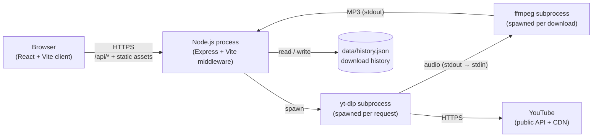
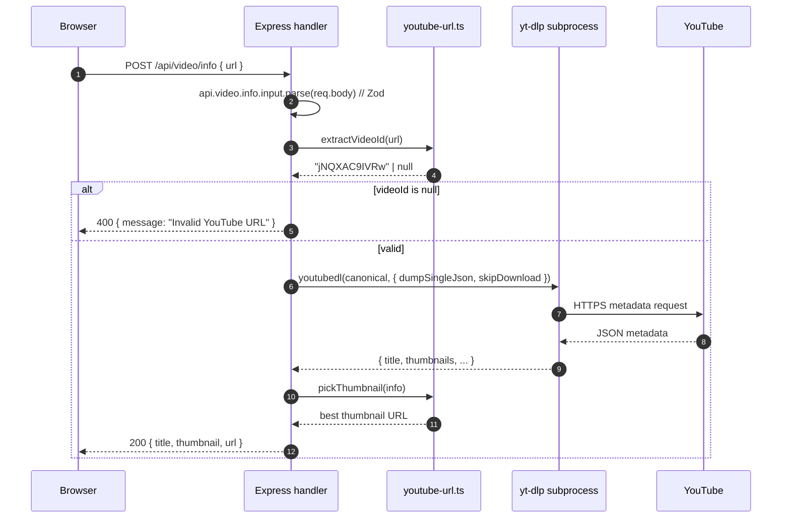
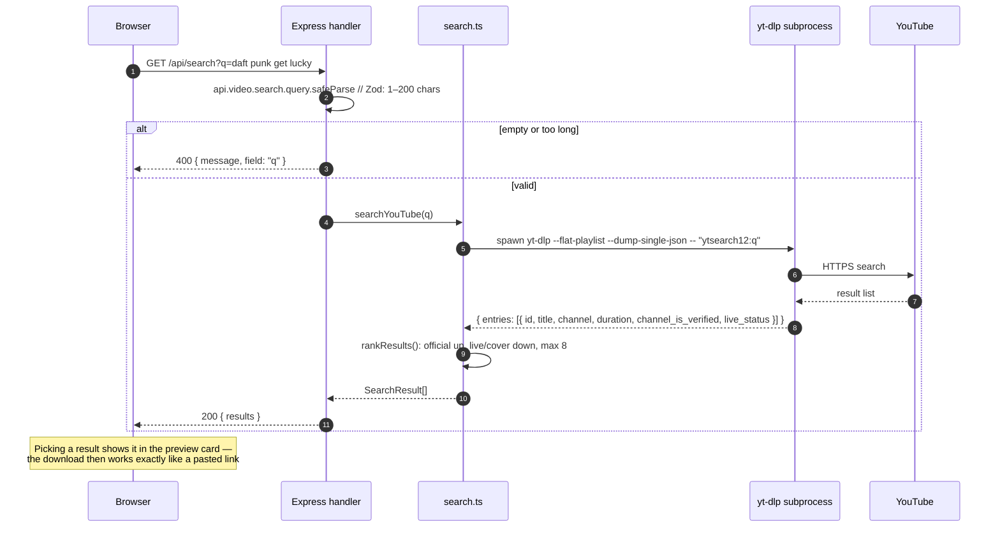
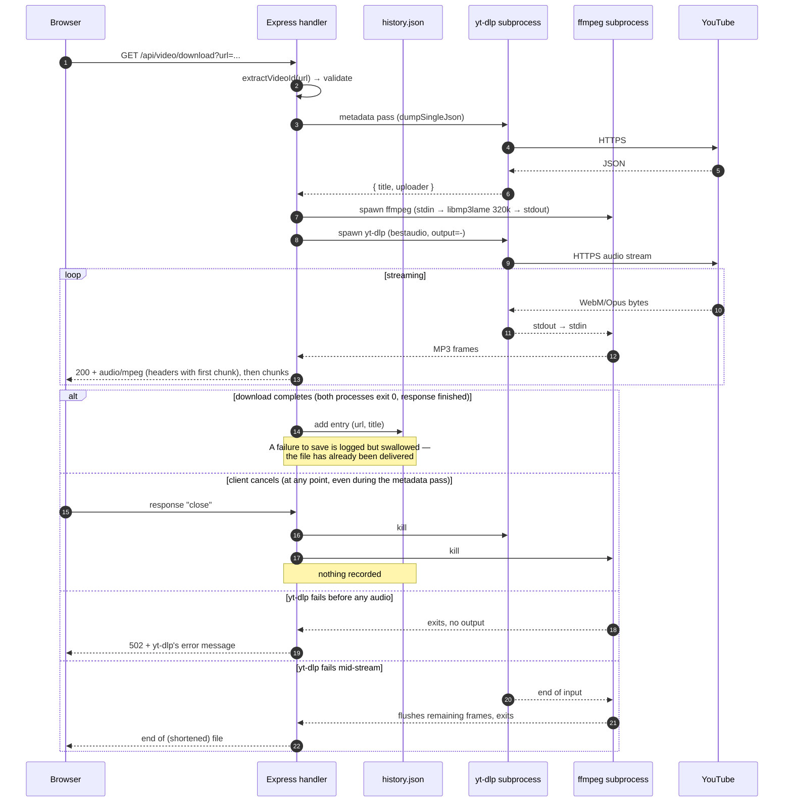
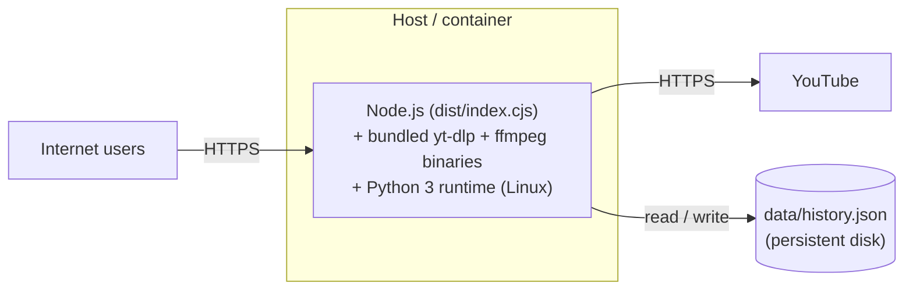

# Technical Documentation & Deployment Guide

This document covers the project's architecture, local development setup, environment configuration, and deployment instructions.

---

## Tech Stack

### Frontend

- **React 18** with TypeScript
- **Vite 7** as the dev server and build tool
- **Wouter** for client-side routing
- **TanStack Query v5** for server-state management and caching
- **Tailwind CSS 3** with shadcn/ui components for styling
- **Framer Motion** for animations
- **Lucide React** for icons

### Backend

- **Node.js** with **Express 5**
- **TypeScript** (executed via `tsx` in development, bundled with `esbuild` in production)
- **youtube-dl-exec** wrapping a bundled **yt-dlp** binary for YouTube video info & audio stream extraction. On Linux/macOS the binary is a Python script and needs Python 3.10+; on Windows it's a standalone `.exe`. yt-dlp is told to use Node (`--js-runtimes node`) as the JavaScript runtime YouTube now requires, so nothing extra needs installing for that.
- **ffmpeg-static** — an ffmpeg binary fetched by `npm install` (any OS, no system install) that converts the audio to MP3 on the fly. Set `FFMPEG_BIN` to use a different ffmpeg.
- **Zod** for request validation

### Storage

- **No database.** The download history is a small JSON file (`data/history.json`), written by `server/storage.ts`. Nothing to install or run.

---

## Project Structure

```
.
├── client/                    # Frontend React application
│   ├── src/
│   │   ├── components/        # UI components (the shadcn/ui ones the app uses, in components/ui)
│   │   ├── hooks/             # Custom React hooks (API calls, remembered choices)
│   │   ├── lib/               # Helpers (queryClient, utils, format: durations + link detection)
│   │   ├── pages/             # Route pages (Home, NotFound)
│   │   ├── App.tsx            # Top-level app & router
│   │   ├── main.tsx           # React entry point
│   │   └── index.css          # Global styles & theme variables
│   └── index.html
├── server/                    # Backend Express application
│   ├── index.ts               # App bootstrap, middleware, port binding
│   ├── env.ts                 # Loads .env before anything reads settings
│   ├── host-check.ts          # Refuses requests for unknown host names (DNS rebinding)
│   ├── routes.ts              # API route handlers
│   ├── youtube-url.ts         # Pure URL-parsing / thumbnail helpers
│   ├── search.ts              # Song search: yt-dlp ytsearch + ranking official uploads first
│   ├── spotify.ts             # Spotify song links → title, artists, length (public embed page)
│   ├── storage.ts             # Download history (IStorage + FileStorage → data/history.json)
│   ├── audio.ts               # yt-dlp / ffmpeg arguments for the download pipeline
│   ├── vite.ts                # Dev-only Vite middleware integration
│   └── static.ts              # Production static-file serving
├── shared/                    # Code shared between client & server
│   ├── schema.ts              # Zod schema + types for history entries
│   └── routes.ts              # Typed API route definitions
├── script/
│   └── build.ts               # Production build script
├── tailwind.config.ts         # Tailwind theme configuration
├── vite.config.ts             # Vite configuration
├── tests/                     # unit, api (Vitest) and browser (Playwright) tests
├── CLAUDE.md                  # Project notes Claude Code reads automatically
└── package.json
```

---

## Architecture Overview

### Single-port serving

The Express server and the Vite dev server are mounted on a single port (default `5000`). In development, Vite middleware is attached to Express via `server/vite.ts`, so the API and the frontend live on the same origin — no CORS or proxy configuration required. In production, the built client assets are served as static files by `server/static.ts`.

### Data flow

1. The user either pastes a link or searches by song (the **Paste a link / Search by song** switch above the input, remembered in `localStorage`). Whatever the switch says, a link is opened and anything else is searched for (`asLink()` in `client/src/lib/format.ts`).
   - **Link:** the frontend calls `POST /api/video/info`. The backend validates the body with Zod, extracts the canonical video ID (`server/youtube-url.ts`), shells out to `yt-dlp` for metadata, and returns `{ title, thumbnail, url }`.
   - **Spotify song link:** also a search — `GET /api/search?q=<the link>`, see [Spotify song links](#spotify-song-links).
   - **Search:** the frontend calls `GET /api/search?q=...`. The backend runs `yt-dlp --flat-playlist --dump-single-json ytsearch12:<query>` (`server/search.ts`), which lists YouTube's top results in a few seconds without opening each video, then ranks them (below) and returns up to 8. Picking a result fills the same preview card with the result's own title and thumbnail — no second `yt-dlp` call.
2. Both paths end at the preview card, which links to the download endpoint for that video.
3. When the user clicks **Download Audio**, the browser navigates to `GET /api/video/download?url=...`. The server does a metadata pass (for the filename and ID3 tags), then runs a two-process pipeline (`server/audio.ts`): `yt-dlp` writes the best audio stream YouTube serves without an account (usually Opus at ~130 kbps) to stdout → `ffmpeg` reads it on stdin and writes a 320 kbps constant-bitrate MP3 with title/artist tags to stdout → the HTTP response, with `Content-Type: audio/mpeg` and a `Content-Disposition` header. Nothing touches disk, and the browser's download starts as soon as the first frames are encoded. With `?format=original` (the UI's **Original audio** toggle), ffmpeg doesn't re-encode: it copies YouTube's stream into a proper tagged file — Ogg Opus (`.opus`) for Opus, fragmented MP4 (`.m4a`) for AAC, Matroska (`.mka`) for anything else. The metadata pass requests the same `bestaudio` selection and the stream is pinned to the `format_id` it picked, so the container always matches the audio that arrives.
4. Only when the download has fully succeeded — `yt-dlp` and `ffmpeg` both exited cleanly and the whole file was handed to the browser — does the server add it to the history. A cancelled or failed download is never recorded.
5. Meanwhile the page polls `/api/downloads` every few seconds until the new entry appears, so the Recent Extractions list updates by itself (it gives up after 15 minutes, since a cancelled download never shows up).
6. With a **Save to** folder chosen, step 3 happens in the page instead of the browser's download manager — see [Save to a folder](#save-to-a-folder).

The visual versions of these flows live in [System Design](#system-design) below.

### Search ranking

Every YouTube upload of a song tops out at the same free audio quality (~130 kbps Opus), so the real difference between results is what the uploader started from. `rankResults()` in `server/search.ts` therefore keeps YouTube's relevance order, with three adjustments:

- **Official uploads of the song move up** — YouTube's auto-generated `Artist - Topic` channels (made from label releases), verified VEVO channels, and verified channels named after the artist: the title starts with the channel's name (the artist's own channel posting "Artist - Song") or the channel is named in the search ("Queen Official" posting "Bohemian Rhapsody" when you searched "queen bohemian rhapsody"). A verified lyrics channel posting someone else's song, or a TV channel's "… performs Get Lucky | BBC", doesn't count.
- **Results missing part of the search move down** — at least 75% of the search's words (ignoring filler like "official", "lyrics", "the") must appear in the title or channel name. This keeps another artist's song with the same name below the one you meant, and an official upload is only moved up when it matches.
- **Other versions move down** — titles with words like live, performance, concert, cover, remix, karaoke, instrumental, sped up, slowed, nightcore, flashmob or trailer, unless the search asks for that kind of version ("… live" keeps live versions, performances and concerts where they are).

Live streams, upcoming premieres, duplicates and non-video entries are dropped. The query reaches `yt-dlp` as a separate argument after `--`, never through a shell, so nothing typed in the search box can run as a command or be read as a `yt-dlp` option.

### Spotify song links

Spotify's audio is DRM-protected and can't be downloaded, but finding the same recording on YouTube only needs the song's details. `server/spotify.ts` reads them from Spotify's public embed player — `https://open.spotify.com/embed/track/<id>`, the page other websites embed, which needs no account or API key. Its Next.js `__NEXT_DATA__` JSON holds the track's name, artists, length in milliseconds and cover art (`props.pageProps.state.data.entity`).

1. `parseSpotifyLink()` accepts `open.spotify.com/track/<22-character id>` (also with `/intl-xx/` or `/embed/`, and with `?si=` share parameters) and `spotify:track:<id>`. Albums, playlists, artists, podcasts and `spotify.link` short links get a `400` explaining what to paste instead. The id is validated before it goes into the embed URL, so the server can only ever fetch that one Spotify page.
2. `fetchSpotifyTrack()` fetches the embed page (10 s timeout). A deleted song gives `404`; Spotify being unreachable or changing its page gives `502` with a plain message.
3. `spotifySearchQuery()` searches YouTube for "main artist + title + audio" ("audio" brings the artist's "Official Audio" uploads up), with release notes stripped from the title ("Bohemian Rhapsody - Remastered 2011" → "Bohemian Rhapsody", "(feat. …)" removed). Notes that mean a different recording ("- Live", "- Acoustic") are kept.
4. The results are ranked as usual plus the song's length: uploads within 5 seconds of the Spotify length (`SAME_LENGTH_SECONDS` in `shared/schema.ts`) that match the search move to the top — "Official Audio" and label uploads of the same master match to within a few seconds, while music videos add intros and radio edits or extended mixes differ by much more. So a Spotify link to the 6-minute album version of a song finds the album version, not the 4-minute radio edit.

The response adds `spotify: { id, url, title, artists, duration, thumbnail }`; the page shows it above the matches, marks same-length uploads, and picks the best match straight away.

### Save to a folder

Browsers always put downloads in their own downloads folder; a page can't change that. What Chrome and Edge (desktop) do offer is the File System Access API, so `client/src/lib/save-folder.ts` saves into a folder you pick instead:

1. **Choose folder** calls `showDirectoryPicker({ mode: "readwrite", startIn: "music" })` — the normal Windows folder dialog. The page only ever sees the folder's name, never its path.
2. The folder handle is kept in IndexedDB (`yt-audio` → `settings` → `save-folder`; a handle can't go in `localStorage`) and restored on the next visit. Before writing, `ensureWriteAccess()` checks permission and, if needed, asks — which must happen straight from a click, so it's the first thing the Download click does. Chrome asks once per visit, or never again if you pick **Allow on every visit**.
3. Download clicks are intercepted (`startDownload()` in `Home.tsx`): the page `fetch`es the same `/api/video/download` URL and streams the body through a byte counter into `FileSystemFileHandle.createWritable()`. The name comes from the response's `Content-Disposition`, made safe for Windows, and an existing file is never overwritten (`Song (1).mp3`, like browsers do).
4. **Cancel** aborts the `fetch`, which closes the connection — the server sees the same "close" as a cancelled browser download, kills `yt-dlp`/`ffmpeg`, and records nothing. The browser writes to a temporary file and only swaps it in when the stream closes cleanly, and `saveToFolder()` removes the empty placeholder file, so a cancelled or failed download leaves nothing behind.
5. The server needs no changes: it records the history entry when the response finishes, exactly as for a normal download.

Browsers without `showDirectoryPicker` (Firefox, Safari, phones) don't show the setting, and downloads stay plain `<a download>` links. The Playwright test can't click through a native folder dialog, so it replaces `showDirectoryPicker` with one that returns a folder in the browser's private storage (OPFS) — a real folder handle, written to the same way — and reads the saved MP3 back out of it.

### Searching the history

Recent Extractions is searched and filtered entirely in the browser — the whole history (at most 1,000 entries) is already on the page, so there's no search endpoint. The logic is in `client/src/lib/history-filter.ts` (unit-tested); `client/src/components/history-search.tsx` is the search box.

- **Search:** every word typed must appear in the title (or the video's link), in any order, and partial words count, so the list narrows as you type. Case, accents and punctuation are ignored, and non-Latin titles work (the text is compared by Unicode letters and digits).
- **Autocomplete:** matching songs are suggested below the box, each title once with how often it was downloaded — titles starting with what was typed first, then titles where every typed word starts a word, then other matches, newest first among equals. Picking one switches to an exact-title filter (every download of exactly that song). The box follows the ARIA combobox pattern (arrow keys, Enter, Escape; screen readers announce the options).
- **Date filters:** All, Past week (last 7 days), Past month (last 30 days) and Older (more than 30 days ago), combined with the search. An entry with an unreadable date only shows under All.
- The list shows 25 entries at a time with **Show more**, and matched words are highlighted in the titles.

The request log (`server/index.ts`) prints at most 200 characters of each JSON response, since the history is refreshed every few seconds while a download is running.

### Storage abstraction

The download history goes through the `IStorage` interface in `server/storage.ts`; routes only call `storage.getDownloads()` and `storage.createDownload(...)`. The implementation, `FileStorage`, keeps the newest 1,000 entries (about 200 KB) in `data/history.json` (or wherever `HISTORY_FILE` points). Writes are queued one at a time and go through a temp file + rename, so simultaneous downloads can't clobber each other and a crash can't leave half a file. If the file is ever unreadable, it's copied aside as `history.json.broken-<timestamp>` and a fresh list starts — the history is a convenience, so it should never break downloads.

### Shared types & routes

`shared/schema.ts` defines the Zod schemas for a history entry and a search result, and the `Download` / `InsertDownload` / `SearchResult` types; `shared/routes.ts` defines the API contract (paths, request/response schemas, the `mp3 | original` download formats, and `buildDownloadUrl()`). Both the client and the server import from `@shared/*`, so the contract stays in sync — the client validates `/api/downloads` responses against the same schema the server writes.

---

## System Design

This section is the visual companion to the prose above. All diagrams use [Mermaid](https://mermaid.js.org/), which renders natively on GitHub, VS Code, and most editors with a Markdown plugin.

### Component diagram

The whole system is one Node process and a JSON file, plus two helper binaries run as subprocesses: `yt-dlp` (which calls out to YouTube) and `ffmpeg` (which converts to MP3).



Key things this picture makes obvious:

- **One port, one process.** The client, the API, and (in dev) the Vite dev server all share port 5000. There is no separate API gateway, no reverse proxy in the default setup.
- **`yt-dlp` and `ffmpeg` are subprocesses, not libraries.** Every metadata fetch spawns a fresh `yt-dlp`; every download spawns a `yt-dlp` + `ffmpeg` pair. Those processes are the unit of failure for anything YouTube-related, and the route is responsible for killing both when the download ends or is cancelled.
- **The history file is only on the write path of the download flow** — and even there, a failure to save it does not block the download (see Failure modes).

### Sequence: video info (`POST /api/video/info`)

The cheap, synchronous path the user hits when they paste a URL.



### Sequence: song search (`GET /api/search`)



### Sequence: audio download (`GET /api/video/download`)

The streaming path. Response headers are only flushed with the first chunk of MP3, so a failure **before** any audio (e.g. YouTube refusing the stream) still becomes a clean `502`. Once audio is flowing, a failure can only cut the file short.



### Deployment topology

If you ever host it (on a VPS, Render, Fly.io, a Docker container, …), the picture collapses to one server process with a few outbound dependencies.



Notes on this topology:

- The only persistent data is `data/history.json`. In a container, put it on a persistent volume (or point `HISTORY_FILE` at one), or accept that the history resets on redeploy.
- `yt-dlp` and `ffmpeg` are fetched into `node_modules/` at install time (`youtube-dl-exec/bin/`, `ffmpeg-static/`), so nothing is installed at runtime. On Linux we **do** need Python 3.10+ in the container, because the Linux yt-dlp build is a Python script.
- There's no object storage. Audio is streamed from `yt-dlp` through `ffmpeg` to the client and never touches disk on the server.

### Failure modes

The interesting failures are at the boundaries with `yt-dlp`, YouTube, and the history file. The table below is the truth as of the code in `server/routes.ts`:

| Failure                             | Where surfaced                  | Behavior                                                                                                        | User sees                                                    |
| ----------------------------------- | ------------------------------- | --------------------------------------------------------------------------------------------------------------- | ------------------------------------------------------------ |
| Invalid / non-YouTube URL           | `extractVideoId` returns `null` | Short-circuit, no subprocess spawned                                                                            | `400 Invalid YouTube URL`                                    |
| Zod body validation fails (info)    | `api.video.info.input.parse`    | Caught in handler, returns `field` + `message`                                                                  | `400 { message, field }`                                     |
| Empty or too-long search            | `api.video.search.query`        | Rejected before `yt-dlp` runs                                                                                   | `400 { message, field: "q" }`                                |
| `yt-dlp` search fails or hangs      | `searchYouTube(...)`            | Non-zero exit → its last error line; killed after 30 s                                                          | `500 { message }`, shown as a toast and inline error         |
| Spotify album/playlist/short link   | `parseSpotifyLink(...)`         | Rejected before any request                                                                                     | `400` explaining that only song links work                   |
| Spotify unreachable or page changed | `fetchSpotifyTrack(...)`        | 10 s timeout; missing song → `404`, anything else → `502`                                                       | `404` / `502 { message }`, shown as a toast and inline error |
| `yt-dlp` metadata throws            | `youtubedl(...)` rejection      | Caught in handler                                                                                               | `500 { message }` (info) or `500` text (download)            |
| Saving the history entry fails      | `storage.createDownload(...)`   | **Swallowed** — logged via `console.error` (the file was already delivered)                                     | Nothing — file still downloads, history just won't show it   |
| `yt-dlp` / `ffmpeg` fails to start  | child process `error` event     | Pipeline stopped; no audio was sent yet                                                                         | `502 Couldn't download the audio: … failed to start`         |
| `yt-dlp` fails before any audio     | `ffmpeg` exits with no output   | Headers not sent yet, so the handler can still answer with an error                                             | `502` with yt-dlp's error message (browser: failed download) |
| `yt-dlp` exits non-zero mid-stream  | `ytdlp.on("close")`             | stderr logged; `ffmpeg` sees end-of-input, flushes and exits; response ended                                    | Shorter but valid MP3                                        |
| Client cancels the download         | `res.on("close")`               | Watched from the start of the request: nothing is spawned if it's already gone, otherwise both processes killed | n/a (user already left)                                      |
| History file can't be read          | `storage.getDownloads()`        | Unparseable file is copied aside and a fresh list starts; other read errors → caught in handler                 | Empty history, or `500 Failed to fetch downloads`            |
| YouTube blocks the request          | `yt-dlp` exits non-zero         | Same as the two rows above — that's why we keep `yt-dlp` itself up to date, not roll our own scraping logic     | `502`, or a shortened file if it happens mid-stream          |

The deliberate design choice worth flagging: **a history problem never breaks downloads**. The download history is best-effort, the audio extraction is the product. We chose this over the alternative (fail the download if we can't log it), because the user's download is what they came for.

### Scaling considerations

This stack is designed for a small-to-medium audience. Here's where it would crack and what we'd do about it:

| Bottleneck                     | When it bites                                                                                             | First thing to do                                                                                                 |
| ------------------------------ | --------------------------------------------------------------------------------------------------------- | ----------------------------------------------------------------------------------------------------------------- |
| Single Node process            | Sustained concurrent downloads, since each one occupies an event-loop slot for the duration of the stream | Run multiple Node instances behind a load balancer.                                                               |
| Subprocess fan-out             | Each download runs a `yt-dlp` + `ffmpeg` pair; MP3 encoding is the main CPU cost                          | Add a per-instance concurrency cap (e.g., a small `p-limit` queue around the download pipeline).                  |
| Outbound bandwidth from server | Every byte of audio flows server → client                                                                 | Move to a presigned-URL or proxy-and-cache model, where popular videos hit a CDN instead of `yt-dlp` per request. |
| History in a JSON file         | Multiple server instances, or a history far longer than the 1,000-entry cap                               | Swap `FileStorage` for a database-backed `IStorage` (SQLite or Postgres); routes don't need to change.            |
| `yt-dlp` extractor rot         | YouTube periodically changes its players and `yt-dlp` ships a fix                                         | Bump the `youtube-dl-exec` dependency on a cadence (or pin a specific `yt-dlp` binary release).                   |
| No background job queue        | If a future feature needs work to outlive the request (e.g., batch playlist downloads)                    | Introduce a queue (BullMQ + Redis is the conventional pick) and a worker process.                                 |
| No caching of metadata         | Same URL fetched repeatedly costs a `yt-dlp` spawn each time                                              | Add a short TTL cache (in-memory `lru-cache` or Redis) keyed by canonical video ID.                               |

None of these are problems today. They're listed here so the next person doesn't have to rediscover the ceiling.

---

## History File

`data/history.json` (git-ignored) holds the newest 1,000 downloads, newest first:

```json
[
  {
    "id": 2,
    "url": "https://www.youtube.com/watch?v=9DII4peQE7I",
    "title": "Progression - Ocean Green (2004)",
    "downloadedAt": "2026-09-29T22:58:44.009Z"
  }
]
```

`downloadedAt` is an ISO 8601 UTC timestamp. It's safe to delete the file to clear the history.

---

## API Reference

| Method | Path                  | Purpose                                                                                                                                                                                                                                                                                                                                                                                                                                 |
| ------ | --------------------- | --------------------------------------------------------------------------------------------------------------------------------------------------------------------------------------------------------------------------------------------------------------------------------------------------------------------------------------------------------------------------------------------------------------------------------------- |
| GET    | `/api/downloads`      | Returns the list of recent downloads, newest first.                                                                                                                                                                                                                                                                                                                                                                                     |
| GET    | `/api/search`         | Query: `?q=...` (1–200 characters). Returns `{ results: [{ id, url, title, channel, duration, thumbnail, official }] }`, up to 8, official uploads first. `400` for an empty search. If `q` is a Spotify song link, also returns `spotify: { id, url, title, artists, duration, thumbnail }` and ranks same-length uploads first; `400` for other Spotify links, `404` for a song Spotify doesn't have, `502` if Spotify can't be read. |
| POST   | `/api/video/info`     | Body: `{ url }`. Returns `{ title, thumbnail, url }`.                                                                                                                                                                                                                                                                                                                                                                                   |
| GET    | `/api/video/download` | Query: `?url=...&format=mp3\|original` (`mp3` is the default). Streams a 320 kbps MP3, or YouTube's original audio unconverted (`.opus` / `.m4a` / `.mka`), as a download. `400` for an unknown format.                                                                                                                                                                                                                                 |

All JSON errors follow the shape `{ message: string, field?: string }`.

---

## Environment Variables

| Variable        | Required | Description                                                                                                       |
| --------------- | -------- | ----------------------------------------------------------------------------------------------------------------- |
| `NODE_ENV`      | No       | `development` (default) or `production`. Controls Vite vs static serving.                                         |
| `PORT`          | No       | Port to bind (default `5000`).                                                                                    |
| `HOST`          | No       | Interface to listen on (default `127.0.0.1`; use `0.0.0.0` in a container).                                       |
| `ALLOWED_HOSTS` | No       | Extra host names to answer to, comma-separated (e.g. a Tailscale name). `localhost` and IP addresses always work. |
| `HISTORY_FILE`  | No       | Where to keep the download history (default `data/history.json`).                                                 |
| `FFMPEG_BIN`    | No       | Use this ffmpeg instead of the one `ffmpeg-static` downloads.                                                     |

None are required. To set any, put them in a `.env` file in the project root (copy `.env.example`); `server/env.ts` loads it on startup. Variables already set in your shell or hosting platform take priority over the file.

---

## Local Development Setup

### Prerequisites

- **Node.js 20** or newer
- **npm** (bundled with Node)
- **Python 3.10+** on `PATH` (Linux/macOS only — Windows uses the standalone `yt-dlp.exe`) — required by `yt-dlp`, which the download endpoint shells out to. Without it, `/api/video/download` will fail at runtime with `python3: No such file or directory`.
  - macOS: `brew install python@3.11`
  - Debian/Ubuntu: `sudo apt install python3`
  - Fedora/RHEL: `sudo dnf install python3`
  - Verify with `python3 --version` (should be 3.10+).

### Steps

1. **Clone the repository**

   ```bash
   git clone <your-repo-url>
   cd <project-directory>
   ```

2. **Install dependencies**

   ```bash
   npm install
   ```

3. **Start the dev server**
   ```bash
   npm run dev
   ```
   The app is available at `http://localhost:5000`. The frontend hot-reloads via Vite; restart the command after changing server files. No configuration is needed — `.env` is optional (see [Environment Variables](#environment-variables)).

---

## Local Development on Windows

The app runs natively on Windows — no WSL or Git Bash needed. The npm scripts are cross-platform (`cross-env`), the server reads `.env` itself, and the Windows build of yt-dlp is a standalone `.exe`, so **Python is not required**.

### Prerequisites — install once

```powershell
winget install -e --id OpenJS.NodeJS.LTS         # Node 20+ and npm
```

Close and reopen your terminal so the new programs are on `PATH`, then check `node --version` (v20.x or newer).

> **PowerShell tip:** if `npm` fails with "npm.ps1 cannot be loaded because running scripts is disabled", either type `npm.cmd` instead of `npm`, or allow local scripts once with `Set-ExecutionPolicy -Scope CurrentUser RemoteSigned`.

### Install and run

```powershell
$env:YOUTUBE_DL_SKIP_PYTHON_CHECK = "1"   # see note below
npm install
npm run dev                      # http://localhost:5000
```

`youtube-dl-exec`'s installer refuses to run unless it finds Python 3.9+, even though the Windows `yt-dlp.exe` doesn't use Python. Setting `YOUTUBE_DL_SKIP_PYTHON_CHECK` skips that check; to make it permanent, run `setx YOUTUBE_DL_SKIP_PYTHON_CHECK 1` once and reopen the terminal.

Works the same in PowerShell, `cmd.exe`, Git Bash, or WSL.

### Production build on Windows

```powershell
npm run build
npm start                        # serves dist/ on http://localhost:5000
```

### Common Windows gotchas

- **Port 5000 is in use.** Set `PORT=5001` (or any free port) in `.env`. Find what's holding 5000 with `Get-NetTCPConnection -LocalPort 5000`.
- **Reaching it from your phone or another PC.** The server only listens on this computer by default. Set `HOST=0.0.0.0` in `.env` (Windows Firewall will ask to allow Node) and open `http://<your PC's IP>:5000`. To use a host name instead of the IP (e.g. a Tailscale name), add it to `ALLOWED_HOSTS`.
- **Downloads stop working after a while.** YouTube changes things regularly; run `npm rebuild youtube-dl-exec` to fetch the latest yt-dlp (with `YOUTUBE_DL_SKIP_PYTHON_CHECK` set, as above).
- **`npm install` skips dev dependencies** (e.g. `'tsx' is not recognized`). `NODE_ENV=production` is set in that terminal — clear it (`Remove-Item Env:NODE_ENV`) and reinstall.
- **Long file paths in `node_modules`.** If `npm install` fails with `ENAMETOOLONG`, enable Windows long-path support: `New-ItemProperty -Path "HKLM:\SYSTEM\CurrentControlSet\Control\FileSystem" -Name "LongPathsEnabled" -Value 1 -PropertyType DWORD -Force` (elevated PowerShell, then reboot).
- **Keep the project path free of spaces** (e.g. `C:\Code\...`, not `C:\My Projects\...`). The yt-dlp wrapper falls back to running through a shell when its path contains spaces, which is more fragile.
- **CRLF vs. LF line endings.** Git on Windows usually checks files out with CRLF; `.prettierrc` uses `"endOfLine": "auto"`, so Prettier accepts either and keeps what's there.

---

## Commands

### Wired-up npm scripts

| Script          | What it does                                                                      |
| --------------- | --------------------------------------------------------------------------------- |
| `npm run dev`   | Starts the dev server (Express + Vite middleware) via `tsx`, in development mode. |
| `npm run build` | Runs `script/build.ts` to bundle the client (Vite) and the server (esbuild).      |
| `npm start`     | Runs the production build from `dist/index.cjs` (production mode is baked in).    |
| `npm run check` | Type-checks the entire project with `tsc`.                                        |

### Tests, linting, and formatting

These tools are installed and configured but have no shortcut script in `package.json` yet — invoke them directly. If you want the short forms (`npm test`, `npm run lint`, etc.) you can add them yourself; suggested entries are listed in the last column.

| Long form                   | What it does                                                       | Suggested script entry                 |
| --------------------------- | ------------------------------------------------------------------ | -------------------------------------- |
| `npx vitest run`            | Runs the entire Vitest suite (unit + API) once.                    | `"test": "vitest run"`                 |
| `npx vitest`                | Runs Vitest in watch mode for fast TDD.                            | `"test:watch": "vitest"`               |
| `npx vitest run tests/unit` | Runs only the unit tests (pure helpers, no network, milliseconds). | `"test:unit": "vitest run tests/unit"` |
| `npx vitest run tests/api`  | Runs only the API end-to-end tests (real HTTP, real YouTube).      | `"test:api": "vitest run tests/api"`   |
| `npx playwright test`       | Runs the Playwright browser end-to-end tests.                      | `"test:e2e": "playwright test"`        |
| `npx eslint .`              | Lints the codebase. Currently: 0 errors, 3 minor warnings.         | `"lint": "eslint ."`                   |
| `npx eslint . --fix`        | Auto-fixes any lint issues that ESLint can fix safely.             | `"lint:fix": "eslint . --fix"`         |
| `npx prettier --check .`    | Verifies all source files are formatted (use in CI).               | `"format:check": "prettier --check ."` |
| `npx prettier --write .`    | Reformats all source files to the project Prettier style.          | `"format": "prettier --write ."`       |

---

## Testing

The project ships with two end-to-end test suites that exercise the real app against a real YouTube video — no mocks. They share small helpers that inspect a downloaded file's bytes: `tests/utils/mp3.ts` checks for a real MP3 (an optional ID3v2 tag followed by an MPEG Layer III frame header — a WebM or M4A renamed to `.mp3` fails it), and `tests/utils/original-audio.ts` checks that an original-audio download really is Ogg Opus / MP4 / Matroska as its extension says. Fast, offline unit tests in `tests/unit/` cover URL parsing, the yt-dlp/ffmpeg arguments, search ranking, the history file, the host check, and the UI's small formatting helpers.

### Layout

```
tests/
├── api/
│   └── video.e2e.test.ts        # Vitest + Supertest, hits Express directly
├── browser/
│   └── download.spec.ts         # Playwright, drives the real UI in headless Google Chrome
├── unit/
│   ├── youtube-url.test.ts      # URL parsing + thumbnail picking
│   ├── audio.test.ts            # yt-dlp / ffmpeg argument builders
│   ├── search.test.ts           # search ranking + "official" detection
│   ├── history-filter.test.ts   # history search, suggestions, date filters, highlighting
│   ├── spotify.test.ts          # Spotify links, embed-page parsing, title clean-up, same-length ranking
│   ├── format.test.ts           # durations + link-vs-search detection
│   ├── storage.test.ts          # history file
│   └── host-check.test.ts       # DNS-rebinding protection
└── utils/
    ├── mp3.ts                    # MP3 validator
    └── original-audio.ts         # .opus / .m4a / .mka validator
```

Configuration files: `vitest.config.ts` and `playwright.config.ts`.

### API end-to-end (Vitest + Supertest)

Boots the real Express app in-process (no Vite, no port binding) and exercises `/api/video/info`, `/api/search`, `/api/video/download`, and `/api/downloads` against a stable test video — the very first YouTube upload, "Me at the zoo" (`jNQXAC9IVRw`).

What it checks:

1. An invalid URL returns HTTP 400 with a message.
2. A real YouTube URL returns title + thumbnail metadata.
3. Searching for "me at the zoo jawed" finds the test video, with a channel, duration and thumbnail; an empty search is rejected with `400`. A Spotify link to Queen's "Bohemian Rhapsody" returns the song's details and a best match of the same length; a Spotify album link is rejected with `400`.
4. The download endpoint streams `audio/mpeg` content with a `.mp3` `Content-Disposition`, the bytes are written to disk, and the file is verified to be a real MP3 (ID3 tag + MPEG frame), not just an audio file with an `.mp3` name.
5. `?format=original` returns YouTube's audio unconverted, with a matching extension and content type, and the file is what its extension says.
6. An unknown `format` is rejected with `400`.
7. The completed download is recorded in the history and surfaces through `/api/downloads`; a download cancelled part-way through is not.

Run it:

```bash
npx vitest run tests/api
```

The tests point `HISTORY_FILE` at a temporary folder, so they never add entries to your real history.

### Browser end-to-end (Playwright)

Drives headless Google Chrome against the app. `playwright.config.ts` starts its own copy with `npm run dev` on port 5099 and a throwaway `HISTORY_FILE`, so the tests never add entries to your real history and can run while your own copy is up on port 5000. Set `E2E_BASE_URL` to test an already-running server instead.

What it checks:

1. The hero loads, the URL input accepts the test video URL, and clicking **Extract** renders a preview card with the title, thumbnail, and a download link.
2. Clicking **Download Audio** triggers a browser download whose suggested filename ends in `.mp3` and whose saved bytes pass the MP3-header check.
3. Turning on **Original audio** switches the link to `format=original`, and the download is a valid `.opus` (or `.m4a`/`.mka`) file.
4. Switching to **Search by song**, searching for the test video and picking it shows the preview with a download link for that video; the mode survives a reload, and a link typed into the search box is opened (the switch flips back to **Paste a link**).
5. Pasting a Spotify song link into the link box switches to **Search by song**, shows the song from Spotify, and picks the best YouTube match with a download link ready.
6. With **Save to** set to a folder (backed by OPFS in the test), cancelling a download leaves the folder empty; a full download lands there as a valid MP3, not through the browser's download manager, appears in the history, and the folder is still chosen after a reload.
7. Recent Extractions (with a made-up history served in place of `/api/downloads`): 25 entries at a time with **Show more**; typing narrows the list word by word; suggestions list each song once with its download count; picking one with the keyboard shows exactly that song; the date filters work alone and with a search; and "Clear search and filters" resets everything.
8. Submitting an invalid URL surfaces a friendly error (toast or inline) instead of crashing.

The tests run in your installed Google Chrome, in headless mode (`channel: "chrome"` in `playwright.config.ts`) — the browser the app is actually used in. Playwright's own lightweight "headless shell" can't be used: it crashes when a page restores a saved **Save to** folder from IndexedDB (real Chrome and Edge are fine). If Chrome isn't installed:

```bash
npx playwright install chrome
```

Run it:

```bash
npx playwright test
```

Open the HTML report after a run:

```bash
npx playwright show-report
```

### Known flakiness — YouTube anti-scraping

Both suites depend on `yt-dlp` (invoked via the `youtube-dl-exec` wrapper) being able to talk to YouTube's API. YouTube actively changes its internals — signed/encrypted stream URLs, PoToken (proof-of-origin token) requirements, format reshuffling — so any extractor can break between releases. yt-dlp is the most aggressively maintained option in this space, but you should still expect periodic breakage.

- The negative tests (invalid URLs → 400) keep passing regardless — they prove the wiring still works.
- The metadata, search and download tests all depend on yt-dlp successfully reaching YouTube (and the Spotify tests on reaching open.spotify.com). If they start failing, first reinstall to get the latest bundled binary:

  ```bash
  # via the package manager — do not edit package.json directly
  # this re-runs youtube-dl-exec's postinstall, which downloads the
  # current yt-dlp release from GitHub
  npm rebuild youtube-dl-exec
  ```

- On Linux/macOS, yt-dlp is a Python script: the host (or container) must have `python3` (3.10+) on `$PATH`. Make sure your image installs it. On Windows, yt-dlp is a standalone `.exe` and needs no Python.
- yt-dlp needs a JavaScript runtime for YouTube. The server passes `--js-runtimes node`, so it uses the same Node that runs the app (Node 20+).

### Test and tooling dependencies

Everything used only for building, testing, linting or formatting is in `devDependencies` (Vitest, Supertest, Playwright, ESLint, Prettier, Vite, Tailwind, …). `dependencies` holds only what the running app and its UI actually import.

---

## Production Build & Deployment

### Build artifacts

Running `npm run build` produces:

- A client bundle (HTML/JS/CSS) inside `dist/public/`.
- A single bundled server file at `dist/index.cjs`.

### Running in production

```bash
npm start   # optionally with PORT / HOST / HISTORY_FILE set
```

The Express server serves the static client from `dist/public` and the API from the same port.

### Deploying

The app is a standard Node.js service and runs on any provider that supports long-running Node processes (Railway, Render, Fly.io, a VPS, Docker, etc.).

A typical flow:

1. Set environment variables on the host: `HOST=0.0.0.0`, `PORT` if the platform requires one, and `HISTORY_FILE` on a persistent volume if you want the history to survive redeploys.
2. Build the project: `npm ci && npm run build`.
3. Start the server: `npm start`.
4. Point your domain / load balancer at the host's exposed port.

> The app has no login. Don't expose it on the public internet as-is — anyone who can reach it can use it. For access from your own devices, a private network like Tailscale is the simple option. Also note YouTube often blocks downloads from data-centre IP addresses, so hosted copies tend to break.

> Serverless platforms (e.g. Vercel, Netlify Functions) are **not recommended** because the audio download endpoint streams long-lived responses, which conflicts with most serverless function time limits.

---

## Security Notes

- **Dependencies:** unused packages from the original template were removed (and the unused shadcn/ui components with them), and everything was updated within its current major version. `npm audit` reported 0 vulnerabilities as of September 2026. Re-check any time with `npm audit`.
- **Updating dependencies:** npm 10 crashes (`Cannot read properties of null (reading 'edgesOut')`) when resolving this project's dependency tree from scratch; use npm 11+ for that, e.g. `npx npm@11 update`. Installing from the existing lockfile works with npm 10.
- **Host check (`server/host-check.ts`):** the server only answers requests addressed to `localhost`, an IP address, or a name in `ALLOWED_HOSTS`, in both dev and production. This blocks DNS-rebinding attacks, where a malicious website points its own domain at `127.0.0.1` to reach servers on your PC. Vite's dev server applies the same rule to its files, and its `fs.deny` list keeps dotfiles such as `.env` from being served.
- **Dev server errors don't stop the server:** Vite errors (a refused file, a syntax error while editing) are logged and shown in the browser overlay.
- The download endpoint accepts only validated YouTube URLs (`extractVideoId` in `server/youtube-url.ts`, which rebuilds a canonical URL from the video ID) and sanitises the filename before sending it back in `Content-Disposition`. yt-dlp and ffmpeg are run with argument arrays, never through a shell.
- Request bodies and query strings are validated with Zod schemas before use.
- The server listens on `127.0.0.1` by default and has no authentication; see the note under [Deploying](#deploying).

---

## Troubleshooting

| Symptom                                           | Likely cause / fix                                                                                                                                         |
| ------------------------------------------------- | ---------------------------------------------------------------------------------------------------------------------------------------------------------- |
| `tsx: not found` when running `npm run dev`       | `node_modules` is incomplete. Run `npm install` again.                                                                                                     |
| `Invalid YouTube URL` on the info endpoint        | The URL isn't a recognised YouTube link. Try a standard `youtube.com/watch?v=...` link.                                                                    |
| Download fails with "Couldn't download the audio" | YouTube refused the stream (age-restricted, region-locked, removed, or bot check). Try another video, or update yt-dlp with `npm rebuild youtube-dl-exec`. |
| Port `5000` already in use                        | Set `PORT=<other-port>` in the environment, then restart.                                                                                                  |
| History list is empty after an update             | Check for `data/history.json.broken-*` — the old file couldn't be read and was set aside.                                                                  |

---

## Further Reading

- User-facing overview: [README.md](./README.md)
- TanStack Query docs: <https://tanstack.com/query/latest>
- Wouter docs: <https://github.com/molefrog/wouter>
- shadcn/ui: <https://ui.shadcn.com/>
