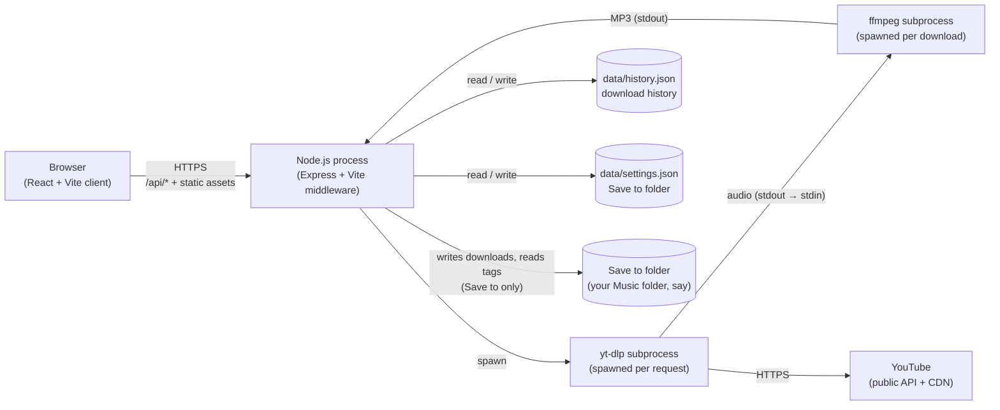
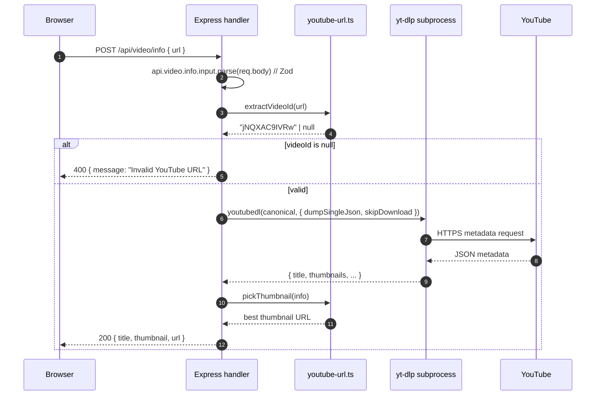
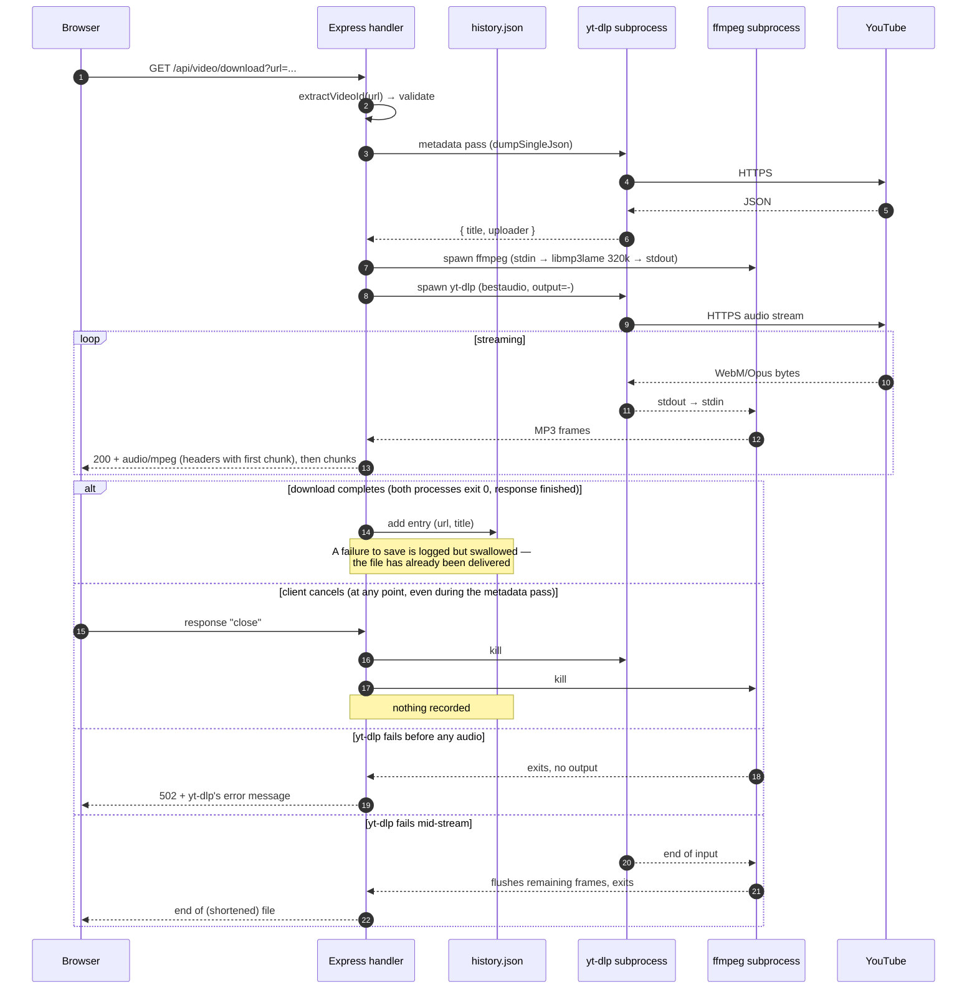
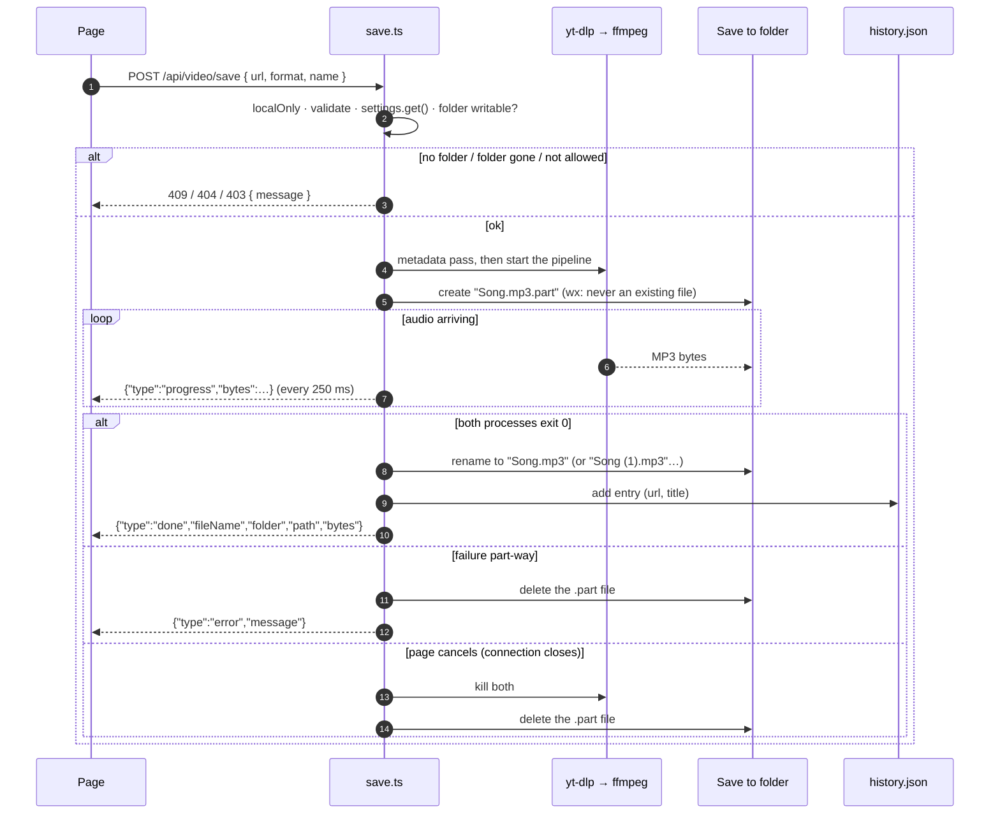
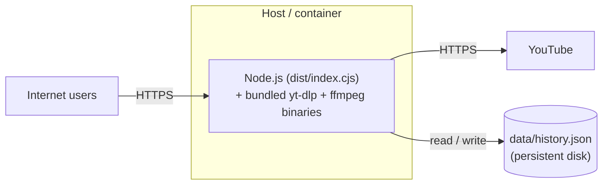

# Technical Documentation & Deployment Guide

This document covers the project's architecture, local development setup, environment configuration, and deployment instructions.

---

## Tech Stack

### Frontend

- **React 19** with TypeScript 6
- **Vite 8** (Rolldown) as the dev server and build tool
- **Wouter** for client-side routing
- **TanStack Query v5** for server-state management and caching
- **Tailwind CSS 4** (through `@tailwindcss/vite`; the theme is in `client/src/index.css`, `tw-animate-css` for animations) with shadcn/ui components for styling
- **Lucide React** for icons

### Backend

- **Node.js** with **Express 5**
- **TypeScript** (executed via `tsx` in development, bundled with `esbuild` in production)
- **youtube-dl-exec** wrapping a bundled **yt-dlp** binary for YouTube video info & audio stream extraction. On every system it's yt-dlp's standalone build, so no Python is needed: youtube-dl-exec downloads `yt-dlp.exe` on Windows, and `scripts/yt-dlp.mjs` swaps in the standalone build on macOS and Linux (see [Local Development Setup](#local-development-setup)). yt-dlp is told to use Node (`--js-runtimes node`) as the JavaScript runtime YouTube now requires, so nothing extra needs installing for that.
- **ffmpeg-static** — an ffmpeg binary fetched by `npm install` (any OS, no system install) that converts the audio to MP3 on the fly. Set `FFMPEG_BIN` to use a different ffmpeg.
- **music-metadata** — reads the tags (title, artist, Spotify song) of the audio files in the **Save to** folder, so the playlist panel can tell which songs are there and the music player can list them; its browser build reads the tags of songs picked on a phone
- **Zod 4** for request validation

### Storage

- **No database.** The download history is a small JSON file (`data/history.json`), written by `server/storage.ts`, and the settings (the **Save to** folder) another (`data/settings.json`), written by `server/settings.ts`. Nothing to install or run.

---

## Project Structure

```
.
├── client/                    # Frontend React application
│   ├── src/
│   │   ├── components/        # UI components (the shadcn/ui ones the app uses, in components/ui)
│   │   ├── hooks/             # Custom React hooks (API calls, remembered choices, a copied link)
│   │   ├── lib/               # Helpers (queryClient, utils, format: durations + link detection, music: the player's songs, clipboard: Paste + copied links)
│   │   ├── pages/             # Route pages (Home, NotFound)
│   │   ├── App.tsx            # Top-level app & router
│   │   ├── main.tsx           # React entry point
│   │   └── index.css          # Global styles & theme variables
│   ├── public/                # Icons and the web app manifest (phones' home screens; made by scripts/make-icons.ts)
│   └── index.html
├── server/                    # Backend Express application
│   ├── index.ts               # App bootstrap, middleware, port binding
│   ├── env.ts                 # Loads .env before anything reads settings
│   ├── host-check.ts          # Refuses requests for unknown host names (DNS rebinding)
│   ├── routes/                # API route handlers, one module per area (index.ts registers them all)
│   ├── youtube-url.ts         # Pure URL-parsing / thumbnail helpers (the parsing is shared/youtube-link.ts)
│   ├── search.ts              # Song search: yt-dlp ytsearch + ranking official uploads first; SoundCloud as the fallback (hedged)
│   ├── soundcloud.ts          # SoundCloud results with canonical links, previews, the recorded look-up
│   ├── audio-source.ts        # A download's look-up and end of stream, for YouTube or SoundCloud
│   ├── youtube-limits.ts      # youtubeGuard: cache, refusals answered at once, hedging memory, self-update, opt-in sign-in
│   ├── yt-dlp-update.ts       # Updates yt-dlp in the background, once an hour at most
│   ├── source-health.ts       # How YouTube, SoundCloud and Spotify have been answering → data/source-health.json
│   ├── cpu-cores.ts           # cpuCores() and mapAtOnce(): one per CPU core wherever work runs in parallel
│   ├── spotify.ts             # Spotify song links → title, artists, length (public embed page)
│   ├── youtube-playlist.ts    # YouTube playlists: yt-dlp --flat-playlist → the playlist panel's songs
│   ├── library.ts             # Which of a playlist's songs are in the Save to folder (tags + names)
│   ├── playlist-file.ts       # "Save playlist file": a playlist's songs in the folder, as an .m3u8 there
│   ├── music.ts               # The music player: the folder's songs by id, FLAC conversions, covers
│   ├── trim.ts                # Trimming a folder song: its waveform and dead air, cutting a part out, Undo
│   ├── song-file.ts           # Changing a folder song's file: one change at a time, and the swap that never leaves half a song
│   ├── storage.ts             # Download history (IStorage + FileStorage → data/history.json)
│   ├── audio.ts               # yt-dlp / ffmpeg: arguments, metadata pass, the download pipeline
│   ├── tags.ts                # The MP3's ID3v2.3 tag (with the cover), written by the app; the Ogg cover block
│   ├── cover.ts               # Download covers: Spotify's album cover or the video's thumbnail, made a square JPEG
│   ├── lyrics.ts              # Lyrics for the player, from LRCLIB (free, no key)
│   ├── catalogues.ts          # A song's genre, album, year, track, cover: iTunes, Deezer, MusicBrainz (no key)
│   ├── song-details.ts        # Fill in details: what a folder song lacks; writing just that into its file
│   ├── download-details.ts    # A download's genre (and album, if it has none) from the catalogues, meanwhile
│   ├── artist-genre.ts        # A genre no catalogue has, guessed from the artist: the folder's songs, else a catalogue
│   ├── not-found.ts           # Fill in details' Not found songs (no catalogue has them) → data/details-not-found.json
│   ├── housekeeping.ts        # Housekeeping: each folder song read through (cut short, damaged, bitrate); other files
│   ├── better-copy.ts         # Housekeeping's better copies: the same song online at a higher bitrate; replacing it
│   ├── details-log.ts         # data/details.log: each song looked up, written or downloaded, and why
│   ├── save.ts                # POST /api/video/save — saves a download straight into the Save to folder
│   ├── settings.ts            # App settings (the Save to folder, Housekeeping's quality bar) → data/settings.json
│   ├── folders.ts             # The folder browser: list and make folders, quick links, new files
│   ├── local-only.ts          # Folder routes answer only this computer's own page; history changes only the app's page
│   ├── retry-when-busy.ts     # Retries a rename/delete Windows briefly blocks (antivirus, indexer)
│   ├── json-file.ts           # writeJsonFile() (temp file + rename) and oneAtATime() for every data/*.json store
│   ├── ffmpeg.ts              # ffmpeg() / runFfmpeg(): every one-off ffmpeg run (timeout, Stop, its error line)
│   ├── vite.ts                # Dev-only Vite middleware integration
│   └── static.ts              # Production static-file serving
├── shared/                    # Code shared between client & server
│   ├── schema.ts              # Zod schemas + types (history, search, settings, folders, save progress)
│   ├── routes.ts              # Typed API route definitions
│   ├── filename.ts            # safeFileName(): download names Windows accepts
│   ├── fold-text.ts           # Names folded for matching: lower case, no accents or punctuation
│   ├── name-noise.ts          # What videos and copies add to a name ("(Official Video)", "HQ"…), taken out
│   ├── song-name.ts           # A song's artist and title: downloads' "Artist - Title", Sanitize's tidy tags
│   ├── youtube-link.ts        # extractVideoId(): which links are YouTube videos (server checks, page spots copied ones)
│   ├── soundcloud-link.ts     # SoundCloud tracks' canonical links; audioLinkOf(): the only links a download may fetch
│   ├── audio-types.ts         # Audio files by extension: MIME type, what to ask canPlayType()
│   └── spotify-names.ts       # cleanTrackTitle(), spotifyFileName(): "Artist - Title"
├── scripts/
│   ├── build.ts               # Production build (npm run build)
│   ├── clean.ts               # npm run clean: what test runs leave behind
│   ├── leftovers.ts           # Each test run's globalSetup: deletes what stopped runs left
│   ├── make-icons.ts          # The app's icons, drawn by Chrome (npx tsx scripts/make-icons.ts)
│   ├── yt-dlp.mjs             # After npm install: yt-dlp's standalone build on macOS/Linux, checked against its SHA-256 sums; npm run update-yt-dlp
│   ├── ffmpeg-check.mjs       # After npm install: ffmpeg checked against its pinned SHA-256
│   ├── needs-build.mjs        # Whether a source copy needs npm run build before start.cmd/start.sh runs it
│   ├── install/               # The install branch's README, .gitignore and Start/Stop/Update shortcuts
│   ├── unix/                  # The same for macOS and Linux: app.sh (POSIX sh) + start/stop/update wrappers and .command files
│   └── windows/               # Double-click helpers: start, stop, update, update-yt-dlp, autostart-on/off (.cmd → app.ps1)
├── .github/
│   ├── workflows/
│   │   ├── install.yml        # Builds the ready-to-run app onto the install branch after every push to main
│   │   ├── tests.yml          # npm run verify on Linux and Windows (macOS weekly), on pull requests and direct pushes
│   │   ├── claude-code-review.yml # Claude reviews each pull request once, with inline comments
│   │   └── claude-refactor.yml # Monthly: Claude runs /refactor and opens a pull request
│   ├── dependabot.yml         # Monthly grouped npm and GitHub Actions updates
│   └── pull_request_template.md # The checklist a pull request starts with
├── .claude/skills/            # Claude Code skills: /verify (npm run verify), /refactor, /backlog
├── .claude/rules/             # Claude Code's rules for each area, loaded with that area's files
├── docs/
│   ├── run/README.md          # Running the app: the scripts, a terminal, from a phone, hosting
│   └── sources.md             # The outside sources: primary, fallbacks, health, what was rejected
├── vite.config.ts             # Vite configuration (the dev server prepares the page's code as it starts: `server.warmup`)
├── tests/                     # unit, api (Vitest) and browser (Playwright) tests
├── CLAUDE.md                  # Claude Code's instructions, sent with every request (≤600 words)
├── LEARNING.md                # The stack, mapped onto .NET concepts
└── package.json
```

---

## File-by-file reference

What each file does, and the function and constant names to look for. This was CLAUDE.md's Layout until Oct 12, 2026; it moved here so it isn't sent with every Claude request (#17). A new file, route or module goes here.

- `server/index.ts` — entry point; Vite middleware in dev, static `dist/public` in prod
- `server/env.ts` — loads `.env`; imported first by `index.ts`
- `server/host-check.ts` — refuses unknown Host headers (DNS rebinding); `ALLOWED_HOSTS` adds names
- `server/routes/` — the API routes, one module per area, each a `register…Routes(app)` that
  `index.ts` (`registerRoutes()`) calls; what they share is `helpers.ts` (`songFor()`: the folder
  song a request names, or the reply why not; `sendAudioFile()`, `sendFolderError()`,
  `validationError()` and the messages). Paths and inputs are in `shared/routes.ts`. A new route
  goes in its area's module:
  - `folders.ts` — `GET/PUT /api/settings` (with `cpuCores`), `GET/POST /api/folders`,
    `POST /api/video/save`, `POST /api/folders/songs`, `POST /api/folders/playlist-file`
  - `music.ts` — `GET /api/music`, `GET /api/music/:id` (+ `/:id/flac`, `/:id/cover`),
    `DELETE /api/music/:id`, `POST /api/music/:id/fix-name`, `POST /api/music/:id/rename`,
    `GET /api/lyrics`
  - `song-details.ts` — `GET/POST /api/music/:id/details`, `GET /api/details-log`
  - `trim.ts` — `GET /api/music/:id/waveform`, `POST /api/music/:id/trim`,
    `POST /api/music/trim/undo`
  - `housekeeping.ts` — `GET /api/music/:id/check`, `GET/POST /api/music/:id/better-copy`,
    `GET /api/folder-files`, `DELETE /api/folder-files/:id`
  - `history.ts` — `GET/DELETE /api/downloads`, `DELETE /api/downloads/:id`,
    `POST /api/downloads/restore` (Undo), `GET /api/downloads/in-folder`
  - `search.ts` — `GET /api/health/sources`, `POST /api/video/info`, `GET /api/search`
    (`?source=soundcloud`: SoundCloud alone), `GET /api/youtube/playlist`
  - `spotify.ts` — `GET /api/spotify/link`, `GET /api/spotify/playlist`, Spotify sign-in
    (`GET /api/spotify/account`, `PUT …/account/client-id`, `POST …/account/sign-in`,
    `POST …/account/sign-out`, `GET …/account/playlists`, `GET /api/spotify/callback`)
  - `download.ts` — `GET /api/video/download`
- `server/youtube-limits.ts` — `youtubeGuard`, which every yt-dlp call to YouTube but the audio stream
  goes through (search, video info, playlists, the metadata pass before a download): a 10-minute
  cache of search/video/playlist answers (`TtlCache`, 200 entries, LRU) and
  `classifyYtDlpError()` (throttled / bot-check / broken / unavailable / other). Every call is made
  at once — nothing gates, holds back or delays one. A throttled or bot-check failure throws
  `YouTubeRefused`, which the routes answer at once with a `502` through `sendRefused()` —
  `{ message, source: "youtube", limited: true }`, the message saying what to do instead — download
  and save too when nothing has been sent yet (`pipelineEnded()`); it's remembered for 10 minutes
  (`refusedRecently()`, `HEDGE_FOR_MS`), during which searches ask SoundCloud at the same time as
  YouTube. A broken/bot-check failure also starts the yt-dlp self-update in the background (nobody
  waits for it). A bot check, with the owner's opt-in setting `youtubeSignIn: "firefox"` on, is made
  again at once signed in (`--cookies-from-browser firefox`; `attempt(signIn)`), and for 10 minutes
  after that works calls and streams sign in straight away (`signInNow()`, carried to the stream
  as `AudioInfo.signIn`); Firefox's cookies unreadable → the bot check is the answer. Turning the
  setting off calls `forgetSignIn()`. Pure parts take the time as an argument; unit-tested with a
  fake clock
- `server/yt-dlp-update.ts` — `YtDlpUpdater`: runs `node scripts/yt-dlp.mjs --update` (what
  `npm run update-yt-dlp` runs; never through a shell) at most once an hour, 2-minute limit, one
  log line at the start and one at the end; a failed update counts as the hour's try
- `server/source-health.ts` — records every attempt against `youtube` (primary for audio),
  `soundcloud` (its fallback), `spotify` (primary for song details), `spotify-oembed` (its
  fallback) and `spotify-web-api` (primary for a playlist's songs past 100; no fallback) — ok, or
  throttled / blocked / error with a note, and a 429's Retry-After (`until`); the last 24 h, ≤500
  events, in memory — and writes the report to `data/source-health.json` (`SOURCE_HEALTH_FILE`;
  debounced, temp file + rename): per source
  `role`/`for`/`ok`/`failed`/`throttled`/`lastOk`/`lastError`/`refusedUntil`, `unreliable` (a
  primary with ≥5 attempts and under half successful, or refusing the app for more than another
  hour — `REFUSED_FOR_MS`, the owner's decision of Oct 12, 2026 — and every fallback for its job
  unreliable too, or none) and a one-sentence `summary`; such a refusal also rewrites the file
  when it stops counting and when it ends. `GET /api/health/sources` serves it
  (not local-only; no paths in it). Pure parts unit-tested with a fake clock
- `server/save.ts` — "Save to": the app saves a download into the chosen folder itself (works in any
  browser): same pipeline into `<name>.<ext>.part` (opened `wx`), renamed when complete onto a name
  claimed with `wx` too (`claimNewName()`), so saves finishing together never take the same name and
  none waits for another — never replacing a file (`Song (1).mp3`); streams JSON-line progress
  (`saveEventSchema`). Before naming the finished file it checks its content (`file-kind.ts`): not
  audio fails the save, another kind of audio gets that kind's extension
- `server/file-kind.ts` — what a file really is from its first bytes (`sniffFile()`, `sniffBytes()`:
  past any ID3 tag, MP3/AAC frame headers, `ftyp`, `fLaC`, `OggS`, RIFF/WAVE, EBML, ASF…; programs,
  archives, PDFs, pictures and web pages by their own starts; anything else can't be told), and
  `kindProblem()`: `realType` (another kind of audio than the name says) or `notAudio`
- `server/settings.ts` — app settings (the Save to folder, Housekeeping's quality bar, the YouTube
  sign-in: `youtubeSignIn`, `"off"` unless turned on, anything else read as off) in
  `data/settings.json` (`SETTINGS_FILE`; the unit tests point it at a file that isn't there)
- `server/library.ts` — which of a playlist's songs are in the Save to folder (`POST /api/folders/songs`):
  walks it and its subfolders (≤6 deep, ≤`MAX_SONG_FILES`), reads tags (one file per CPU core;
  cached per file until it changes, and kept between runs in `data/song-tags.json`, `SONG_TAGS_FILE`:
  `saveSongTags()` writes it in the background after each look, `SONG_TAGS_VERSION` says which way
  they were read, and a file that couldn't be opened isn't kept), and `findSongs()` matches by the Spotify id in the tags, else title + an artist (tags, file
  name, folder names), else an exact file name with no contradicting artist tag. Pure parts unit-tested.
  `readFolderTags()` (the scan + tags) also feeds the player; `oggDuration()` reads an Ogg file's
  length from its last page (music-metadata would read the whole file). `readTags()` also sniffs
  each file's content (`file-kind.ts`), cached with its tags; a file that isn't audio never counts
  as a song in the folder. `findDownloads()` finds the
  history's downloads in the folder (`GET /api/downloads/in-folder`, via `historyInFolder()` in
  `music.ts`): by the file name it was saved under (`fileName`, kept with each download since; an
  older entry's title as the app names files), anywhere in the folder, as a second copy or in any
  case; else by `findSongs()` with the Spotify id or the video's "Artist - Title" (unit-tested)
- `server/playlist-file.ts` — "Save playlist file" (`POST /api/folders/playlist-file`, local-only): the
  playlist's songs found in the Save to folder (`songsInFolder()` — the page sends songs, never a
  path), written there as "<name>.m3u8" in the playlist's order; replaces only a file with the app's
  `PLAYLIST_FILE_MARK` line, else "<name> (1).m3u8". Pure parts unit-tested
- `server/music.ts` — the music player's side of the Save to folder (`GET /api/music…`, local-only):
  the songs by id (`musicTrackId()`: the place in the folder, hashed — the page never sends a path),
  `readCover()`, and `convertedForBrowser()`: a song the browser can't play, as FLAC (lossless) in
  `PLAYER_CACHE_DIR` (temp folder, ≤2 GB, oldest-played go first); requests share one conversion,
  and when all of them are gone ffmpeg is killed and the `.part` deleted; `deleteMusicFile()` (Delete
  from folder: to the bin via `trash.ts`, or for good only when asked); `fixSongName()` (Fix name:
  the extension the content says) and `renameSong()`: a name another file has is refused
  (`NameTakenError`, `409`; `assertNameFree()` checks first), never replaced nor numbered;
  `folderArtistSongs()`: each folder song's artist and genres, for the artist genre guess
- `server/trash.ts` — `moveToTrash()`: a file to the system's bin — Windows' Recycle Bin
  (`SHFileOperation` with undo, run by PowerShell, no dialogs; a network or removable drive is
  refused with `NoBinError`), macOS's Trash (Finder, else `~/.Trash`), the freedesktop.org trash
  elsewhere (with its `.trashinfo`); `TRASH_DIR` replaces it in tests. Unit-tested
- `server/song-file.ts` — every change to a folder song's file goes through it: `whileBusy()` lets
  one change at a time at a song (Fill in details, Rename and Fix name, Trim and its Undo, better
  copies; a second gets 409 "That song is being changed already."), and the finished new version
  takes the song's place one of three ways: `writeOver()` (written into the same file, dates put
  back: tags), `swapIn()` (a `.part` renamed over it, else copied over when Windows holds the file:
  Trim) or `binAndSwapIn()` (the old one to the bin first: better copies; `PartKeptError` when the
  copy can't take its name). Unit-tested on plain files
- `server/trim.ts` — trimming a folder song (local-only): `readWaveform()` (ffmpeg decodes it to
  8 kHz mono; the loudest sample per 50 ms gives the bars and `silencesIn()` the dead air: below
  −45 dBFS for a second or more), and `trimSong()`: ffmpeg re-encodes the song minus the cut
  (`trimFilter()`: `atrim` both sides, a 5 ms fade at the join, `concat`) in its own format and
  bitrate (lossless stays lossless), tags and cover kept, into a `.part` swapped in when done. The
  original goes first into `TRIM_BACKUP_DIR/<undo id>/` with `trim.json`; `undoTrim()` puts it back
  only into the same folder and only if the song hasn't changed since. Backups go after 30 days
- `server/folders.ts` — the folder browser (list/make folders, quick links — on Windows from the
  registry's User Shell Folders — writable check), and new files that never replace one:
  `createNewFile()` (the `.part`) and `claimNewName()` (the finished name), both opened `wx`
- `server/cpu-cores.ts` — `cpuCores()` (`os.availableParallelism()`: how many things the app does at
  once wherever it can — Download all's songs, the folder's tag reads, a long Spotify playlist's
  pages) and `mapAtOnce()` (one per core, results in order)
- `server/local-only.ts` — `localOnly()`: folder routes answer only loopback, same-origin, JSON
  requests with no proxy headers; `GET /api/settings` says `canSaveToFolder: false` elsewhere
- `server/search.ts` — song search: `yt-dlp ytsearch12:` (flat, ~4s) + `rankResults()` (official
  uploads up; partial matches and live/cover/remix down unless searched for; `sameSongAs()`: the
  song searched for at its length, for better copies), and SoundCloud's
  `scsearch12:` ranked the same way (30-second previews last). `searchSongs()` always asks YouTube;
  SoundCloud at once when YouTube's search fails or finds nothing, and at the same time while YouTube
  has refused in the last 10 minutes (hedging); YouTube's results when it has some, else
  SoundCloud's — each result and the answer carry `source`. `searchSoundCloudOnly()` for
  `?source=soundcloud`. SoundCloud's answers are cached like YouTube's; pure parts unit-tested
- `server/soundcloud.ts` — SoundCloud, the fallback for audio: `soundCloudResult()` (a search entry
  as a result with its canonical link), `looksLikePreview()` (a 30-second preview of a
  subscribers-only track), `lookUpSoundCloud()` (the look-up before a download, recorded in source
  health; refuses a preview: yt-dlp's format id ends "_preview"), `recordSoundCloud()`
- `server/spotify-sign-in.ts` — signing in with Spotify (Authorization Code with PKCE, no secret):
  `SpotifySignIn` (`spotifySignIn`) keeps your Spotify app's Client ID (or `SPOTIFY_CLIENT_ID`) and
  the sign-in in `data/spotify-sign-in.json` (`SPOTIFY_SIGN_IN_FILE`); `start()` gives Spotify's
  authorize address (scopes `SIGN_IN_SCOPES`, a one-time `state`, `pkcePair()`), `finish()` swaps
  the code at the callback (`callbackUrl()`: `http://127.0.0.1:<port>/api/spotify/callback`, since
  Spotify refuses `localhost`), `accessToken()` renews it before it ends (one renewal at a time; a
  `400` from Spotify signs you out, no connection doesn't). Recorded in source health as
  `spotify-account` (`recordAccountAnswer()`)
- `server/audio-source.ts` — `lookUpAudio()` and `audioEnded()`: the download and save routes' look-up
  and end of stream for a YouTube video (through `youtubeGuard`) or a SoundCloud track
- `server/spotify.ts` — Spotify song links (`/api/search?q=<link>`): title/artists/length from the
  public embed page `open.spotify.com/embed/track/<id>` (`__NEXT_DATA__`, no account or API key),
  then a search ranked with `targetDuration` (same length ±`SAME_LENGTH_SECONDS` first;
  `spotifySearchQuery()` adds "audio" for YouTube, not SoundCloud).
  A download's album, track number, release date and 640 px cover come from the song's own page
  (`open.spotify.com/track/<id>` fetched with a curl User-Agent, which gets its link-preview `<meta>`
  tags: `parseTrackPage()`).
  Every Spotify request goes through `fetchSpotify()`: recorded in source health, never retried or
  delayed. A song's details from the embed page are kept 10 minutes (`spotifyTrackCache`; Download
  all asks about each song more than once). When the embed page fails for any reason but 404 (a 429 included), at once,
  `fetchSpotifyTrack()` falls back to the keyless oEmbed endpoint
  (`fetchOembedTrack()`, `parseOembed()`): title and cover only — artists `[]`, `duration: null`,
  `source: "spotify-oembed"` on the track (optional field in `spotifyTrackSchema`); the page then
  searches by title and "Download all" marks such a song "check".
  Playlists and albums (`/api/spotify/playlist?link=`): the songs from `embed/playlist|album/<id>`
  (`parsePlaylistPage()`; Spotify lists at most 100 songs of a playlist there), and past 100 the
  rest from the Web API with the embed page's anonymous pass (`readEmbedAccessToken()`,
  `fetchMorePlaylistSongs()`: the first page gives the total, the rest are asked for together, one
  per CPU core; ≤`SPOTIFY_PLAYLIST_MAX_SONGS`). Why it stopped short goes in the answer's `more`
  (`reason`: `refused` — a 429 with Retry-After, `parseRetryAfter()` — `failed`, `spotify-own` —
  Spotify's own playlists answer 404 — or `limit`; `retryAt`, `note`) next to `maybeMore`. A
  refusal is the route's quota, not one pass's: `webApiRefusal` remembers it until its Retry-After,
  and meanwhile playlists open with their first 100 songs without asking the Web API
  `spotify.link` short links: `resolveShortLink()` asks Spotify's short-link host where it leads
  (redirects followed only between `spotify.link`/`spotify.app.link`); `GET /api/spotify/link`
  tells the page where one leads, so it can search or open the playlist panel
- `server/youtube-playlist.ts` — YouTube playlists (`/api/youtube/playlist?link=`): yt-dlp's
  `--flat-playlist` of `youtube.com/playlist?list=<validated id>` (first 500), `parsePlaylistJson()`
  into the Spotify playlist's shape with `source: "youtube"`; refuses mixes and personal lists
- `server/audio.ts` — yt-dlp and ffmpeg arguments (unit-tested), `fetchAudioInfo()` (metadata pass,
  with YouTube Music's album and date, and the stream's bitrate, `abr`), `prepareAudioOutput()` (the output, with the cover: written
  to a `ytdownload-cover-` temp folder for .opus/.mka, `cleanup()` after) and `startAudioPipeline()`
  (yt-dlp → ffmpeg, used by both download and save, for a YouTube video or a SoundCloud track alike;
  an MP3's tag goes out with the first chunk, `withPrefix()`, and on a cancel the stream handed out
  is drained so ffmpeg can't block), yt-dlp error lines
- `server/tags.ts` — the MP3's ID3v2.3 tag, written by the app (`id3v2Tag()`: title, artist, album,
  genre, year, track, `TXXX:spotify_id`, front cover) since ffmpeg can't stream one with a cover; the Ogg
  cover block (`flacPictureBlock()`), `jpegSize()`. Pure, unit-tested
- `server/id3-frames.ts` — an MP3's ID3v2.3/2.4 frames, byte for byte (`readId3Frames()`), and
  `withFramesFrom()`, which puts frames ffmpeg drops (web addresses, play counts, ratings) back into
  a copy's tag. Unit-tested
- `server/cover.ts` — download covers: Spotify's album cover (validated `i.scdn.co` /
  `image-cdn-xx.spotifycdn.com` URL), else the video's thumbnail (`i.ytimg.com`, built from the video
  id, looked for alongside the look-up) or a SoundCloud track's artwork (`sndcdn.com`, 500×500, from
  the look-up; `isSoundCloudArtworkUrl()`), made a ≤600 px square JPEG by ffmpeg (`squareJpeg()`);
  `coverFor()` waits ≤10 s, never fails
- `server/catalogues.ts` — a song's genre, album, year, track number and cover from the iTunes
  Search API (`itunes.apple.com/search`), else Deezer's API (`api.deezer.com`: search, then the song
  and album for track number, year and genre), else MusicBrainz (`musicbrainz.org/ws/2/recording`,
  `musicBrainzSongs()`: the artist's own album before a compilation, the genre from its top tag, no
  cover; one request a second, its turns queued, with the app's `User-Agent`, `503` = refused) —
  all free, no key; only title, artist and length sent. Given what a song lacks (`needs`), each is
  asked in turn until one has all of it, and the one with the most is used (the earlier on a tie;
  one with none of it is passed over); `noneHasIt` says every catalogue answered and none had it.
  A recording MusicBrainz has without a genre gets its artist's (`/ws/2/artist/<id>`,
  `musicBrainzArtistGenre()`, `genreOf: "artist"`). When none has the song but one has another
  version of it (`pickVersion()`: the same artist, the same bare title, any length — "Breathe (In
  the Air)" for "Breathe (In The Air) (Extended)"), that version's genre is taken and nothing else
  (`otherVersion`).
  A name with no dash and no artist ("Michael Jackson Earth Song") matches a song whose artist and
  title it is, one of its artists and its title, or whose words are the title's and an artist's in
  any order (`namesBoth()`). `pickMatch()` takes only the same title by the same artist (or,
  without an artist, the same length) — or a title that differs only in brackets, the same length —
  best the artist's own, then the same title and length, on the artist's own album; the halves of
  a name are also taken the other way round ("Rebellion - Linkin Park", `pickEither()`; an album
  in brackets after the artist left out: "My December - Linkin Park (Hybrid Theory)"). The same
  title can have its words in another order ("Remix (Paul Oakenfold)"), "Remix" for "Mix", a
  featured artist after it ("ft. Daddy Yankee") left out, the same recording's notes ("(Original
  Mix)", "[Amended]") left out, a year or "original" after ours ("Heaven Lange Remix 1999"), no
  spaces ("Kyur4 th Ich") or a letter or two out ("Call Me When Your Sober"), but never another
  number ("Part 2"). The same artist is a whole name, one of a credit's names ("Bob Marley & The
  Wailers"), spelt the same but for spaces, signs, "and" or "the" ("ACDC", "AC/DC"; "Black White",
  "Black And White") or a letter or two out: never part of a name ("Fred & Ginger" isn't "Fred
  Lark Brown"); or our "artist" is the film the song's album is named after ("Mohabbatein -
  Pairon Mein Bandhan Hai", `fromAlbum()`), never a tribute's or karaoke album. A search Deezer
  answers without the song, or MusicBrainz without anything, is asked again with the bare title
  (`bareTitle()`: without brackets, what follows a dash — "- Live 1978" — or a year, "original",
  "HD" at the end); MusicBrainz, which searches title and artist apart, is also asked a name's
  halves the other way round. iTunes is asked once a search: it allows the fewest. MusicBrainz is
  given 20 seconds to answer, the others 8. Each is asked no faster than its published limit
  (`CATALOGUE_LIMITS`: iTunes 20 a minute, Deezer 50 in 5 s, MusicBrainz 1 a second; past it
  Deezer answers "nothing" for songs it has), and one that refuses (iTunes `403`/`429`, Deezer
  error 4) or whose limit is used up is skipped at once for the next; when the ones left are all
  busy, the look-up waits for whichever is back first, but once one has answered only for a
  moment (`SHORT_WAIT_MS`, 5 s: waiting out iTunes' minute made a folder's run seven times
  slower), and never past its own limit's window or after it says no again once its time is up
  (then "was busy, so it wasn't asked", and the song isn't marked Not found). Covers only from
  `isCatalogueCoverUrl()` hosts (`mzstatic.com`, `dzcdn.net`); answers cached in memory. Pure parts
  unit-tested. `genreOfArtistNamed()`: the genre a catalogue files an artist under, by name — iTunes'
  artist search (`entity=musicArtist`, `itunesArtistGenre()`), else MusicBrainz's (`/ws/2/artist`,
  a score of 90 or more, `musicBrainzArtistId()`, then its top tag); the same artist as
  `sameArtist()` says, one that's busy or out of reach passed over at once, answers cached
- `server/artist-genre.ts` — a genre for a song no catalogue has one for, guessed from its artist
  (`guessGenre()`): the genre most of the artist's other songs in the folder have
  (`folderGenreOf()`: each song's first genre, spelt as most spell it; the whole credit, else the
  first artist it names — "Linkin Park" for "Linkin Park feat. Kiiara"), else the one a catalogue
  files the artist under (`genreOfArtistNamed()`). Returns the genre and why ("3 of Linkin Park's
  other songs here are Nu Metal", "iTunes files Daft Punk under Electronic"), always offered as a
  guess; never rejects. Unit-tested
- `server/not-found.ts` — the songs marked **Not found** (`DETAILS_NOT_FOUND_FILE`, default
  `data/details-not-found.json`): a song Fill in details looked up when every catalogue answered and
  none had it (and its file name gave nothing), kept by its place in the folder and its size, so a
  changed song is no longer marked; a later match takes the mark off. `loadNotFound()` reads it
  once; `isNotFound()` gives `detailsNotFound` in the folder list; `setNotFound()` writes one at a
  time, through a temp file
- `server/housekeeping.ts` — **Housekeeping** (`GET /api/music/:id/check`, `GET/DELETE
/api/folder-files`, local-only): `checkSong()` decodes a song all the way through
  (`ffmpegCheckArgs()`: `-f null` with `-progress`, read by `decodeResultOf()`) and compares how far
  it plays with the length its header gives (`songCheckOf()`: more than 5 s and 3 % short is cut
  short), counts decoding errors (more than `MAX_ERRORS` is damaged, as is a file ffmpeg can't read),
  and gives its bitrate (`kbpsOf()`), codec and whether it's lossless; kept until the file changes.
  `otherFiles()` lists the folder's files that aren't songs (`findAudioFiles()` with `others`),
  saying what each is (`describeFile()`, by content where `sniffFile()` knows it), a download's
  `.part` left over marked `leftover` — not playlists, `desktop.ini` and the like, nor a `.part` a
  save is writing now (`isBeingSaved()` in `save.ts`); `deleteOtherFile()` sends one to the bin.
  Unit-tested on ffmpeg-made songs
- `server/better-copy.ts` — Housekeeping's **better copies** (`GET/POST /api/music/:id/better-copy`,
  local-only): `findBetterCopy()` searches for a folder song by its tidied artist and title
  (`searchSongs()`, so YouTube, else SoundCloud; `betterCopyQuery()`), keeps the uploads that are
  the same song at its length (`sameSongAs()` in `search.ts`), looks the best-ranked `CANDIDATES`
  (3) up at once for the bitrate of their audio (yt-dlp's `abr`), and offers the highest only when
  it's above the song's own — else says why not (lossless already, no same length, no better
  bitrate). `replaceWithBetterCopy()` (one change to a song at a time: song-file.ts' `whileBusy()`)
  runs the usual pipeline into a `.part` next to the song, in the song's own file type
  (`betterCopyArgs()`: the stream copied as it is when it's that kind of audio, else encoded at
  `BETTER_KBPS`, 320, with trim.ts' `ENCODINGS`), the old file's tags and cover mapped across; reads
  it all the way through (`decodeThrough()`: it must play through and be the song's length within
  `SAME_LENGTH_SECONDS`); then the old song goes to the bin (`moveToTrash()`; none: `NoBinError`,
  nothing changed) and the copy takes its name and its modified date (song-file.ts' `binAndSwapIn()`). Unit-tested on ffmpeg-made
  songs, yt-dlp played by stand-ins
- `server/details-log.ts` — the details log, `data/details.log` (`DETAILS_LOG_FILE`): a plain-text
  line per song Fill in details looks up (`lookupEntry()`: found and what, not found with each
  search and its closest answer, can't be written and why, failed) or writes, and per download
  (`downloadEntry()`: what the catalogues added, or why nothing). Written one line at a time, never
  failing anything; past 1 MB it becomes `details.log.1`. `GET /api/details-log` (local-only) shows
  the newest 500 lines
- `server/download-details.ts` — a download's details from the music catalogues (`catalogues.ts`),
  looked up while it downloads: `lookUpDownload()` (by its title, artist and the source's length),
  `catalogueTagsFor()` (the genre; the album, year and track only for a song without an album; never
  a title or artist, nor anything the source gave) and `lateDetails()` (the catalogue's cover for a
  download without one). A song no catalogue has a genre for gets its artist's (`guessGenre()`,
  `server/artist-genre.ts`; a save weighs the folder's songs by them first), noted as a guess in the
  details log. Each waits `DETAILS_WAIT_MS` (5 s) at most and never fails; an MP3's tag
  waits for it while ffmpeg starts (`prepareAudioOutput()`'s `later`), so it rarely costs any time
- `server/song-details.ts` — **Fill in details** (`GET/POST /api/music/:id/details`, local-only):
  `lookUpDetails()` (what a folder song lacks — `detailsPresent()` — and the catalogue's values for
  just that, or `detailsFromName()`'s title and artist from an untagged "Artist - Song" name; a genre
  no catalogue has is guessed from the artist, `guessGenre()`, as `guess`) and `writeSongDetails()`: ffmpeg copies the file's streams and tags as they are
  (`-c copy`, `detailsArgs()`) with the new tags from an ffmetadata file, into a temp folder; the
  copy is checked (`rewriteProblem()`: same audio and length, every tag it had, the new ones there;
  an MP3's frames ffmpeg can't copy, like WOAS, are put back first: `server/id3-frames.ts`)
  and written over the song in place, its dates put back. `.mp3`, `.m4a`, `.flac`, `.ogg`/`.oga`,
  `.opus` only; an Ogg file's cover is carried over in its comment. What a file really holds is
  asked of ffmpeg first (`probeFile()`, `parseProbe()`): a file whose contents aren't what its name
  says — an M4A or Ogg file named `.mp3`, MP2 audio — would make ffmpeg refuse ("Invalid argument"),
  so `muxerFor()` says what it really is and what to rename it to (the lookup's `problem`), and
  it's left as it is
- `server/lyrics.ts` — lyrics for the player from LRCLIB's search (`lrclib.net`, free, no key; only
  title, artist and length sent): `searchesFor()`, `pickLyrics()` (same length ±3 s, synced first),
  `parseLrc()`; answers cached in memory. `cleanSongTitle()` and `searchesFor()` are also how
  the catalogues are searched ("Static - X - Dead Souls" is Static-X's "Dead Souls"; a dash-less
  "Yar Daddi, Ali Zafar" is split at its comma too, and "George HarrisonMy Sweet Lord" searched
  as "George Harrison My Sweet Lord"). Pure parts unit-tested
- `server/youtube-url.ts` — pure URL-parsing and thumbnail helpers (unit-tested)
- `server/storage.ts` — `FileStorage`: newest 1,000 entries (`MAX_HISTORY`), queued writes,
  temp-file + rename; `server/retry-when-busy.ts` retries the renames and deletes Windows briefly
  blocks (antivirus, the indexer)
- `server/json-file.ts` — the one way the app writes its `data/*.json` files: `writeJsonFile()`
  (pretty JSON to a temp file, then a rename through `retryWhenBusy()`; `mode` for the Spotify
  sign-in's 0o600) and `oneAtATime()`, the queue that runs one file's changes one after another.
  Used by the history, settings, Not found marks, source health and Spotify sign-in; a new JSON
  store uses them too (unit-tested)
- `server/ffmpeg.ts` — every ffmpeg run that isn't the download pipeline (yt-dlp piped into
  ffmpeg, `audio.ts`): `ffmpeg(args, options)` feeds an `input`, streams (`onStdout`) or keeps the
  output, keeps the first or last of what it prints, stops it after `timeoutMs` or when `signal`
  gives up (stopped outright 2 s later if it ignores that, as it can on macOS and Linux) and
  answers with how it ended; `ffmpegFailure()` is its last error line; `runFfmpeg()` (30-minute
  limit) rejects with that line. Used by the player's FLAC conversions, Trim's waveform and cut,
  Housekeeping's check, Fill in details' probe and write, and covers (unit-tested)
- `shared/` — schema and API contracts shared by client and server; `shared/soundcloud-link.ts` has
  `parseSoundCloudLink()` (a SoundCloud track's one canonical link,
  `https://api.soundcloud.com/tracks/<digits>`, from that or the URL-encoded URN form yt-dlp lists —
  exact text matching, nothing else) and `audioLinkOf()` (what a download or save may fetch: a
  YouTube video's canonical watch link or a SoundCloud track's — the only links that reach yt-dlp);
  `shared/fold-text.ts` is how every name is folded for matching (`foldCase()`, `foldWords()`,
  `foldSquashed()`: lower case, Latin accents gone, punctuation a space): search ranking
  (`normalize()`), finding songs in the folder (`words()`), the catalogues (`plain()`), Sanitize's
  artist keys (`artistKey()`), song names and the page's filters all call it, so they all agree:
  Latin accents go ("Mötley Crüe" is "motley crue"), other scripts keep their marks (a Hindi
  title stays whole); a new comparison uses `foldWords()`; pinned in
  `tests/unit/fold-text.test.ts`);
  `shared/filename.ts` has
  `safeFileName()`, used by the server to name downloads and by the page to show that name;
  `shared/spotify-names.ts` has `cleanTrackTitle()` and `spotifyFileName()` ("Artists - Title", the
  default name of any download found from Spotify); `shared/name-noise.ts` has `withoutNameNoise()`
  (a name without "(Official Video)", "HQ", "Lyrics Video", "Lyrical Video", "High Quality",
  "(prod. …)", "(1998)", a copy's "(1)", a converter site's "yt1s.com - " or "HD " in front, "HD"
  or "LyricsHQ" run on to the name, "(Full Version)", "- 2011 Remaster", and `decodeEntities()`
  for "&#39"), used before the catalogues and LRCLIB are searched, and `sanitizedFileName()`
  (Sanitize Filename's tidy name; parts in capitals put in title case by `fromAllCaps()`), and
  `knownArtists()` / `artistFirst()` ("Song - Artist" put round when the folder names the artist);
  `shared/song-name.ts` has a song's artist and title as a player shows them, shared by the server
  and the page so the name shown is the name saved: `songOfVideo()` (a download's, from the video's
  title and channel: the artist the title names, not the channel that uploaded it, else the
  channel's artist — "Linkin Park - Topic", "TaylorSwiftVEVO" — with "ft." as "(feat. …)") and
  `fileNameOf()` ("Artist - Title", a download's default file name and its title and artist tags),
  `folderArtistsOf()` (what a folder's songs say about its artists: how each is spelt most, and
  which artist tags are really a channel that uploads other people's songs) with `tidiedSong()` and
  `tidiedFile()` (Sanitize Filename's tidy title, artist and file name for a folder song: swapped
  tags put back, a channel's uploads given the artist their titles name, track numbers and an album
  after the song taken out), and `songKeyOf()` (what two copies of a song have in common, for
  Housekeeping's Extra copies); `shared/audio-types.ts` has `AUDIO_TYPES` (the
  audio files the app knows: MIME type, and what to ask `canPlayType()`)
- `client/src/pages/Home.tsx` — the page: its state and what each action does (open a link, search,
  open a playlist, Paste, download or save), laid out from components — `find-box.tsx` (the Link /
  Search / Playlist switch, the box, Paste, the copied-link suggestion), `preview-card.tsx` (the
  chosen video, Download Audio — Download Complete once it's in the history, still downloading it
  again — Original audio), `active-saves.tsx` (saves into the folder still running that the card
  doesn't show, after another song is picked, each with Cancel), `search-results.tsx` (with the inline video
  preview; a SoundCloud mark on SoundCloud's results, and **Search SoundCloud** over YouTube's) and
  `recent-extractions.tsx` (the history, its search and filters; removing a song and Clear history,
  with Undo in the note — `hooks/use-history-actions.tsx`; with a Save to folder, In folder / Not in
  folder on each download — In folder finds it in Your music — Play from the folder and a view of either — `hooks/use-history-in-folder.ts`).
  `client/src/components/ui/` holds only the shadcn/ui components in use — add more with
  `npx shadcn@latest add <name>` (config in `components.json`)
- `client/src/hooks/use-youtube.ts` — the page's API calls as TanStack Query hooks (history,
  search — `searchSongs()`, `soundCloudOnly` for SoundCloud alone — Spotify links, playlists —
  `usePlaylist()` — and video info)
- `client/src/lib/clipboard.ts` + `hooks/use-clipboard-link.ts` — Paste and the copied-link
  suggestion (`findCopiedLink()`, `textToPaste()`, `canReadClipboard()`; unit-tested)
- `client/src/hooks/use-stored-choice.ts` — a choice remembered in localStorage; used for the MP3 /
  Original audio toggle (`use-download-format.ts`) and the Link / Search / Playlist switch;
  `use-stored-value.ts` remembers free text (the open playlist's link); `use-recent-playlists.ts`
  the playlists opened lately (`lib/recent-playlists.ts`, pure, unit-tested), listed under the box in
  Playlist mode by `components/recent-playlists.tsx`
- `client/src/lib/format.ts` — `formatDuration()`, `isSpotifyLink()`, `isSpotifyPlaylistLink()` and
  `asLink()` (a YouTube link is opened, a playlist/album link opens the panel, anything else is
  searched)
- `client/src/components/spotify-account.tsx` + `hooks/use-spotify-account.ts` +
  `lib/spotify-account.ts` — Spotify sign-in in Playlist mode, above Recent playlists: **Set up
  Spotify sign-in** (the steps, the Redirect URI to copy, the Client ID), **Sign in with Spotify**
  (the page goes to Spotify and comes back), who is signed in, **Sign out**, and your playlists to
  open in a click. Hidden on another device (`canSignIn: false`)
- `client/src/components/spotify-playlist.tsx` — the playlist panel (Spotify playlists and albums,
  and YouTube playlists — `source`; `usePlaylist()` picks the endpoint from the link): lists the songs
  (filter); picking a Spotify song searches its song link, picking a video opens it. Under a
  playlist it couldn't list to the end, a note says why and when the app asks again
  (`playlistMoreNote()` in `lib/playlist-more.ts`), and `usePlaylist()` asks again by itself at
  `more.retryAt` (`hooks/use-ask-again-at.ts`; a tab asleep then asks once it's shown), the rest
  joining the list in place. With a Save to
  folder: In folder marks and counts (`hooks/use-songs-in-folder.ts`, refetched on focus and after
  saves; when more songs arrive, the last answer stands meanwhile and Download waits for the new one), a Not in folder view, tick boxes and Download (`hooks/use-download-all.ts`:
  `downloadSongs()` works on as many songs at once as the app's computer has CPU cores
  (`cpuCores` from `/api/settings`) — search, `confidentMatch()` (same length as on Spotify) or mark
  "check", then `saveOnServer()`, and after a save YouTube refused, the same on SoundCloud alone; a
  YouTube playlist's videos are saved as they are; Stop, or a problem with the folder, aborts every
  song in flight), and Play / Shuffle
  (the songs in the folder, in the playlist's order: `playlistQueue()` in `lib/music.ts`) and Save
  playlist file. Without a
  folder: Downloaded marks from history entries' `spotifyId` (or video id). Downloads carry
  `spotifyId` (history + file tag)
- `client/src/lib/save-to-folder.ts` + `hooks/use-save-settings.ts` — the page's side of "Save to":
  settings/folder API calls and `saveOnServer()` (reads the progress lines with `getReader()`);
  `unexpectedAnswer()` says the app needs restarting when an answer is a page (an older server).
  `components/folder-picker.tsx` is the folder browser (native `<dialog>`, portalled to `<body>`);
  `components/save-to-setting.tsx` sits under the search box, always visible — other devices get
  a note there instead. `components/youtube-sign-in-setting.tsx` under it is the "Use my Firefox
  YouTube sign-in" switch (`PUT /api/settings { youtubeSignIn }`), shown only on this computer
- `client/src/components/video-preview.tsx` — a search result's video in YouTube's embedded player
  (`youtubeEmbedUrl()` in `shared/youtube-link.ts`, youtube-nocookie), opened by its thumbnail under
  that result, one at a time; it pauses the app's player
- `client/src/components/renameable-title.tsx` — the preview card's title: the name the song is
  saved as unless renamed (`defaultNameOf()` in `preview-card.tsx`: "Artist - Title" from the
  video's title and channel, `songOfVideo()`); click it to rename the file (sent as `?name=` on
  the download link); Enter keeps, Esc cancels, **Use that name** goes back
- `client/src/lib/history-filter.ts` + `components/history-search.tsx` — searching Recent
  Extractions in the browser: word/partial matching, autocomplete suggestions (combobox; picking one
  filters to that exact title), date ranges, highlighting; the list pages 25 at a time
- The music player: `hooks/use-player.tsx` (`PlayerProvider` in `App.tsx`: one `<audio>` for the
  page, queue/shuffle/repeat, the FLAC fallback for folder songs, Media Session) and
  `components/player-bar.tsx` (fixed to the bottom; rendered by `layout.tsx`), with `components/up-next.tsx`
  (the queue, opened from the bar; Play next / Add to queue are `queueWith()` in `lib/music.ts`),
  `components/lyrics-panel.tsx` (Lyrics, opened from the bar in Up next's place: synced lines follow
  the song, a click seeks; `hooks/use-lyrics.ts`, `lib/lyrics.ts`),
  `hooks/use-player-shortcuts.tsx` (keyboard shortcuts; the pure part is `lib/player-keys.ts`) and
  `lib/remembered-player.ts` (the folder-song queue and position kept in localStorage, so the next
  visit carries on, paused; pure, unit-tested). `components/music-library.tsx`
  is "Your music": the folder's songs (`hooks/use-folder-music.ts`) or songs picked on the device
  (`hooks/use-device-music.ts`, `lib/device-music.ts`: tags read in the page, one per core of that
  device, played from blob URLs);
  `lib/music.ts` has the pure parts (songs, sort/filter, the genre/artist/album/year filters
  `facetCounts()`/`filterByFacets()`, their choices as typed `facetChoicesOf()`/`matchChoices()`,
  play order; unit-tested); `components/facet-filter.tsx` is each filter's combobox (type to
  narrow the choices; arrow keys, Enter, Escape); `components/fill-in-details.tsx`
  and `lib/song-details.ts` are **Fill in details** (look up, review, write; one per core).
  Fill in details, Sanitize Filename and Housekeeping all work through their songs with
  `eachAtOnce()` in `lib/at-once.ts` (one per core, the next the moment one is done, its
  `onProgress` the "3 of 10" count; unit-tested) and Stop with `hooks/use-batch-run.ts`
  (`start()` gives a run's signal, `stop()` or closing the panel aborts it); a new panel that
  works on many songs uses both.
  `components/sanitize-names.tsx` is **Sanitize Filename** (a tidy file name, title and artist for
  each song, suggested by `tidyOf()` in `lib/music.ts` — `tidiedFile()` in `shared/song-name.ts`
  over what `folderArtistsFor()` says about the whole folder — editable, changed when ticked through
  `sanitizeChangeOf()`, one per core) and `components/rename-song-dialog.tsx` is **Rename** (each
  folder song's pencil button: file name, title and artist; its Sanitize button fills all three),
  both through `renameFolderSong()` in `lib/music.ts`.
  `components/housekeeping.tsx` is **Housekeeping** (check one per core, review, delete ticked;
  Find better copies and Replace, one per core) and `lib/housekeeping.ts` its API calls (with
  `betterCopyText()`), `songProblem()` (the worst thing wrong with a song, against
  the quality bar) and `copiesOf()` (Extra copies: songs with the same artist and title, tidied, the
  same version and at most `SAME_LENGTH_SECONDS` apart, and which copy to keep; both unit-tested);
  the bar is saved through `useSaveSettings().setQualityBar`.
  `components/delete-song-dialog.tsx` is Delete from folder (from a song's row or the player bar):
  asks, takes the song out of the queue (`discard()`, `queueWithoutSong()`), then
  `DELETE /api/music/:id` (`deleteFolderSong()`), asking again before deleting for good
  `components/trim-song.tsx` is the trim window (each folder song's scissors button in Your music):
  the waveform with two range inputs over it for the cut's start and end, the dead air found, time
  boxes, and a preview on its own `<audio>` that skips the cut; the player lets go of the song
  while it changes (`letGo()` in `use-player.tsx`). `lib/trim.ts` has its requests and pure parts
  (times, keeping the cut inside the song, the skip; unit-tested)
- `scripts/build.ts` — the production build (`npm run build`). `scripts/windows/` — double-click
  helpers for running the app (`start.cmd`, `stop.cmd`, `update.cmd`, `update-yt-dlp.cmd`,
  `autostart-on/off.cmd`), all thin wrappers around `app.ps1`; `scripts/unix/` is the same for
  macOS and Linux (`app.sh`, POSIX sh, with `start/stop/update/update-yt-dlp.sh` wrappers and
  `.command` files for Finder; `tests/unit/unix-scripts.test.ts` checks them). `app.ps1` is Windows
  PowerShell 5.1, plain ASCII and CRLF (`tests/unit/windows-scripts.test.ts` checks); it and `stop`
  have rules of their own in `.claude/rules/scripts.md`. The scripts serve two kinds of copy, told apart by
  `server\index.ts`: the source (installs everything, runs `npm run build` when `scripts/needs-build.mjs` finds code newer
  than `dist/index.cjs`, then `npm start`; `npm run dev` with `-Dev`/`--dev` or if the build fails) and a
  ready-to-run build (`npm ci --omit=dev`, `npm start`)
- `.github/workflows/install.yml` — after every push to `main`, builds the app on GitHub and
  force-pushes the ready-to-run result to the `install` branch as a single commit: `dist/`,
  `package*.json`, the Windows and Unix scripts and `scripts/install/` (README with the build filled in,
  `.gitignore`, `Start/Stop/Update.cmd` shortcuts — one line each, as `Update.cmd` replaces them
  while they run). PCs `git clone --depth 1 --branch install`; `update.cmd` fetches and resets
  (no history to merge); it's only ever written by the workflow (`CLAUDE.md` › Workflow)
- `.github/workflows/tests.yml` — `npm ci`, yt-dlp/ffmpeg run, then `npm run verify` (formatting,
  lint, type-check, dependency licences, the core-flows and instructions checks, unit tests + the music and history API tests) on Linux and Windows on pull requests and direct pushes to `main`, not the "Merge pull request" push
  (macOS on Mondays / by hand: its minutes count 10×); its `browser` job runs the Playwright tests (Chrome and WebKit, on
  Linux) with stand-ins for YouTube, Spotify and SoundCloud. The YouTube API tests and the `@live`
  browser tests aren't run there (GitHub's machines get refused)
- `.github/workflows/claude-code-review.yml` — Claude reviews each pull request once (opened or
  marked ready; not drafts, forks or Dependabot's) with inline comments, on a different model.
  `claude-refactor.yml` — monthly, runs the `/refactor` skill and opens a pull request.
  `claude-backlog.yml` — when the owner comments on a `decision` or `debt` issue, records the
  answer in `docs/decisions.md`, does the work it calls for and opens a pull request (`backlog`
  skill). All three need the `CLAUDE_CODE_OAUTH_TOKEN` secret and skip, green, without it. `.github/dependabot.yml` —
  monthly grouped npm and Actions updates (TypeScript majors by hand);
  `.github/pull_request_template.md` — the PR checklist
- `.claude/skills/` — `verify` (runs `npm run verify`, before each commit), `refactor` (measure,
  then at most three behaviour-preserving cleanups) and `backlog` (files, triages and works the
  `debt`/`decision` issues; records decisions in `docs/decisions.md`)
- `.claude/rules/` — the rules for each area, which Claude Code loads only while it works on the
  files a rule file's `paths:` globs match (the list: [Conventions and gotchas](#conventions-and-gotchas)).
  `CLAUDE.md`, sent with every request, keeps only what holds everywhere.
  `scripts/instructions.ts` (`npm run instructions`, in verify) keeps them small and scoped, with
  the pure rules in `scripts/instructions-rules.ts` (`tests/unit/instructions.test.ts`): `CLAUDE.md`
  within `CLAUDE_MD_MAX_WORDS` (600) words, each rules file within `RULES_FILE_MAX_WORDS` (500),
  each with `paths:` whose globs all match files git tracks (`git ls-files`, `path.matchesGlob`)
- `scripts/yt-dlp.mjs` — the `postinstall`: on macOS/Linux, swaps youtube-dl-exec's Python yt-dlp
  (needs Python 3.10+) for yt-dlp's standalone build (`yt-dlp_macos`, `yt-dlp_linux[_aarch64]`,
  musl builds); on Windows it keeps youtube-dl-exec's `yt-dlp.exe` (or downloads it, if that
  didn't come). Whatever it ends up with is checked against the newest release's `SHA2-256SUMS`: a
  download that doesn't match is never installed, an installed one that doesn't match is swapped
  for a checked copy (an older one stays if none can be had); offline nothing is checked.
  `--update` (`npm run update-yt-dlp`) runs `yt-dlp -U`, then checks. Plain JS, no packages — the
  install branch ships it too; `yt-dlp.d.mts` gives the tests its types
- `scripts/needs-build.mjs` — whether a copy of the source code needs `npm run build` before the start
  scripts run its build: no `dist/index.cjs` yet, or a file in `client/`, `server/`, `shared/` or one of
  `BUILD_SOURCES.files` (package files, Vite/TypeScript config, `scripts/build.ts`) changed after it.
  Exits 0 when a build is needed (or it can't tell), 1 when not. Plain JS, no packages;
  `needs-build.d.mts` gives the tests its types (`tests/unit/needs-build.test.ts`)
- `scripts/ffmpeg-check.mjs` — the `postinstall`'s second step: ffmpeg-static's ffmpeg against the
  SHA-256 pinned in `FFMPEG_SHA256` for its release and system; one that doesn't match is deleted
  (installing again gets a new copy). A new ffmpeg-static release needs its hashes added
  (`tests/unit/ffmpeg-check.test.ts` fails until then). Shipped on the install branch too
- `client/public/` — `manifest.webmanifest` and the icons (tab, phones' home screens), drawn by
  `scripts/make-icons.ts` with Chrome (`npx tsx scripts/make-icons.ts`; `tests/unit/web-app.test.ts`)
- `tests/unit` (no network: yt-dlp, SoundCloud and Spotify played by stand-ins — `audio-routes.test.ts`
  runs the real routes and pipeline with a Node process writing ffmpeg-made audio, and
  `spotify-routes.test.ts` the playlist route with a stand-in Spotify), `tests/api`
  (Vitest + Supertest, real YouTube, SoundCloud — `soundcloud.e2e.test.ts` — and Spotify), `tests/browser`
  (Playwright, in Chrome and WebKit; Firefox on request; `stand-ins.ts` has their stand-ins for
  YouTube, Spotify and SoundCloud, and the tests tagged `@live` use the real ones and run only with
  `npm run e2e:live`). The player's tests (`music*.test.ts`, `trim*.test.ts`,
  `player.spec.ts`, `trim.spec.ts`) make their own songs with ffmpeg — no YouTube needed. Tests name their temp
  files `yt-audio-<what>-` + `fs.mkdtemp()`'s suffix and delete them afterwards; each run's
  `globalSetup` (`scripts/leftovers.ts`) deletes what stopped runs left (a Playwright run's server
  files once its process is gone, other test folders a day old), and `scripts/clean.ts` everything
  at once (`clean-script.test.ts` checks every name)
- `docs/decisions.md` — decisions made, one line each (date, decision, why, issue). Pending decisions
  and debt are GitHub issues labelled `decision` and `debt`; the `backlog` skill files and closes
  them, and the monthly refactor takes `debt` issues first
- `docs/core-flows.md` — the core flows (what a person relies on the app for), each naming a unit,
  an integration and a UI test (`file` › exact title), `—` for a gap, and `Gaps allowed: N`.
  `scripts/core-flows.ts` (`npm run core-flows`, in verify) checks it, with the pure rules in
  `scripts/core-flows-rules.ts` (`tests/unit/core-flows.test.ts`): each named test exists, unit and
  integration tests are ones verify runs, UI tests are `tests/browser` specs not tagged `@live`, and
  the gaps equal the allowed count. Integration means real routes/pipeline with stand-ins
  (`audio-routes.test.ts`, `spotify-routes.test.ts`, the music and history API tests); a browser
  test counts only if it runs on stand-ins (`page.route`, the stand-in front of `stand-ins.ts`,
  ffmpeg-made songs) — the `@live` ones in `download.spec.ts` use live YouTube or Spotify and don't

---

## Conventions and gotchas

The project's rules and pitfalls, with the reasons behind them, are kept by area in `.claude/rules/`. Claude Code loads each file only while it reads or edits one of the files named in the `paths:` list at its top; the few rules that hold everywhere are in `CLAUDE.md`. They apply to anyone changing the code: read the area's file before changing it. `npm run instructions` (part of `npm run verify`) keeps `CLAUDE.md` within 600 words and each rules file within 500, scoped to files git tracks.

| File                                                                 | Area                                                                                                                      |
| -------------------------------------------------------------------- | ------------------------------------------------------------------------------------------------------------------------- |
| [`downloads.md`](.claude/rules/downloads.md)                         | the audio pipeline (yt-dlp → ffmpeg): formats, the MP3 and its tags, covers, cancels, `502`s, file names                  |
| [`history.md`](.claude/rules/history.md)                             | the download history (Recent Extractions): who may change it, keeping `/api/downloads` cheap                              |
| [`outside-sources.md`](.claude/rules/outside-sources.md)             | YouTube, SoundCloud and yt-dlp: "never slow the app down" in full, `youtubeGuard`, source health, search, canonical links |
| [`spotify-and-playlists.md`](.claude/rules/spotify-and-playlists.md) | Spotify (validated ids, no sign-in, songs past 100) and "Download all"                                                    |
| [`save-to-folder.md`](.claude/rules/save-to-folder.md)               | Save to folder: real download links, a save's lifetime, `music-metadata` in `library.ts`                                  |
| [`music-player.md`](.claude/rules/music-player.md)                   | the music player: playing inside the click, one `<audio>`, local-only songs, FLAC, WebKit on Windows                      |
| [`browsers.md`](.claude/rules/browsers.md)                           | supported browsers and the Playwright tests                                                                               |
| [`scripts.md`](.claude/rules/scripts.md)                             | the run scripts (Windows, macOS, Linux) and the owner's PC                                                                |
| [`dev-server.md`](.claude/rules/dev-server.md)                       | the server's startup and the dev server (Vite's `server.fs`)                                                              |
| [`dependencies.md`](.claude/rules/dependencies.md)                   | dependencies, licences, npm versions, npm scripts, Prettier                                                               |
| [`code.md`](.claude/rules/code.md)                                   | TypeScript, Zod 4 and Tailwind CSS 4 quirks, and the shared helpers to use instead of writing another                     |

---

## Developer setup notes

The install details CLAUDE.md summarises.

- No setup beyond `npm install` (Node 24 LTS; no Python on any system). `.env` is optional (`PORT`,
  `HOST`, `ALLOWED_HOSTS`, `HISTORY_FILE`, `SETTINGS_FILE`, `SOURCE_HEALTH_FILE`, `FFMPEG_BIN`,
  `PLAYER_CACHE_DIR`, `DETAILS_LOG_FILE`, `DETAILS_NOT_FOUND_FILE`, `SPOTIFY_CLIENT_ID`,
  `SPOTIFY_SIGN_IN_FILE`, `SONG_TAGS_FILE`); shell variables override it. Delete `data/history.json` to clear the history.
- The API tests point `HISTORY_FILE`/`SETTINGS_FILE`/`SOURCE_HEALTH_FILE` at a temp folder, and the
  Playwright config starts its own server on port 5099 with a temp history, settings and health
  file, so tests never touch the real ones (a unit test that records source health does the same:
  `.claude/rules/outside-sources.md`).
- `npm install` needs `YOUTUBE_DL_SKIP_PYTHON_CHECK=1` in the environment on a system without Python
  3.9+: youtube-dl-exec's installer demands it though the app doesn't use Python (`yt-dlp.exe` on
  Windows; `scripts/yt-dlp.mjs` installs the standalone build on macOS/Linux afterwards). Don't use
  `npm rebuild youtube-dl-exec` on macOS/Linux — it brings back the Python yt-dlp until
  `node scripts/yt-dlp.mjs` runs again; `npm run update-yt-dlp` updates it in place.
- In PowerShell, `npm` may be blocked by the script execution policy — use `npm.cmd` (or `cmd.exe`).
- If `npm install` skips dev dependencies, `NODE_ENV=production` is set in that shell — unset it.
- The owner's PC (versions, winget, Git's installer): `.claude/rules/scripts.md` and
  `.claude/rules/dependencies.md`.

### The stack, in short

- **Frontend:** React 19 + Vite 8, wouter (routing), TanStack Query, shadcn/ui, Tailwind CSS 4 — `client/`
- **Backend:** Express 5 + TypeScript (`tsx` in dev, esbuild bundle in prod) — `server/`
- **Storage:** no database — the download history is `data/history.json`, the settings are
  `data/settings.json` and the source-health report is `data/source-health.json` (all git-ignored),
  written by `server/storage.ts`, `server/settings.ts` and `server/source-health.ts`; shapes in
  `shared/schema.ts`
- **YouTube and SoundCloud:** `youtube-dl-exec` wrapping a yt-dlp binary that `npm install` downloads
  into `node_modules/youtube-dl-exec/bin/` (`yt-dlp.exe` on Windows — no Python needed); SoundCloud
  through the same yt-dlp, with no key or account
- **MP3:** `ffmpeg-static` (ffmpeg fetched by `npm install`; `FFMPEG_BIN` overrides it)
- **Tags:** `music-metadata` reads the audio files' tags in the Save to folder (`server/library.ts`),
  and — its browser build, loaded on demand — the tags of songs picked on a phone for the player

### Commands in detail

- `npm run verify` — the one check before a change is done: `prettier --check`, `eslint`, `tsc`,
  `npm run licenses` (every dependency must carry a free, open-source licence; `ffmpeg-static`, GPL like
  ffmpeg itself, is the one agreed exception, so a new copyleft or non-open package fails the check rather
  than widening the list), `npm run core-flows`, `npm run instructions`, then the unit tests and the music and history API tests (no network). CI runs the same script on every push and pull
  request
- `npm run core-flows` — checks `docs/core-flows.md` against the tests (one line when all is well)
- `npm run instructions` — checks Claude's instructions: `CLAUDE.md` within 600 words, each
  `.claude/rules/` file within 500 and with `paths:` globs that each match a file git tracks (one
  line when all is well)
- `npm run dev` — dev server at http://localhost:5000 (nothing else needs to be running);
  `scripts\windows\start.cmd` (`scripts/unix/start.sh` on macOS and Linux) builds the app when its code changed and runs the build (quicker to load), with install checks, and opens the browser; `-Dev` (`--dev`) runs the dev server instead
- `npm run check` — type-check
- `npx vitest run tests/unit` — fast unit tests
- `npx vitest run tests/api` — end-to-end API tests (needs internet)
- `npx playwright test` — browser tests in installed Google Chrome and WebKit (starts its own server on
  port 5099); `--project=chrome|webkit` for one; `E2E_BROWSERS=chrome,webkit,firefox` adds Firefox.
  First time: `npx playwright install chrome webkit firefox`. The `@live` ones (real YouTube and
  Spotify) are left out; `npm run e2e:live` runs just them
- `npx eslint .` and `npx prettier --check .`
- `npm run coverage` — the unit tests with V8 coverage of `client/src`, `server` and `shared` (not
  `components/ui`): a text summary and an HTML report in `reports/coverage/` (git-ignored)
- `npm run build`, then `npm start` — production bundle
- `npm run update-yt-dlp` — the newest yt-dlp, on any system (Windows: `update-yt-dlp.cmd` too)
- `npm run clean` — removes what test runs leave behind: their temp files, Playwright's
  `test-results/`, `playwright-report/` and leftover browser profiles (`-- --dry-run` lists them).
  Never `data/`, `dist/`, the player's cache or a Save to folder; run it when no tests are running

### Core flows: what each level means

- Core flows (`docs/core-flows.md`): every flow names a test at each level — unit (one module, no
  network), integration (several parts through the real routes or pipeline, outside services
  played by stand-ins) and UI (a real browser driving the running app, on stand-ins). A change to
  a core flow updates its tests at all three levels in the same change; a new feature adds its
  flow and all three tests before it's done. Closing a gap lowers `Gaps allowed`; it never goes up.
  Tests against live services stay separate (`tests/api`'s YouTube/SoundCloud/Spotify tests).

---

## Architecture Overview

### Single-port serving

The Express server and the Vite dev server are mounted on a single port (default `5000`). In development, Vite middleware is attached to Express via `server/vite.ts`, so the API and the frontend live on the same origin — no CORS or proxy configuration required. In production, the built client assets are served as static files by `server/static.ts`.

### Data flow

1. The user either pastes a link or searches by song (the **Paste a link / Search by song** switch above the input, remembered in `localStorage`). Whatever the switch says, a link is opened and anything else is searched for (`asLink()` in `client/src/lib/format.ts`).
   - **Link:** the frontend calls `POST /api/video/info`. The backend validates the body with Zod, extracts the canonical video ID (`server/youtube-url.ts`), shells out to `yt-dlp` for metadata, and returns `{ title, thumbnail, url }`.
   - **Spotify song link:** also a search — `GET /api/search?q=<the link>`, see [Spotify song links](#spotify-song-links).
   - **Spotify playlist or album link** (the **Playlist** mode, though any box takes one): opens the playlist panel — `GET /api/spotify/playlist?link=<the link>`, see [Spotify playlists](#spotify-playlists). Picking a song there is a search for that song's link.
   - **YouTube playlist link** (`youtube.com/playlist?list=…`): opens the same panel — `GET /api/youtube/playlist?link=<the link>`, see [YouTube playlists](#youtube-playlists). Picking a video opens it straight away.
   - **Search:** the frontend calls `GET /api/search?q=...`. The backend runs `yt-dlp --flat-playlist --dump-single-json ytsearch12:<query>` (`server/search.ts`), which lists YouTube's top results in a few seconds without opening each video, then ranks them (below) and returns up to 8. When YouTube's search fails or finds nothing, SoundCloud's `scsearch12:<query>` is asked at once — and at the same time as YouTube while YouTube has refused this computer in the last 10 minutes — and its results are used instead, ranked the same way; every result and the answer say which source they're from (`source`). `?source=soundcloud` searches SoundCloud alone (the results' **Search SoundCloud** button). See [docs/sources.md](docs/sources.md). Picking a result fills the same preview card with the result's own title and thumbnail — no second `yt-dlp` call. Clicking a result's thumbnail plays its video right there, under that result, in YouTube's embedded player (`client/src/components/video-preview.tsx`; `youtubeEmbedUrl()` in `shared/youtube-link.ts` builds the `youtube-nocookie.com` address from a validated id), one at a time and before it's chosen; the app's own player pauses meanwhile. The results' **Close** button hides them (resets the search) and leaves the preview card as it is.
2. Both paths end at the preview card, which links to the download endpoint for that video.
3. When the user clicks **Download Audio**, the browser navigates to `GET /api/video/download?url=...` — a YouTube video's link, or a SoundCloud result's canonical track link (`audioLinkOf()` in `shared/soundcloud-link.ts` lets nothing else through, and only the canonical link reaches `yt-dlp`). The server does a metadata pass (for the filename and ID3 tags), then runs a two-process pipeline (`server/audio.ts`): `yt-dlp` writes the best audio stream the source serves without an account (on YouTube usually Opus at ~130 kbps; on SoundCloud MP3 or Opus) to stdout → `ffmpeg` reads it on stdin and writes a 320 kbps constant-bitrate MP3 with title/artist tags to stdout → the HTTP response, with `Content-Type: audio/mpeg` and a `Content-Disposition` header. Nothing touches disk, and the browser's download starts as soon as the first frames are encoded. With `?format=original` (the UI's **Original audio** toggle), ffmpeg doesn't re-encode: it copies the source's stream into a proper tagged file — Ogg Opus (`.opus`) for Opus, fragmented MP4 (`.m4a`) for AAC, MP3 (`.mp3`) for SoundCloud's MP3, Matroska (`.mka`) for anything else. The metadata pass requests the same `bestaudio` selection and the stream is pinned to the `format_id` it picked, so the container always matches the audio that arrives.
   The file is named "Artist - Title", or after `?name=` when you renamed it in the preview card (click the title — `client/src/components/renameable-title.tsx`). `songOfVideo()` in `shared/song-name.ts` finds the song in the video's title and channel: the artist the title names ("Paul van Dyk - For An Angel (Official Video) HD" uploaded by Trance Classics is Paul van Dyk's), else the channel's artist (" - Topic" and "VEVO" taken off), spelt as the artist's own channel spells them; who's featured goes in the title as "(feat. …)", and what videos add ("(Official Video)", "HQ"…) goes. `fileNameOf()` joins the two (the title alone when no artist is known); the page uses the same functions for the name it shows (`defaultNameOf()` in `preview-card.tsx`). Either way the name goes through `safeFileName()` in `shared/filename.ts` — used by the page too, so the name shown is the name saved: characters Windows can't store are replaced (`/` → `-`, `:` and `|` → `-`, `?*"<>` dropped), a typed `.mp3` is dropped, reserved names like `CON` get a `_`, and it's capped at 150 characters. Accents and non-Latin letters are kept: `res.attachment()` sends both an ASCII `filename` and a UTF-8 `filename*` (RFC 6266), which browsers prefer. The title and artist tags are that song's (Spotify's when the song came from a Spotify link); the history keeps the video's title.
4. Only when the download has fully succeeded — `yt-dlp` and `ffmpeg` both exited cleanly and the whole file was handed to the browser — does the server add it to the history. A cancelled or failed download is never recorded.
5. Meanwhile the page polls `/api/downloads` every few seconds until the new entry appears, so the Recent Extractions list updates by itself (it gives up after 15 minutes, since a cancelled download never shows up).
6. With a **Save to** folder chosen, step 3 changes: the app saves the file into that folder itself (`POST /api/video/save`) instead of handing it to the browser's download manager — see [Save to a folder](#save-to-a-folder).

The visual versions of these flows live in [System Design](#system-design) below.

### Search ranking

Every YouTube upload of a song tops out at the same free audio quality (~130 kbps Opus), so the real difference between results is what the uploader started from. `rankResults()` in `server/search.ts` therefore keeps YouTube's relevance order, with three adjustments:

- **Official uploads of the song move up** — YouTube's auto-generated `Artist - Topic` channels (made from label releases), verified VEVO channels, and verified channels named after the artist: the title starts with the channel's name (the artist's own channel posting "Artist - Song") or the channel is named in the search ("Queen Official" posting "Bohemian Rhapsody" when you searched "queen bohemian rhapsody"). A verified lyrics channel posting someone else's song, or a TV channel's "… performs Get Lucky | BBC", doesn't count.
- **Results missing part of the search move down** — at least 75% of the search's words (ignoring filler like "official", "lyrics", "the") must appear in the title or channel name. This keeps another artist's song with the same name below the one you meant, and an official upload is only moved up when it matches.
- **Other versions move down** — titles with words like live, performance, concert, cover, remix, karaoke, instrumental, sped up, slowed, nightcore, flashmob or trailer, unless the search asks for that kind of version ("… live" keeps live versions, performances and concerts where they are).

Live streams, upcoming premieres, duplicates and non-video entries are dropped. The query reaches `yt-dlp` as a separate argument after `--`, never through a shell, so nothing typed in the search box can run as a command or be read as a `yt-dlp` option.

SoundCloud's results go through the same ranking (none counts as official: the listing doesn't say who uploaded a track on whose behalf), with one more rule: a track listed as exactly 30 seconds long — SoundCloud's preview of a song only its subscribers can hear in full — goes after every whole track, and the look-up before a download refuses its preview stream.

### Spotify song links

Spotify's audio is DRM-protected and can't be downloaded, but finding the same recording on YouTube only needs the song's details. `server/spotify.ts` reads them from Spotify's public embed player — `https://open.spotify.com/embed/track/<id>`, the page other websites embed, which needs no account or API key. Its Next.js `__NEXT_DATA__` JSON holds the track's name, artists, length in milliseconds and cover art (`props.pageProps.state.data.entity`).

1. `parseSpotifyLink()` accepts `open.spotify.com/track/<22-character id>` (also with `/intl-xx/` or `/embed/`, and with `?si=` share parameters) and `spotify:track:<id>`. Albums, playlists, artists and podcasts get a `400` explaining what to paste instead. A `spotify.link` short link is opened first: see [Spotify short links](#spotify-short-links). The id is validated before it goes into the embed URL, so the server can only ever fetch that one Spotify page.
2. `fetchSpotifyTrack()` fetches the embed page (10 s timeout), and keeps what it read for 10 minutes (`spotifyTrackCache`). A deleted song gives `404`. When the page can't be had for any other reason — a `429`, a `5xx`, a timeout, a page that can't be read — it asks Spotify's oEmbed endpoint at once instead (title and cover only: see [docs/sources.md](docs/sources.md)); only when both fail is it a `502` with a plain message.
3. `spotifySearchQuery()` searches YouTube for "main artist + title + audio" ("audio" brings the artist's "Official Audio" uploads up) — and SoundCloud, when it's asked, for "main artist + title" — with release notes stripped from the title ("Bohemian Rhapsody - Remastered 2011" → "Bohemian Rhapsody", "(feat. …)" removed). Notes that mean a different recording ("- Live", "- Acoustic") are kept.
4. The results are ranked as usual plus the song's length: uploads within 5 seconds of the Spotify length (`SAME_LENGTH_SECONDS` in `shared/schema.ts`) that match the search move to the top — "Official Audio" and label uploads of the same master match to within a few seconds, while music videos add intros and radio edits or extended mixes differ by much more. So a Spotify link to the 6-minute album version of a song finds the album version, not the 4-minute radio edit.

The response adds `spotify: { id, url, title, artists, duration, thumbnail }`; the page shows it above the matches, marks same-length uploads, and picks the best match straight away.

### Spotify short links

The Spotify app's **Share → Copy link** on a phone gives a short link, `https://spotify.link/<code>`, run by Branch (`spotify.app.link` is the same service). `parseSpotifyLink()` reads one as `{ kind: "short", host, code }`, and `resolveShortLink()` (in `server/spotify.ts`) asks where it leads:

1. It fetches `https://<host>/<code>` itself — the host is one of those two and the code is letters, digits, `-` and `_` only, so a link can't make the app fetch anything else — without following redirects, as a command-line tool (Branch redirects those straight away; browsers get a page that redirects with a script).
2. A redirect to `open.spotify.com` is the answer; one to the other short-link host is followed (at most 3 hops); one anywhere else is never fetched. A page with no redirect is searched for an `open.spotify.com` song, playlist or album address. A `404` means the link leads nowhere; anything else is a `502` asking to open the link and copy its `open.spotify.com` address.
3. `readSpotifyLink()` is `parseSpotifyLink()` with that step, and `/api/search` and `/api/spotify/playlist` use it, so a short link works wherever a full one does. The page asks first (`GET /api/spotify/link?link=…` → `{ kind, url }`, `isSpotifyShortLink()` in `client/src/lib/format.ts`), then goes on as if that `open.spotify.com` link had been typed: a song is searched for, a playlist or album opens in the panel. The copied-link suggestion offers short links too.

### Spotify playlists

The **Playlist** mode (the third option in the switch above the box) opens a public playlist or album in a panel under the search box, to pick songs from one at a time (`client/src/components/spotify-playlist.tsx`). It needs no Spotify account: the app reads the same public embed page as for a song (and pages past its first 100 songs with the pass that page carries, step 3). Signed in with Spotify (step 8), your own playlists list whole from the Web API instead.

1. `parseSpotifyLink()` recognises `open.spotify.com/playlist/<id>` and `/album/<id>` (with the same variations as song links). The page also spots them in any box (`isSpotifyPlaylistLink()` in `client/src/lib/format.ts`) and switches to the playlist mode.
2. `fetchSpotifyPlaylist()` fetches `https://open.spotify.com/embed/playlist/<id>` (or `/embed/album/<id>`) — again only a validated 22-character id goes into the URL — and `parsePlaylistPage()` reads its `trackList`: each song's id, title, artists (as one string, the way Spotify shows them), length and explicit flag, plus the name, owner (or album artist) and cover. Podcast episodes and local files in a playlist are left out. A private or deleted playlist comes back as Spotify's "not found" page → `404`, asking to make it public.
3. Spotify's embed page lists at most the first 100 songs of a playlist (`PLAYLIST_EMBED_LIMIT`). With 100, `fetchSpotifyPlaylist()` fetches the rest from Spotify's Web API, 100 per page (`fetchMorePlaylistSongs()`: `GET https://api.spotify.com/v1/playlists/<id>/tracks?offset=…&limit=100&fields=…`, `parsePlaylistItemsPage()`), up to `SPOTIFY_PLAYLIST_MAX_SONGS` (1,000): the first page says how many songs there are, and the rest are asked for together, one per CPU core (`mapAtOnce()`), and put back in the playlist's order. It signs those requests with the anonymous pass the embed page itself carries (`state.settings.session.accessToken`, read by `readEmbedAccessToken()`; no account behind it, never sent to the browser) — an unofficial route the owner chose, since an app's own Web API key can no longer read the songs of playlists its owner didn't make (February 2026 Development Mode). Spotify answers it only for playlists people made: its own (editorial lists, mixes) answer `404` and stay at 100. A page that fails keeps the songs before it, with `maybeMore: true`, and the panel explains how to get a later song (paste its own link). Albums are always complete.
4. Clicking a song runs the usual search for its link (`/api/search?q=https://open.spotify.com/track/<id>`), so it's matched exactly like a pasted song link: same-length uploads first, and the best match picked straight away.
5. The download remembers the song: the preview card passes `spotifyId=<id>` on the download link (and in the **Save to** request), and the history entry keeps it (`spotifyId` in `shared/schema.ts`). When downloads go to the browser, the panel marks every song whose id is in the history as **Downloaded** and counts them — this only knows about downloads made this way. With a **Save to** folder it looks in the folder instead: see [The playlist and the Save to folder](#the-playlist-and-the-save-to-folder).
6. The open playlist's link is remembered in `localStorage` (`spotify-playlist`), so it reopens on the next visit; **×** forgets it, and the reload button fetches it again (TanStack Query keeps it cached otherwise). The panel filters its songs as you type (`searchableText()` from the history search: every word, any order, accents ignored).
7. **Signing in with Spotify** (the owner's choice of Oct 26, 2026, once Spotify kept refusing step 3's anonymous pass with `429 QUOTA_EXCEEDED` for hours on end): since February 2026 Spotify's Web API shares a playlist's songs only with someone signed in who made it or collaborates on it, through an app in Development Mode whose owner has Premium. So you make one free app at developer.spotify.com (Redirect URI `http://127.0.0.1:<port>/api/spotify/callback`, Web API ticked), paste its Client ID in Playlist mode, and sign in once (`server/spotify-sign-in.ts`, Authorization Code with PKCE: no secret; scopes `playlist-read-private playlist-read-collaborative`). Then `fetchSpotifyPlaylist()` asks first as you (`fetchOwnPlaylist()`: `GET /v1/playlists/<id>`, then `/v1/playlists/<id>/items`, 50 a page, together, one per CPU core; the song is under `item` since February 2026, `parsePlaylistItemsPage()` reads both): your playlists come whole (≤1,000), private ones too, with no embed page. For anyone else's playlist Spotify gives no `items`, and on any refusal or no answer, it goes on as in steps 2–3. A 429 there is your app's own quota, so `webApiRefusal` is left alone. Signed in, your playlists are listed in Playlist mode (`GET /api/spotify/account/playlists`, `fetchMyPlaylists()`, `/v1/me/playlists`). Only a browser on the computer running the app can see, use or change the sign-in (`localOnly()`; the playlist route uses it only for `isLocalRequest()`); the callback comes from Spotify's site, so it checks the one-time `state` instead of the origin.
8. **Recent playlists:** each playlist or album the panel shows is remembered, newest first, in `localStorage` (`recent-playlists`, at most 12 — `client/src/lib/recent-playlists.ts`, unit-tested; `useRecentPlaylists()`): the link it was opened with, and its name, owner, cover and song count. One playlist is listed once, whichever link opened it (`?si=…` and all). In Playlist mode they're listed under the box (`client/src/components/recent-playlists.tsx`): clicking one opens it again (or reloads it, if it's open), **×** takes it off the list. Anything stored that doesn't look right is left out. They never leave the browser.

### YouTube playlists

The same panel lists a public (or unlisted) YouTube playlist's videos — a YouTube Music album too, which is a playlist whose id starts `OLAK5uy_`.

1. `extractPlaylistId()` and `isYouTubePlaylistLink()` (`shared/youtube-link.ts`, used by the server and the page) take the `list=` id from a YouTube link. Only a link for the playlist itself opens the panel (`playlistSourceOf()` in `client/src/lib/format.ts`): a video played in a playlist (`watch?v=…&list=…`) is that video, as before — downloads pass `--no-playlist` to yt-dlp, so they're always just the one video.
2. `fetchYouTubePlaylist()` (`server/youtube-playlist.ts`) refuses Watch later, Liked videos and Liked music (`WL`, `LL`, `LM` — only their owner can see them) and mixes (`RD…`, made up as they play) with a `400`, then runs `yt-dlp --flat-playlist --dump-single-json --playlist-end 500 -- https://www.youtube.com/playlist?list=<id>` — like the song search, it lists without opening each video, and only the validated id goes into the address. `parsePlaylistJson()` (pure, unit-tested) keeps each video's id, title, channel (shown where a Spotify song shows its artists), length and thumbnail, and leaves out private and deleted videos. The answer is the Spotify playlist's shape with `source: "youtube"`, and `maybeMore` when there are more than 500. A playlist YouTube says doesn't exist or is private → `404`.
3. Picking a video opens it in the preview card from what the list says — no search, no second `yt-dlp` call. **Download** (with a Save to folder) saves each ticked video as it is, several at once (one per CPU core of the app's computer), named after the video (`useDownloadAll()` with `source: "youtube"`), and the folder check sends each video's id, title and channel to `POST /api/folders/songs`, which recognises the app's own saves by their file name (the video's title) or their title and artist tags (the video's title and channel). Without a folder, videos in the download history are marked **Downloaded**.

### The playlist and the Save to folder

With a **Save to** folder chosen, the playlist panel compares the playlist with the folder, and downloads what's missing in one go.

1. **What's in the folder:** the page sends the playlist's songs (id, title, artists) to `POST /api/folders/songs`. The server (`server/library.ts`) looks through the **Save to** folder and its subfolders — up to six deep, skipping hidden and system folders and shortcuts, and at most 5,000 audio files (`MAX_SONG_FILES`; the answer says `complete: false` if there were more) — and reads each file's tags with **music-metadata**. Tags are read once per file and kept until the file's size or time changes — in memory, and in `data/song-tags.json` for the next time the app starts — so looking again is quick, even right after a restart (1,677 songs: 2.4 s to read, 80 ms from the kept copy). The route only ever reads the chosen folder (the page sends songs, never a path) and, like the other folder routes, only answers this computer's own page.
2. **Matching** (`findSongs()`): a file is the song when its tags carry the song's Spotify id — which every file this app saves for a Spotify song has: an ID3 `TXXX:spotify_id` frame in an MP3, a `SPOTIFY_ID` comment in an `.opus` or `.mka`, and the song's link as the comment of an `.m4a` (which can't hold a tag of its own); a Spotify song link in any tag counts too. Otherwise, when it has the song's title — without release notes or extras: "Sweet Dreams (Are Made of This) - 2005 Remaster" → "sweet dreams" — and one of its artists, in its tags, its name or the names of the folders it's in ("Queen\Greatest Hits\02 Bohemian Rhapsody.mp3"). Or, last, when it's named exactly like the song and has no artist tag saying it's someone else's ("Forever Young.mp3"). Words are compared without case, accents or punctuation, in any alphabet, and "ACDC" finds "AC/DC". An album folder's name isn't taken for a song's title: "Michael Jackson\Thriller\01 Wanna Be Startin' Somethin'.mp3" isn't "Thriller". The answer is `{ folder, files, complete, found: { <song id>: { file, by } } }`, `by` being `spotify`, `title-artist` or `title`.
3. **The panel** marks each song **In folder** (its file in the tooltip), counts what's there and what's missing, and **Not in folder** lists just the missing ones (plus the songs of the last **Download**, to show how they went). The check runs again when you come back to the page — you may have added or moved files in Explorer — and after every save into the folder (`useSongsInFolder()` in `client/src/hooks/use-songs-in-folder.ts`).
4. **Download** (`useDownloadAll()` in `client/src/hooks/use-download-all.ts`): each missing song has a tick box, all ticked to begin with, and **Download N songs** works through the ticked ones as many at once as the app's computer has CPU cores (`downloadSongs()`; the page gets `cpuCores` from `GET /api/settings`, since it may itself be on a phone), starting the next song the moment one is done with. A song in the playlist twice is downloaded once. Each song is searched for exactly as if it had been clicked (`/api/search?q=<song link>`) and saved with `POST /api/video/save` only if the best match is the same length as the song on Spotify (`confidentMatch()`: within `SAME_LENGTH_SECONDS`, so almost surely the same recording). Otherwise it's marked **Check** — and unticked — for you to pick an upload yourself. When YouTube refuses the save (it's limiting this computer), the song is searched for on SoundCloud alone at once (`?source=soundcloud`), and a SoundCloud track the same length as the song is saved instead, marked **SoundCloud**. A song whose search or save fails is marked **Failed** and stays ticked to try again, and the run goes on. A save the folder itself refuses (gone, off-limits, full) stops the run. **Stop** — or closing the panel or the page, which asks first — cancels every song being saved, as does a folder problem: their `.part` files are removed, as with any cancelled save. Saved songs are in the folder, so pressing **Download** again carries on with the rest.
5. **Names and tags:** a song found from Spotify — clicked in the panel, saved by **Download**, or from a pasted song link — is saved as "Artists - Title" (`spotifyFileName()` in `shared/spotify-names.ts`): "Queen - Bohemian Rhapsody", not the video's "Queen – Bohemian Rhapsody (Official Video Remastered)". The preview card shows that name, and it can still be renamed. The server tags the file with Spotify's title and artists (`spotifySongTags()` in `server/spotify.ts`, looked up while yt-dlp reads the video's details; if Spotify doesn't answer within 5 seconds, the tags come from YouTube or SoundCloud as for any download) and the song's id.

6. **Play and Save playlist file:** once some of the playlist's songs are in the folder, **Play N songs** and **Shuffle** play them in the app's music player in the playlist's order (`playlistQueue()` in `client/src/lib/music.ts` pairs each found file with the folder's song from `/api/music`; the player starts inside the click, like every Play). **Save playlist file** sends the playlist's name and songs to `POST /api/folders/playlist-file`, and the server (`server/playlist-file.ts`) looks through the folder again (`songsInFolder()`, so the page never sends a path) and writes "<playlist name>.m3u8" into it: UTF-8 M3U with an `#EXTINF` line per song (its length and "Artists - Title") and the file's place relative to the folder, in the playlist's order, each file once. VLC, Windows Media Player, foobar2000 and phones' music apps read it. The file's third line marks it as the app's own: saving again replaces such a file (written beside it, then renamed), so it can be brought up to date after downloading more songs, but any other file of that name is kept and the new one is "<name> (1).m3u8".

Without a folder, the panel says what choosing one would add.

### Save to a folder

Browsers always put downloads in their own downloads folder, and a web page can't choose another one (only Chrome and Edge have an API for it). But the app runs on your computer, so it saves the file itself — which works the same in every browser:

1. **The setting** sits just below the search box (`client/src/components/save-to-setting.tsx`), always visible, so it can be set before a video is opened and applies to **Redownload** too. It's stored by the app in `data/settings.json` (or wherever `SETTINGS_FILE` points; `server/settings.ts`), so every browser on this computer shares it. `GET /api/settings` returns `{ saveFolder, canSaveToFolder, cpuCores, qualityBar, youtubeSignIn }` — `cpuCores` being how many songs **Download all** works on at once.
2. **Choosing the folder:** browsers can't show a folder picker that tells the page a real path, so **Choose folder** opens the app's own folder browser (`client/src/components/folder-picker.tsx`, a native `<dialog>`). `GET /api/folders?path=…` lists a folder's subfolders (hidden and system ones left out) plus quick links — Music, Downloads, Desktop, Documents, Home and, on Windows, each drive (`server/folders.ts`). On Windows the quick links come from the registry (`User Shell Folders`), so a Music folder moved to another drive or into OneDrive is found where it really is. You can click through folders, type or paste a path (Explorer's **Copy as path** quotes are fine), or make a **New folder** (`POST /api/folders`). **Use** sends `PUT /api/settings`, which checks the folder by writing a tiny file there and deleting it — on Windows the permission check alone misses folders only an administrator can change, like `C:\` or Program Files.
3. **Saving:** download clicks are intercepted (`startDownload()` in `client/src/pages/Home.tsx`, for the preview card and Recent Extractions alike): instead of following the link, the page calls `POST /api/video/save` with `{ url, format, name }` (`saveOnServer()` in `client/src/lib/save-to-folder.ts`). The server (`server/save.ts`) runs the same yt-dlp → ffmpeg pipeline as a download (`startAudioPipeline()` in `server/audio.ts`), but into `<name>.<ext>.part` in the folder — created with the `wx` flag, so the system itself refuses to open an existing file. When both processes have exited cleanly, it's renamed to `<name>.<ext>` — or `<name> (1).<ext>` and so on; an existing file is never replaced — and added to the history. The name is claimed first by creating it empty with `wx` too (`claimNewName()`), then the `.part` file is renamed over it, so saves finishing at the same moment never take the same name, without any of them waiting for another.
4. **Progress:** once the first audio arrives, the reply is a stream of JSON lines (`application/x-ndjson`, `saveEventSchema` in `shared/schema.ts`): `{"type":"progress","bytes":…}` every quarter-second, then `{"type":"done","fileName","folder","path","bytes"}` or `{"type":"error","message"}`. Problems found before that — no folder chosen (`409`), the folder is gone (`404`) or off-limits (`403`), YouTube refused the video or SoundCloud only previews the track (`502`) — are a normal JSON error. A save YouTube refused offers **Find on SoundCloud**, which searches SoundCloud alone for the song. The page reads the stream with `getReader()` (Safari can't loop over it with `for await`) and shows the size on the button.
5. **Cancel** aborts the `fetch`. The server sees the connection close, kills `yt-dlp`/`ffmpeg`, deletes the `.part` file and records nothing — the same as a cancelled browser download. Leaving or reloading the page does the same, so while a save is running the page asks first (`beforeunload`).

**Only a browser on this computer can use it** (`server/local-only.ts`). The folder routes (`PUT /api/settings`, `/api/folders`, `/api/video/save`) answer only requests from a loopback address with no proxy headers (`X-Forwarded-For`, `Forwarded`, `X-Real-IP`), and only from the app's own page: another website's request is labelled `Sec-Fetch-Site: cross-site` (or carries a different `Origin`) and gets a `403`, and changes must be sent as JSON, which a plain HTML form on another site can't do (`415`). With `HOST=0.0.0.0`, a phone on your Wi-Fi gets `canSaveToFolder: false`: the setting is replaced by a note, and its downloads go to the phone as usual.

### The music player

**Your music** (`client/src/components/music-library.tsx`) lists the songs the page can play, and the player bar (`client/src/components/player-bar.tsx`) plays them. One `<audio>` element plays every song (`PlayerProvider` in `client/src/hooks/use-player.tsx`, around the whole app), so music keeps playing while you search and download. A song starts inside the click that asked for it — phones only let a page start sound on a tap — and the same element then moves on to the next song by itself.

1. **The Save to folder's songs** (in a browser on the computer running the app): `GET /api/music` (`server/music.ts`) lists the folder's audio files with their tags — the same scan and tag cache as the playlist check (`readFolderTags()` in `server/library.ts`: up to 5,000 files, six folders deep) — plus each one's length, album and when it arrived (the later of the file's creation and change times, so a copied file counts from when it was copied). An Ogg file (`.opus`, as **Original audio** saves) only says how long it is on its last page, which music-metadata would read the whole file to reach, so `oggDuration()` reads just the file's end. Each song has an id — its place in the folder, hashed (`musicTrackId()`, 22 characters). The page plays `/api/music/<id>`, which the server maps back to a file the scan found (a request never names a path) and sends with `res.sendFile()`, so range requests work and the player can seek. The list is fetched again when you come back to the page and after each save into the folder (`useFolderMusic()`).
2. **Songs a browser can't play:** the page asks `canPlayType()` about each kind of file (`AUDIO_TYPES` in `shared/audio-types.ts`). A folder song the browser says it can't play — or that fails to load anyway — is played from `/api/music/<id>/flac` instead: the server converts it with ffmpeg to FLAC (24-bit for a lossy file's decoded audio, so nothing is lost on top of the file) into a cache folder (`PLAYER_CACHE_DIR`, by default `yt-audio-player` in the system's temp folder) and sends that like any file. Requests for the same song share one conversion; if all of them go away before it's done (the song was skipped), ffmpeg is stopped and its `.part` file deleted. The cache keeps up to 2 GB, deleting the conversions played longest ago. Covers come from `/api/music/<id>/cover`: the front cover in the tags, JPEG/PNG/GIF/WebP/BMP only, sent with `X-Content-Type-Options: nosniff` (`204` when there's none). A file cut short (a download that stopped part-way) still says how long the whole song is; a seek past where it stops lands at its very end, and the browser fires `ended`. `seekRanOffTheEnd()` (`client/src/lib/music.ts`) tells that from the song finishing — the seek asked for a place before the last second and landed at the end — so the player stays on the song, paused, with a note in the player bar, instead of moving on. WebKit (Safari) doesn't end the song: it lands short of the place asked for and stands still there (seen on Windows), or never finishes the seek. Still so 4 s after the seek (`STUCK_SEEK_MS`; a seek still going counts only once the browser fetches nothing more, and is looked at again every 4 s until then), the player pauses with the same note.
3. **Songs on this device** (any browser; on a phone, the only kind): **Choose songs** is a file input (`multiple`, audio types), and **Open a folder** (desktop browsers) the same with `webkitdirectory`. The files never leave the device: their tags and covers are read in the page by music-metadata's browser build (`client/src/lib/device-music.ts`, loaded only once songs are picked — Vite puts it in its own chunks), and they play from `URL.createObjectURL(file)`. A page can't open files again by itself, so they're picked again on the next visit. A song the browser can't play is marked and left out of what plays.
4. **The player:** the play order (`shuffledOrder()`, `nextPosition()`, `previousPosition()` in `client/src/lib/music.ts`, unit-tested); the queue — **Up next** in the player bar (`client/src/components/up-next.tsx`) lists the songs after the current one, to play one now or take it out, and **Play next** / **Add to queue** on a song in **Your music** (or **Add to queue** in the playlist panel) put songs right after the current one or at the end (`queueWith()`, `queueWithout()`, `upNext()` in `client/src/lib/music.ts`, unit-tested: a song already queued moves rather than playing twice, and added songs are also listed where they play, so turning shuffle off keeps them there; with nothing playing, they start playing); shuffle and repeat (off, all, one), remembered with the volume; Previous restarting a song that has played for 3 seconds; a song that fails skipped after 2 seconds with the reason shown (unless every song failed); and the Media Session API for media keys, Windows' media overlay and phones' lock screens (where the browser has it). Phones get no volume slider: they use their buttons (and iPhones ignore a page's volume). Keyboard shortcuts (`playerKeyAction()` and `keyTargetOf()` in `client/src/lib/player-keys.ts`, unit-tested; `client/src/hooks/use-player-shortcuts.tsx` listens on the document while a song is loaded): Space/K, ←/→ (5 s), J/L (10 s), Shift+N/P, M and ? — never with Ctrl, Alt or ⌘, while typing in a box or a widget the arrow keys move, or inside a dialog, and Space leaves a focused button to press itself. The queue of folder songs (at most 1,000, around the current one) and where the song was are remembered in localStorage (`client/src/lib/remembered-player.ts`, unit-tested: what's read back is checked, song ids included, before it's used); the next visit shows that song paused without loading anything, and Play loads it and moves to that point once its length is known (`loadedmetadata`). Songs picked on a device aren't remembered.
5. **Delete from folder:** a folder song's bin button (its row in **Your music**, or the player bar while it plays) opens `client/src/components/delete-song-dialog.tsx`, a native `<dialog>` that asks first. Confirmed, the song leaves the queue at once, inside the click (`discard()` in `use-player.tsx`, `queueWithoutSong()` in `client/src/lib/music.ts`, unit-tested: the next song takes over — playing, if this one was — else the one before, paused, else the player closes), so the file is no longer played or converted; then `DELETE /api/music/<id>` (local-only, JSON) moves it to the system's bin (`moveToTrash()` in `server/trash.ts`): Windows' Recycle Bin through the shell's own `SHFileOperation` with undo and no dialogs (run by PowerShell, the path passed in an environment variable); macOS's Trash through Finder (so **Put Back** works), else straight into `~/.Trash`; elsewhere the freedesktop.org trash GNOME and KDE share (`$XDG_DATA_HOME/Trash`, or `.Trash-<uid>` at the top of another drive) with the `.trashinfo` that puts it back. A drive with no bin — on Windows, a network or removable one, where the shell would delete for good — answers `409` with `noBin`, and the dialog asks again before sending `permanently: true`. The song leaves **Your music** straight away and the folder is looked through again. The tests set `TRASH_DIR`, a folder that stands in for the bin on every system.

6. **Trimming a song:** the scissors button on a folder song in **Your music** opens the trim window (`client/src/components/trim-song.tsx`). It asks `GET /api/music/<id>/waveform` (`readWaveform()` in `server/trim.ts`): ffmpeg decodes the song to 8 kHz mono, and the loudest sample in each 50 ms gives up to 1,000 bars and the dead air — stretches below −45 dBFS lasting a second or more, offered as buttons (the first is picked to start with). The cut's start and end are two range inputs laid over the waveform (only their red dots take the pointer, so a click elsewhere moves the preview there; the arrow keys move them too), plus time boxes that take 1:23.4 or seconds and **Set here** buttons. The preview plays the song on its own `<audio>` and jumps over the cut (checked every frame), so it sounds as it will; **Hear the join** starts 3 seconds before it. **Cut it out** sends `POST /api/music/<id>/trim` with `{ start, end }`. The server copies the original into the backup folder (`TRIM_BACKUP_DIR`, default `data/trimmed-originals`, kept 30 days), then has ffmpeg re-encode the song without that part — `atrim` on each side, a 5 ms fade either side of the join so it can't click, `concat` — in its own format: MP3 at its bitrate with an ID3v2.3 tag, AAC, Opus and Vorbis at theirs, FLAC, WAV, AIFF and WavPack lossless at their sample size; `.ape` can't be written, so it has no scissors. Tags (the Spotify id too) and the cover are copied from the original. The new file is written as a `.part` next to the song and renamed over it (written over it instead if Windows won't let it be replaced). A note offers **Undo**: `POST /api/music/trim/undo` with the trim's id puts the original back, only into the same Save to folder and only if the song hasn't changed since. If the song is the one in the player, the player lets go of the file first (`letGo()`) and stays on it, paused, where it was in what's left.
7. **Lyrics:** the player bar's **Lyrics** button opens a panel in Up next's place (`client/src/components/lyrics-panel.tsx`). The page asks `GET /api/lyrics` with the song's title, artist and length (`useLyrics()`, once per song), and the server (`server/lyrics.ts`) asks [LRCLIB](https://lrclib.net) — a free, open lyrics library with no account or key — through its search (`/api/search`, by title and artist; for a title like "Artist - Song (Official Video)", by its two halves first). It takes a result the same length as the song (±3 s, when the length is known), preferring "synced" lyrics (LRC, a time per line: `parseLrc()`), and keeps the answer in memory. Synced lines follow the song: the line being sung is the last one started, a quarter of a second early (`currentLine()` in `client/src/lib/lyrics.ts`), kept in the middle of the list (only the list scrolls, and not for 4 seconds after you scroll it yourself), and clicking a line seeks there. Plain lyrics are shown as they are. Only the title, artist and length go to the app and on to LRCLIB, never the song itself — for songs picked on a phone too.

8. **Filters and Fill in details:** **Your music** filters by genre, artist, album and year (`facetCounts()`, `filterByFacets()` in `client/src/lib/music.ts`), each offered once the songs give it a choice, with each value's count among the songs the other filters let through and a "No genre" (etc.) choice for songs without one; "Rock" and "rock" are one. Each filter is a combobox (`client/src/components/facet-filter.tsx`, the owner's ask: no scrolling through a long list): typing narrows its choices to the ones that have what's typed — in any case, without accents, dashes or spaces, those with a word starting with it first (`matchChoices()`) — and a click, or the arrow keys and Enter (Enter alone takes the first), picks one; Escape leaves it as it was, and its first choice, while nothing is typed, shows every song. Genres come from the files' tags (`genresOf()` in `shared/audio-types.ts`: "Rock; Pop" is two), as do years. **Fill in details** (`client/src/components/fill-in-details.tsx`, Save to folder only) looks up the songs listed — not the one playing — one per CPU core: `GET /api/music/<id>/details` says which of title, artist, album, genre, year, track number and cover the file lacks, and what the music catalogues have for just those (`server/catalogues.ts`: Apple's iTunes Search API, then Deezer's, then MusicBrainz — free, no key — using whichever has the most of what the song lacks, the earlier on a tie; a found song must have the same title and artist, or with no artist the same length, or a name that is its artist and title; when none has the song but one has another version of it, that version's genre and nothing else, and a recording MusicBrainz has without a genre gets its artist's — the review says which). A song still without a genre gets a guess from its artist (`server/artist-genre.ts`): the genre most of the artist's other songs in the folder have, else the one iTunes or MusicBrainz files the artist under; the review marks it as a guess and says where it came from, and a song only that was found for is still marked Not found. A song no catalogue has — each answered, none busy or out of reach — and whose name gives nothing is marked **Not found** (`server/not-found.ts`): **Your music** can show just those under the **Details** filter, and Fill in details leaves them out (saying how many) unless they're all that's listed, when it looks them up again. Each song's outcome shows the moment it's done (found, and what it adds; not found, with each search and its closest answer and what was different about it — another artist, another title, another length — or which catalogue was busy; already complete; or why it couldn't be looked up), newest at the top, in an **Each song** list that stays open through the review and the writing. Nothing is written until the person has seen the matches and unticked any that are wrong; then `POST /api/music/<id>/details` writes the ticked ones (`server/song-details.ts`): only what the file still lacks, never over a tag it has, the audio copied as it is (`ffmpeg -c copy`) into a temp file that's checked before it's written over the song in place, with its dates put back so it stays where it was in **Recently added**. WMA, WAV, AIFF and other files that can't hold these tags are counted and left alone, and a file whose contents aren't what its name says (an M4A renamed `.mp3`, say: ffmpeg would refuse to copy it as an MP3) is listed as failed, saying what it really is and what to rename it to. Each song written shows its new details in the list and its filters at once, from the track the write answers with (set into the folder list's query), without the list being read again; the list is read again once all are written. Every look-up, write and download is also a line in the details log (`server/details-log.ts`, `data/details.log`), which the panel links to (`/api/details-log`), so why a song wasn't filled in can be read afterwards.

9. **Files that aren't what their name says:** each folder file's first bytes are checked once (`server/file-kind.ts`, cached with its tags). One that's another kind of audio than its extension (an M4A named `.mp3`) is listed with `realType`, played as what it is (its real MIME type and `canPlayType()` check), and gets a **Fix name** button (amber, a file with a warning sign): `POST /api/music/<id>/fix-name` renames it to that extension (`Song.m4a`; refused if another file has that name), out of the player first. One that isn't audio at all (a program, an archive, a web page…) is listed with `notAudio`, can't be played (the row says what it is) and keeps only its bin button; the server answers `415` to playing, converting or reading it, and it never counts as a playlist song in the folder.

10. **Sanitize Filename and Rename:** **Sanitize Filename** (`client/src/components/sanitize-names.tsx`, Save to folder only) lists the songs listed — not the one playing — whose file name carries what videos and copies add ("(Official Audio)", "HQ", "Lyrics Video", a year in brackets, a copy's "(1)", "&#39", "Artist- Song"), each with the tidy name `sanitizedFileName()` suggests in an editable box, ticked — and any song that's another kind of audio than its name says (`realType`: an M4A named .mp3), with its own name and the right extension. "Song - Artist" is put round (`artistFirst()`, with `artistsOf()` the listed songs' artists); **Rename N songs** renames the ticked ones one per CPU core through `POST /api/music/:id/rename`, each shown under its new name at once (set into the folder list's query, out of the Up next queue). A name another song in its folder has — or that an earlier song in the list is to get — is never given, nor a number added (`clashesOf()`): the song is unticked, shown with the other's file name and both lengths, and for each a **Play** button (`player.play([song], 0)`: the song on its own, to hear which is which; Pause when it's playing) and a **Delete** button, which opens the usual Delete from folder dialog, so a copy can go to the bin — the one playing too, as it leaves the player first; once one is gone the rename is ticked again. A song listened to and then renamed leaves the player before its file is renamed; the one playing as the panel opens isn't offered. **Rename** (`client/src/components/rename-song-dialog.tsx`, each folder song's pencil button) changes one song's file name, title and artist tags; its **Sanitize** button fills in the suggested name, and the song playing leaves the player first.

11. **Housekeeping:** **Housekeeping** (`client/src/components/housekeeping.tsx`, Save to folder only) checks the songs listed, one per CPU core, through `GET /api/music/<id>/check` (`server/housekeeping.ts`): each is decoded all the way through by ffmpeg, so a file that isn't audio, one that ends long before the length its header gives (a download cut short: "Plays 0:44 of the 7:50 it says it is"), or one that can't be read through is found; and its bitrate is weighed against the quality bar (the owner's choice: below 128 kbps by default; 192, 256, anything not lossless, or off; lossless files always pass), a setting kept in `data/settings.json` (`qualityBar`) and changed from the panel. After a check, another bar applies when **Check N songs** is pressed beside it (the list says which bar it's for until then), and lists the songs again at once from the bitrates already read, without reading them again. It also lists the folder's files that aren't songs (`GET /api/folder-files`): pictures, programs, text, and downloads that didn't finish (`.part`, ticked) — never playlists, the system's `desktop.ini` and the like, or a download being saved now. Each is listed under Not audio, Cut short, Damaged, Low quality or Other files with why, as each song is checked; everything but other files is ticked. Nothing is deleted until the person presses **Delete N files** and confirms; then the ticked ones go to the Recycle Bin / Trash (`DELETE /api/music/<id>` or `DELETE /api/folder-files/<id>`), leaving Your music and the Up next queue at once, and a drive with no bin is asked about again before deleting for good. The song playing is left alone. Instead of deleting a song below the bar, **Find better copies** (over the Low quality list; `GET /api/music/<id>/better-copy`, one per CPU core, `server/better-copy.ts`) looks for the same song online at its length: YouTube's search, else SoundCloud's, by its artist and title, and the best few uploads of it looked up for the bitrate of their audio. A copy is offered under the song ("Replace it with YouTube's 130 kbps Opus copy, “…”"), ticked, and the song unticked for deleting, only when that bitrate is higher than the song's; otherwise the line says why not. **Replace N songs** (`POST /api/music/<id>/better-copy`) downloads each ticked copy through the usual pipeline into the song's own file type — the owner's pick: an MP3 stays an MP3, made at 320 kbps; audio that's that kind already (Opus for an `.opus` song) is copied as it is — with the old song's tags and cover, checks it plays through and is the song's length, then sends the old song to the Recycle Bin / Trash and gives the copy its name and modified date. Its new check takes it off the list, and Your music shows it at once (the same id). A copy that doesn't check out, a refusal from YouTube, or a drive with no bin leaves the song as it was, saying why under it.

### On a phone's home screen

The page has a web app manifest (`client/public/manifest.webmanifest`: name, `display: standalone`, theme colour) and icons — the header's logo, white headphones on a dark tile — so "Add to Home Screen" (iPhone) or "Install app" (Android, over HTTPS) gives it its own icon and window. `scripts/make-icons.ts` draws them with Chrome (through Playwright): `favicon.png` and `icon.svg` for the tab, 192 and 512 px icons, a "maskable" one (the logo inside the circle Android keeps), and `apple-touch-icon.png`. There's no service worker: the page needs the app's server anyway, so working offline wouldn't help, and browsers don't require one to install a web app. iPhones stop a home-screen web app's audio when the phone locks, so the run guide suggests adding it as a Safari bookmark there (iOS 26's **Open as Web App** switch off); Android keeps playing.

### The clipboard

The main box has a **Paste** button, and suggests a link you've copied (`client/src/lib/clipboard.ts`, `client/src/hooks/use-clipboard-link.ts`):

- **Reading it:** `navigator.clipboard.readText()`, which browsers offer only in a secure context — `http://localhost` on the computer running the app, or https. Over plain http from a phone there's no `navigator.clipboard`, so no **Paste** button either (`canReadClipboard()`).
- **Paste** reads it inside the click: Chrome and Edge ask once for the clipboard-read permission, and Firefox and Safari show a small Paste button of their own every time. The text goes into the box on one line (`textToPaste()`: spaces and line breaks collapsed, trimmed, up to 300 characters) and is submitted as if typed — the same `submit()` as the form, so a YouTube link opens, a Spotify playlist or album link opens the panel, and anything else is searched for. Refused, it depends on why: when you dismiss the browser's own question (Firefox's or Safari's Paste button, or Chrome's "Allow?") nothing happens; when Chrome or Edge is set to block the clipboard (the permission is `denied`), a toast says where to allow it, or to press Ctrl+V (⌘V on a Mac) in the box. No text on the clipboard gets a toast too.
- **The suggestion** only where the page may read the clipboard unasked: `navigator.permissions.query({ name: "clipboard-read" })` answers `granted` — Chrome and Edge, once allowed; Firefox and Safari don't know that permission. The page looks when it opens, when it comes to the front (`focus`, `visibilitychange`) and when the empty box gets focus, and reads nothing otherwise, so the browser never asks. `findCopiedLink()` looks through the copied text — its first 5,000 characters, word by word, without the punctuation around a link — for a YouTube video link, by the same rules the server checks links with (`extractVideoId()` in `shared/youtube-link.ts`), or a Spotify song, playlist or album link; only that link is shown, shortened (`youtu.be/<id>`), never the rest of the text. It's offered under the empty box as **Link you copied**, following the ARIA combobox pattern: the box becomes a `combobox` (while the page may look) and the link is its one `option`, already active, so Enter or a click opens it and Esc or its × dismisses it. A link that was opened or dismissed is remembered (`localStorage`, by video id or Spotify id, so other links to the same video count too) and not suggested again until something else is copied; nor is the video or playlist that's open.
- Nothing read from the clipboard leaves the page unless you open the link.

### Works in every browser

Every feature works in current Chrome, Edge, Firefox and Safari, on computers and phones (Save to only on the computer running the app, as above). The build targets Vite 8's default baseline — Chrome/Edge 111+, Firefox 114+, Safari 16.4+ — and Tailwind CSS 4 needs Firefox 128+, so those are the oldest browsers it supports. And:

- The page uses no browser-specific APIs; the one it used to (File System Access, for Save to) was replaced by the app saving the file itself. The folder browser is a native `<dialog>`, which all of them have.
- The music player uses a plain `<audio>` element and asks each browser which files it can play (`canPlayType()`): on the computer running the app, the app converts what a browser can't play; elsewhere, those songs are marked. The Media Session API is used only where the browser has it.
- Syntax that older Safari rejects at run time is kept out, and `tests/unit/browser-support.test.ts` checks the page's code for it: no `for await` over a stream (Safari can't). (Regular-expression lookbehind, which Safari before 16.4 rejected, is fine since the baseline moved to 16.4.)
- The clipboard: **Paste** works in all of them (where the page may read the clipboard at all — see [The clipboard](#the-clipboard)); a copied link is suggested by itself only in Chrome and Edge, the browsers that let a page read the clipboard without asking each time.
- The Playwright tests run in Chrome (Blink) and WebKit (Safari's engine), and in Firefox (Gecko) when asked — see [Browser end-to-end](#browser-end-to-end-playwright).

### Searching the history

Recent Extractions is searched and filtered entirely in the browser — the whole history (at most 1,000 entries) is already on the page, so there's no search endpoint. The logic is in `client/src/lib/history-filter.ts` (unit-tested); `client/src/components/history-search.tsx` is the search box, and `client/src/components/recent-extractions.tsx` the list.

- **Search:** every word typed must appear in the title (or the video's link), in any order, and partial words count, so the list narrows as you type. Case, accents and punctuation are ignored, and non-Latin titles work (the text is compared by Unicode letters and digits).
- **Autocomplete:** matching songs are suggested below the box, each title once with how often it was downloaded — titles starting with what was typed first, then titles where every typed word starts a word, then other matches, newest first among equals. Picking one switches to an exact-title filter (every download of exactly that song). The box follows the ARIA combobox pattern (arrow keys, Enter, Escape; screen readers announce the options).
- **Date filters:** All, Past week (last 7 days), Past month (last 30 days) and Older (more than 30 days ago), combined with the search. An entry with an unreadable date only shows under All.
- The list shows 25 entries at a time with **Show more**, and matched words are highlighted in the titles.

The request log (`server/index.ts`) prints up to 200 characters of each JSON response, since the history is refreshed every few seconds while a download is running.

### Covers and tags in downloads

Every download carries a cover, and a Spotify song's download its album details too (`server/cover.ts`, `server/tags.ts`, `prepareAudioOutput()` in `server/audio.ts`). Every download also gets a genre when the music catalogues have one (`server/download-details.ts`):

- **From the catalogues:** the moment the source has said what the song is, it's looked up in iTunes, then Deezer, then MusicBrainz (`lookUpSong()` in `server/catalogues.ts`: the first that has it; the look-up **Fill in details** uses) by its title and artist — Spotify's, for a Spotify song — and the length yt-dlp gave. What it adds: the genre, which no source gives; for a song without an album (a plain YouTube video, SoundCloud), the album, year and track number, all one release's; and the catalogue's cover only for a download that has none. It never replaces what the source gave, nor the title or artist. An MP3's tag waits for the answer while yt-dlp and ffmpeg start on the audio (`withPrefix()` holds the first chunk until the tag is ready), so it costs nothing unless the answer is slower than that; the original formats carry their tags in ffmpeg's arguments, so they wait for it first. A song the catalogues have no genre for gets its artist's, as **Fill in details** guesses it (a save to the folder weighs the folder's songs by them first), within the same wait, and the details log says it's a guess. Either way the wait is 5 seconds at most (`DETAILS_WAIT_MS`), and an answer that's slow, empty or a failure means the file is tagged exactly as it would have been without it: the download and the conversion never fail because of it.

- **Where they come from:** for a Spotify song, `spotifySongTags()` reads, alongside the embed page, the song's own page `open.spotify.com/track/<id>`. Fetched like a link preview (a curl User-Agent — a browser gets a page that fills itself in with scripts), it carries `<meta>` tags: `music:album:track`, `music:release_date`, the 640 px cover (`og:image`) and a description reading "Artist · Album · Song · 1987", which gives the album (`parseTrackPage()`). Any other video's cover is its thumbnail from `i.ytimg.com` (`maxresdefault`, else `sddefault`, else `hqdefault`, at an address built from the validated video id); a YouTube Music upload also has its album and date in yt-dlp's details (`youtubeAlbumTags()`). A SoundCloud track's cover is its artwork, whose address the look-up before the download gives: made the 500×500 one and checked to be on SoundCloud's image host (`soundCloudArtworkUrl()` in `shared/soundcloud-link.ts`). Only those hosts are fetched, and a Spotify cover URL is checked before it is.
- **The cover:** ffmpeg makes it a square JPEG of at most 600 px (`squareJpeg()`): a Spotify cover or SoundCloud artwork as it is, a thumbnail cut to its middle square (inside the black bars of a 4:3 one) — for a YouTube Music upload, exactly the album cover. A video's is looked for while YouTube is asked about the video (a SoundCloud track's once the look-up has given its artwork), and a download never waits more than 10 seconds for it or fails without one.
- **Into the file:** the MP3's whole ID3v2.3 tag is written by the app (`id3v2Tag()`) and sent with ffmpeg's first chunk of audio (`withPrefix()`, so a failure before any audio still turns into an error response): ffmpeg (run with `-id3v2_version 0`, so it writes no tag of its own) can only get a tag's size right when it holds a picture by seeking back in the file, which a stream can't. Text is Latin-1 or UTF-16, as ID3v2.3 allows, and the Spotify song stays a `TXXX:spotify_id` frame. An `.opus` file gets the cover as a `METADATA_BLOCK_PICTURE` comment (`flacPictureBlock()`), read by ffmpeg from a metadata file since it's far longer than a Windows command line, and an `.mka` as a `cover.jpg` attachment; both files are written to a `ytdownload-cover-` folder in the temp folder and deleted once ffmpeg is done (`cleanup()`). A streamed `.m4a` can't hold a cover — its header goes out before any picture — so it gets the tags only.

### Managing the history

Each song in Recent Extractions has a remove button (🗑), and **Clear history** (which asks first, in its own place) empties the list (`client/src/hooks/use-history-actions.tsx`). The list changes at once, the app's history file with it (`DELETE /api/downloads/:id`, `DELETE /api/downloads`), and a note says what was taken out, with **Undo**, which sends the entries back (`POST /api/downloads/restore`): they go back in date order, an entry already there isn't added twice, and one whose id a newer download got meanwhile gets a new one (ids are the highest plus one, so they start again after a Clear). Only the history changes: downloaded files stay where they are. Any device using the app may do this, as long as it's the app's own page asking (`sameOriginOnly()` in `server/local-only.ts`) — the history is shared by everyone using the app, like the downloads.

### Finding downloads in the folder

On the computer running the app, with a **Save to** folder, each download in Recent Extractions says **In folder** (its path in the tooltip) or **Not in folder**; **In folder** finds the song in **Your music** (`locate` on `MusicLibrary`, set by `Home.tsx`: the folder's list is shown, the filters cleared if they hide it, enough pages listed, and the row scrolled to the middle, outlined for 4 seconds and its button focused); it has a play button for one that's there, and **All / In folder / Not in folder** shows either kind. The page asks `GET /api/downloads/in-folder` (behind `localOnly()`, reading only the chosen folder), which answers with each entry's file and its song id in the player (`historyInFolder()` in `server/music.ts`, the same scan and tag cache as **Your music**). Matching is `findDownloads()` in `server/library.ts`: first the file name the download was saved under — every download keeps it in the history as `fileName` (a save's name in the folder, a download's name as given to the browser); older entries use their title the way the app names files — found anywhere in the folder, as "Song (1).mp3", with another audio extension or in another case; then a file with its Spotify song in the tags, or its title and artist read from the video's "Artist - Title" (as a playlist's songs are found). Play queues the listed downloads that are in the folder, newest first, from the one clicked. The answer is asked for again when the history gains an entry, when you come back to the page and after a song is deleted from the folder (`useHistoryInFolder()`, which keeps the last answer meanwhile). `/api/downloads` itself stays cheap: it never looks at the folder.

### Storage abstraction

The download history goes through the `IStorage` interface in `server/storage.ts`; routes call `storage.getDownloads()`, `createDownload(...)`, `removeDownload(id)`, `clearDownloads()` and `restoreDownloads(entries)`. The implementation, `FileStorage`, keeps the newest 1,000 entries (about 200 KB) in `data/history.json` (or wherever `HISTORY_FILE` points). Writes are queued one at a time and go through a temp file + rename, so simultaneous downloads can't clobber each other and a crash can't leave half a file. If the file is ever unreadable, it's copied aside as `history.json.broken-<timestamp>` and a fresh list starts — the history is a convenience, so it should never break downloads.

The settings (just the **Save to** folder so far) work the same way in `server/settings.ts`: `data/settings.json` (or `SETTINGS_FILE`), queued writes, temp file + rename; a missing or damaged file simply means the defaults. On Windows, antivirus or the search indexer can hold a brand-new file for a moment, so renames and deletes go through `retryWhenBusy()` (`server/retry-when-busy.ts`).

### Shared types & routes

`shared/schema.ts` defines the Zod schemas for a history entry, a search result, the **Save to** setting, folder listings and save progress events, with their types (`Download`, `SearchResult`, `SaveSettings`, `FolderListing`, `SaveEvent`, …); `shared/routes.ts` defines the API contract (paths, request/response schemas, the `mp3 | original` download formats, and `buildDownloadUrl()`). Both the client and the server import from `@shared/*`, so the contract stays in sync — the client validates `/api/downloads` responses against the same schema the server writes.

---

## System Design

This section is the visual companion to the prose above. All diagrams use [Mermaid](https://mermaid.js.org/), which renders natively on GitHub, VS Code, and most editors with a Markdown plugin.

### Component diagram

The whole system is one Node process and a JSON file, plus two helper binaries run as subprocesses: `yt-dlp` (which calls out to YouTube) and `ffmpeg` (which converts to MP3).



Key things this picture makes obvious:

- **One port, one process.** The client, the API, and (in dev) the Vite dev server all share port 5000. There is no separate API gateway, no reverse proxy in the default setup.
- **`yt-dlp` and `ffmpeg` are subprocesses, not libraries.** Every metadata fetch spawns a fresh `yt-dlp`; every download spawns a `yt-dlp` + `ffmpeg` pair. Those processes are the unit of failure for anything YouTube-related, and the route is responsible for killing both when the download ends or is cancelled.
- **The history file is only on the write path of the download flow** — and even there, a failure to save it does not block the download (see Failure modes).

### Sequence: video info (`POST /api/video/info`)

The cheap, synchronous path the user hits when they paste a URL.



### Sequence: song search (`GET /api/search`)

```mermaid
sequenceDiagram
  autonumber
  participant C as Browser
  participant S as Express handler
  participant R as search.ts
  participant Y as yt-dlp subprocesses
  participant YT as YouTube
  participant SC as SoundCloud

  C->>S: GET /api/search?q=daft punk get lucky
  S->>S: api.video.search.query.safeParse  // Zod: 1–200 chars
  alt empty or too long
    S-->>C: 400 { message, field: "q" }
  else valid
    S->>R: searchSongs(q)
    opt YouTube refused this computer in the last 10 minutes (hedging)
      R->>Y: spawn yt-dlp ... -- "scsearch12:q" (at the same time)
      Y->>SC: HTTPS search
    end
    R->>Y: spawn yt-dlp --flat-playlist --dump-single-json -- "ytsearch12:q"
    Y->>YT: HTTPS search
    YT-->>Y: result list (or a refusal)
    Y-->>R: { entries: [{ id, title, channel, duration, channel_is_verified, live_status }] }
    alt YouTube answered with results
      R->>R: rankResults(): official up, live/cover down, max 8
      R-->>S: { results, source: "youtube" }
    else YouTube failed, refused or found nothing
      R->>Y: spawn yt-dlp ... -- "scsearch12:q" (at once, unless already asked)
      Y->>SC: HTTPS search
      SC-->>R: { entries: [{ url: api.soundcloud.com/tracks/soundcloud%3Atracks%3A…, title, uploader, duration }] }
      R->>R: soundCloudResult(): canonical links; rankResults(): previews last
      R-->>S: { results, source: "soundcloud" }
    end
    S-->>C: 200 { results, source }
  end
  Note over C: Picking a result shows it in the preview card —<br/>the download then works exactly like a pasted link
```

### Sequence: audio download (`GET /api/video/download`)

The streaming path. Response headers are only flushed with the first chunk of MP3, so a failure **before** any audio (e.g. YouTube refusing the stream) still becomes a clean `502`. Once audio is flowing, a failure can only cut the file short.



### Sequence: saving into the folder (`POST /api/video/save`)

The same pipeline as a download, written to a file in the **Save to** folder instead of the response; the response carries progress.



### Deployment topology

If you ever host it (on a VPS, Render, Fly.io, a Docker container, …), the picture collapses to one server process with a few outbound dependencies.



Notes on this topology:

- The only persistent data is `data/history.json`, `data/settings.json`, the `data/source-health.json` report, the `data/details.log` log and the `data/details-not-found.json` marks. In a container, put them on a persistent volume (or point `HISTORY_FILE` / `SETTINGS_FILE` / `SOURCE_HEALTH_FILE` / `DETAILS_LOG_FILE` / `DETAILS_NOT_FOUND_FILE` at one), or accept that they reset on redeploy.
- `yt-dlp` and `ffmpeg` are fetched into `node_modules/` at install time (`youtube-dl-exec/bin/`, `ffmpeg-static/`), so nothing is installed at runtime. No Python is needed: on Linux, `scripts/yt-dlp.mjs` (the `postinstall`) puts yt-dlp's standalone build in place of the Python one.
- There's no object storage. Audio is streamed from `yt-dlp` through `ffmpeg` to the client and never touches disk on the server — except with **Save to**, which only a browser on the same computer can use.

### Failure modes

The interesting failures are at the boundaries with `yt-dlp`, YouTube, SoundCloud, Spotify and the history file. The table below is the truth as of the code in `server/routes/`:

| Failure                                                                                | Where surfaced                                     | Behavior                                                                                                                                                                                                                                                                                                                                                     | User sees                                                                                                                   |
| -------------------------------------------------------------------------------------- | -------------------------------------------------- | ------------------------------------------------------------------------------------------------------------------------------------------------------------------------------------------------------------------------------------------------------------------------------------------------------------------------------------------------------------ | --------------------------------------------------------------------------------------------------------------------------- |
| Invalid / non-YouTube URL                                                              | `extractVideoId` returns `null`                    | Short-circuit, no subprocess spawned                                                                                                                                                                                                                                                                                                                         | `400 Invalid YouTube URL`                                                                                                   |
| Zod body validation fails (info)                                                       | `api.video.info.input.parse`                       | Caught in handler, returns `field` + `message`                                                                                                                                                                                                                                                                                                               | `400 { message, field }`                                                                                                    |
| Empty or too-long search                                                               | `api.video.search.query`                           | Rejected before `yt-dlp` runs                                                                                                                                                                                                                                                                                                                                | `400 { message, field: "q" }`                                                                                               |
| YouTube's search fails, hangs or finds nothing                                         | `searchSongs(...)`                                 | Non-zero exit or killed after 30 s → SoundCloud is searched at once (already under way while YouTube has refused in the last 10 minutes); YouTube's empty answer stands if SoundCloud finds nothing                                                                                                                                                          | SoundCloud's results, marked **SoundCloud**                                                                                 |
| YouTube and SoundCloud both can't be searched                                          | `searchSongs(...)`                                 | `SearchFailed`: both sources' error lines; `limited: true` when YouTube refused                                                                                                                                                                                                                                                                              | `502 { message }`, shown as a toast and inline error                                                                        |
| Spotify album/playlist link in search                                                  | `parseSpotifyLink(...)`                            | Rejected before any request                                                                                                                                                                                                                                                                                                                                  | `400` explaining that only song links work                                                                                  |
| Spotify unreachable or page changed                                                    | `fetchSpotifyTrack(...)`                           | 10 s timeout; missing song → `404`; anything else → the oEmbed endpoint at once, and `502` only if that fails too                                                                                                                                                                                                                                            | `404` / `502 { message }`, shown as a toast and inline error                                                                |
| `yt-dlp` metadata throws                                                               | `youtubedl(...)` rejection                         | Caught in handler; the message is yt-dlp's own error line (`ytDlpFailure()`), not the command line                                                                                                                                                                                                                                                           | `500 { message }` (info), `500` text (download), `502` (save)                                                               |
| Saving the history entry fails                                                         | `storage.createDownload(...)`                      | **Swallowed** — logged via `console.error` (the file was already delivered)                                                                                                                                                                                                                                                                                  | Nothing — file still downloads, history just won't show it                                                                  |
| `yt-dlp` / `ffmpeg` fails to start                                                     | child process `error` event                        | Pipeline stopped; no audio was sent yet                                                                                                                                                                                                                                                                                                                      | `502 Couldn't download the audio: … failed to start`                                                                        |
| `yt-dlp` fails before any audio                                                        | `ffmpeg` exits with no output                      | Headers not sent yet, so the handler can still answer with an error                                                                                                                                                                                                                                                                                          | `502` with yt-dlp's error message (browser: failed download)                                                                |
| `yt-dlp` exits non-zero mid-stream                                                     | `ytdlp.on("close")`                                | stderr logged; `ffmpeg` sees end-of-input, flushes and exits; response ended                                                                                                                                                                                                                                                                                 | Shorter but valid MP3                                                                                                       |
| Client cancels the download                                                            | `res.on("close")`                                  | Watched from the start of the request: nothing is spawned if it's already gone, otherwise both processes killed                                                                                                                                                                                                                                              | n/a (user already left)                                                                                                     |
| History file can't be read                                                             | `storage.getDownloads()`                           | Unparseable file is copied aside and a fresh list starts; other read errors → caught in handler                                                                                                                                                                                                                                                              | Empty history, or `500 Failed to fetch downloads`                                                                           |
| Save to folder gone or off-limits                                                      | `assertWritableFolder(...)`                        | Checked before any work starts; the page reloads the setting                                                                                                                                                                                                                                                                                                 | `404` / `403 { message }`, shown as a toast                                                                                 |
| Disk full or write fails mid-save                                                      | `.part` file stream `error`                        | Pipeline stopped, `.part` file deleted, nothing recorded                                                                                                                                                                                                                                                                                                     | An `error` line (`507` if it happens before any audio)                                                                      |
| Save cancelled, or the page closes                                                     | `res.on("close")` in `save.ts`                     | Both processes killed, `.part` file deleted, nothing recorded                                                                                                                                                                                                                                                                                                | "Download cancelled"                                                                                                        |
| A file in the folder isn't audio                                                       | `parseFile(...)` in `library.ts`                   | Its tags count as empty; it can still be recognised by its name                                                                                                                                                                                                                                                                                              | Nothing                                                                                                                     |
| No upload is surely the same song                                                      | `confidentMatch(...)` (page)                       | "Download all" skips it rather than guess                                                                                                                                                                                                                                                                                                                    | **Check** on the song, to pick one yourself                                                                                 |
| The folder refuses a "Download all" save                                               | `saveOnServer(...)` (page)                         | `403`/`404`/`409`/`507` stops the run (every other song would fail too); the page reloads the setting                                                                                                                                                                                                                                                        | A toast with the reason; saved songs stay saved                                                                             |
| YouTube blocks the request                                                             | `yt-dlp` exits non-zero                            | Same as the two rows above — that's why we keep `yt-dlp` itself up to date, not roll our own scraping logic                                                                                                                                                                                                                                                  | `502`, or a shortened file if it happens mid-stream                                                                         |
| YouTube limits the computer                                                            | `classifyYtDlpError()` says throttled or bot-check | Answered at once (`server/youtube-limits.ts`): a pasted link's video, a YouTube playlist, or a download or save refused before any audio gets a `502` `{ message, source: "youtube", limited: true }` saying what to do; searches ask SoundCloud at the same time as YouTube for the next 10 minutes. Nothing waits, and the next request asks YouTube again | The message; SoundCloud's results; **Find on SoundCloud** on a refused save; **Download all** gets the song from SoundCloud |
| yt-dlp looks outdated                                                                  | `classifyYtDlpError()` says broken (or bot-check)  | The app runs `scripts/yt-dlp.mjs --update` itself in the background, once an hour at most; the failed call is answered at once, and later calls use the new yt-dlp                                                                                                                                                                                           | The error, once; then it works again                                                                                        |
| Spotify answers `429`, a `5xx`, or a page that can't be parsed                         | `fetchSpotifyTrack(...)`                           | The oEmbed endpoint stands in at once — no retry, no wait — with the title and cover only (`source: "spotify-oembed"`)                                                                                                                                                                                                                                       | The song is found by title; **Download all** marks it **Check**                                                             |
| A download is handed a link that isn't a YouTube video or a canonical SoundCloud track | `audioLinkOf(...)`                                 | Refused before anything runs: look-alike hosts, credentials, `http:`, sets, users' pages, odd encodings                                                                                                                                                                                                                                                      | `400 Invalid or missing YouTube or SoundCloud link`                                                                         |
| SoundCloud only previews the track (subscribers only)                                  | `lookUpSoundCloud(...)`                            | yt-dlp's stream is a `…_preview`: refused at the look-up, nothing started                                                                                                                                                                                                                                                                                    | `500` (download) / `502` (save): "SoundCloud shares only a 30-second preview…"                                              |
| Two saves finish with the same name at once                                            | `claimNewName(...)`                                | Each claims a name with `wx`; the system gives each a different one — no lock, no waiting                                                                                                                                                                                                                                                                    | "Song.mp3" and "Song (1).mp3"                                                                                               |

The deliberate design choice worth flagging: **a history problem never breaks downloads**. The download history is best-effort, the audio extraction is the product. We chose this over the alternative (fail the download if we can't log it), because the user's download is what they came for.

### Scaling considerations

This stack is designed for a small-to-medium audience. Here's where it would crack and what we'd do about it:

| Bottleneck                     | When it bites                                                                                             | First thing to do                                                                                                                                  |
| ------------------------------ | --------------------------------------------------------------------------------------------------------- | -------------------------------------------------------------------------------------------------------------------------------------------------- |
| Single Node process            | Sustained concurrent downloads, since each one occupies an event-loop slot for the duration of the stream | Run multiple Node instances behind a load balancer.                                                                                                |
| Subprocess fan-out             | Each download runs a `yt-dlp` + `ffmpeg` pair; MP3 encoding is the main CPU cost                          | Run more instances. The app never caps its own work (see [docs/sources.md](docs/sources.md)): **Download all** already runs one song per CPU core. |
| Outbound bandwidth from server | Every byte of audio flows server → client                                                                 | Move to a presigned-URL or proxy-and-cache model, where popular videos hit a CDN instead of `yt-dlp` per request.                                  |
| History in a JSON file         | Multiple server instances, or a history far longer than the 1,000-entry cap                               | Swap `FileStorage` for a database-backed `IStorage` (SQLite or Postgres); routes don't need to change.                                             |
| `yt-dlp` extractor rot         | YouTube periodically changes its players and `yt-dlp` ships a fix                                         | Run `npm run update-yt-dlp` (`yt-dlp -U`) on a cadence (or pin a specific `yt-dlp` binary release).                                                |
| No background job queue        | If a future feature needs work to outlive the request ("Download all" is driven by the open page today)   | Introduce a queue (BullMQ + Redis is the conventional pick) and a worker process.                                                                  |
| No caching of metadata         | Same URL fetched repeatedly costs a `yt-dlp` spawn each time                                              | Add a short TTL cache (in-memory `lru-cache` or Redis) keyed by canonical video ID.                                                                |

None of these are problems today. They're listed here so the next person doesn't have to rediscover the ceiling.

---

## History File

`data/history.json` (git-ignored) holds the newest 1,000 downloads, newest first:

```json
[
  {
    "id": 3,
    "url": "https://www.youtube.com/watch?v=fJ9rUzIMcZQ",
    "title": "Queen – Bohemian Rhapsody (Official Video Remastered)",
    "downloadedAt": "2026-09-30T23:12:05.338Z",
    "spotifyId": "4u7EnebtmKWzUH433cf5Qv"
  },
  {
    "id": 2,
    "url": "https://www.youtube.com/watch?v=9DII4peQE7I",
    "title": "Progression - Ocean Green (2004)",
    "downloadedAt": "2026-09-29T22:58:44.009Z"
  }
]
```

`downloadedAt` is an ISO 8601 UTC timestamp. `spotifyId` is there only for a download found from a Spotify song or playlist (see [Spotify playlists](#spotify-playlists)). It's safe to delete the file to clear the history (or use **Clear history** on the page).

---

## API Reference

| Method | Path                             | Purpose                                                                                                                                                                                                                                                                                                                                                                                                                                                                                                                                                                                                                                                                                                                                                                                                                                                                                                                                                                                                                                                                                                                                                                                                                                                 |
| ------ | -------------------------------- | ------------------------------------------------------------------------------------------------------------------------------------------------------------------------------------------------------------------------------------------------------------------------------------------------------------------------------------------------------------------------------------------------------------------------------------------------------------------------------------------------------------------------------------------------------------------------------------------------------------------------------------------------------------------------------------------------------------------------------------------------------------------------------------------------------------------------------------------------------------------------------------------------------------------------------------------------------------------------------------------------------------------------------------------------------------------------------------------------------------------------------------------------------------------------------------------------------------------------------------------------------- |
| GET    | `/api/downloads`                 | Returns the list of recent downloads, newest first.                                                                                                                                                                                                                                                                                                                                                                                                                                                                                                                                                                                                                                                                                                                                                                                                                                                                                                                                                                                                                                                                                                                                                                                                     |
| DELETE | `/api/downloads/:id`             | Takes that entry out of the history (the downloaded file stays) and returns it; `404` if it isn't there. The app's own page only, from any device.                                                                                                                                                                                                                                                                                                                                                                                                                                                                                                                                                                                                                                                                                                                                                                                                                                                                                                                                                                                                                                                                                                      |
| DELETE | `/api/downloads`                 | Empties the history and returns what it held. The app's own page only, from any device.                                                                                                                                                                                                                                                                                                                                                                                                                                                                                                                                                                                                                                                                                                                                                                                                                                                                                                                                                                                                                                                                                                                                                                 |
| GET    | `/api/downloads/in-folder`       | Which downloads in the history are in the Save to folder still: `{ folder, complete, found: { [entry id]: { song, file, by } } }` — `song` is its id in `/api/music`, `by` is `file`, `spotify`, `title-artist` or `title`. `409` without a folder. This computer's own page only.                                                                                                                                                                                                                                                                                                                                                                                                                                                                                                                                                                                                                                                                                                                                                                                                                                                                                                                                                                      |
| POST   | `/api/downloads/restore`         | Body: `{ entries: [...] }` — entries taken out before (Undo). Puts them back in date order and returns them; an entry already there is skipped, and one whose id was given to a newer download gets a new id. The app's own page only, as JSON.                                                                                                                                                                                                                                                                                                                                                                                                                                                                                                                                                                                                                                                                                                                                                                                                                                                                                                                                                                                                         |
| GET    | `/api/lyrics`                    | Query: `?title=...&artist=...&duration=...` (seconds; artist and duration optional). Returns `{ lyrics: { synced: [{ time, text }] \| null, plain, instrumental, track, artist } \| null }` from LRCLIB — `null` when it has none. `400` without a title, `502` if LRCLIB can't be reached.                                                                                                                                                                                                                                                                                                                                                                                                                                                                                                                                                                                                                                                                                                                                                                                                                                                                                                                                                             |
| GET    | `/api/search`                    | Query: `?q=...` (1–200 characters), and `source=soundcloud` to search SoundCloud alone. Returns `{ results: [{ id, url, title, channel, duration, thumbnail, official, source }], source }`, up to 8, official uploads first — YouTube's, or SoundCloud's when YouTube's search fails or finds nothing (asked at the same time while YouTube has refused in the last 10 minutes); `source` says which. `400` for an empty search. If `q` is a Spotify song link, also returns `spotify: { id, url, title, artists, duration, thumbnail }` and ranks same-length uploads first; `400` for other Spotify links, `404` for a song Spotify doesn't have, `502` if Spotify can't be read or no source could be searched.                                                                                                                                                                                                                                                                                                                                                                                                                                                                                                                                     |
| POST   | `/api/video/info`                | Body: `{ url }`. Returns `{ title, thumbnail, url }`.                                                                                                                                                                                                                                                                                                                                                                                                                                                                                                                                                                                                                                                                                                                                                                                                                                                                                                                                                                                                                                                                                                                                                                                                   |
| GET    | `/api/spotify/link`              | Query: `?link=...` — any Spotify link, including a `spotify.link` short link (opened to see where it leads). Returns `{ kind, url }`: `track`, `playlist` or `album`, and its `open.spotify.com` address. `400` for other Spotify pages or non-Spotify text, `404` for a short link that leads nowhere, `502` if Spotify can't be read.                                                                                                                                                                                                                                                                                                                                                                                                                                                                                                                                                                                                                                                                                                                                                                                                                                                                                                                 |
| GET    | `/api/spotify/playlist`          | Query: `?link=...` — a public Spotify playlist or album link. Returns `{ kind, id, url, name, by, image, tracks: [{ id, url, title, artists, duration, explicit }], maybeMore }` (up to 1,000 songs of a playlist; the first 100 of Spotify's own). `400` for anything else (a song link says to search for it), `404` for a private or missing playlist, `502` if Spotify can't be read.                                                                                                                                                                                                                                                                                                                                                                                                                                                                                                                                                                                                                                                                                                                                                                                                                                                               |
| GET    | `/api/spotify/account`           | Spotify sign-in: `{ canSignIn, clientId, signedInAs, redirectUri, error }` (never the passes). Another device gets `canSignIn: false` and nothing else.                                                                                                                                                                                                                                                                                                                                                                                                                                                                                                                                                                                                                                                                                                                                                                                                                                                                                                                                                                                                                                                                                                 |
| PUT    | `/api/spotify/account/client-id` | Body: `{ clientId }` (32 hex digits, or `null` to remove it); a new one signs you out. This computer only. `400` for anything else.                                                                                                                                                                                                                                                                                                                                                                                                                                                                                                                                                                                                                                                                                                                                                                                                                                                                                                                                                                                                                                                                                                                     |
| POST   | `/api/spotify/account/sign-in`   | Body: `{}`. Returns `{ url }`: Spotify's sign-in page, to send the browser to. This computer only. `400` without a Client ID.                                                                                                                                                                                                                                                                                                                                                                                                                                                                                                                                                                                                                                                                                                                                                                                                                                                                                                                                                                                                                                                                                                                           |
| POST   | `/api/spotify/account/sign-out`  | Body: `{}`. Forgets the sign-in (keeps the Client ID). This computer only.                                                                                                                                                                                                                                                                                                                                                                                                                                                                                                                                                                                                                                                                                                                                                                                                                                                                                                                                                                                                                                                                                                                                                                              |
| GET    | `/api/spotify/account/playlists` | Your playlists on Spotify: `[{ id, url, name, by, image, songs }]`. This computer only. `401` when not signed in.                                                                                                                                                                                                                                                                                                                                                                                                                                                                                                                                                                                                                                                                                                                                                                                                                                                                                                                                                                                                                                                                                                                                       |
| GET    | `/api/spotify/callback`          | Where Spotify sends the browser back (`?code&state` or `?error&state`): finishes the sign-in and redirects (`303`) to the page it started on; `400` for a used or unknown `state`.                                                                                                                                                                                                                                                                                                                                                                                                                                                                                                                                                                                                                                                                                                                                                                                                                                                                                                                                                                                                                                                                      |
| GET    | `/api/youtube/playlist`          | Query: `?link=...` — a public YouTube playlist link (`youtube.com/playlist?list=…`). Returns the same shape as `/api/spotify/playlist` with `source: "youtube"`: each video's id, link, title, channel (as `artists`), length and thumbnail — the first 500. `400` for other links, mixes and personal lists, `404` for a private or missing playlist, `502` if YouTube can't be read.                                                                                                                                                                                                                                                                                                                                                                                                                                                                                                                                                                                                                                                                                                                                                                                                                                                                  |
| POST   | `/api/video/save`                | Body: `{ url, format?, name?, spotifyId? }`, as for a download. Saves the audio into the **Save to** folder and streams JSON lines: `progress` (bytes so far), then `done` (`fileName`, `folder`, `path`, `bytes`) or `error` (`message`). `409` if no folder is chosen, `404`/`403` if it's gone or off-limits, `502` if YouTube refuses the video or SoundCloud only previews the track. This computer's own page only.                                                                                                                                                                                                                                                                                                                                                                                                                                                                                                                                                                                                                                                                                                                                                                                                                               |
| GET    | `/api/settings`                  | Returns `{ saveFolder, canSaveToFolder, cpuCores, qualityBar }` — the **Save to** folder (or `null` for the browser's downloads), whether this browser can use one (only on the computer running the app), and the app computer's CPU cores (how many songs **Download all** works on at once), and Housekeeping's quality bar.                                                                                                                                                                                                                                                                                                                                                                                                                                                                                                                                                                                                                                                                                                                                                                                                                                                                                                                         |
| PUT    | `/api/settings`                  | Body: `{ saveFolder?, qualityBar? }` (one or both) — a full folder path, or `null`, which must exist and be writable (checked by writing a small file there); and Housekeeping's quality bar, `"off"`, `"128"`, `"192"`, `"256"` or `"lossless"` (default `"128"`). This computer's own page only.                                                                                                                                                                                                                                                                                                                                                                                                                                                                                                                                                                                                                                                                                                                                                                                                                                                                                                                                                      |
| GET    | `/api/folders`                   | Query: `?path=...` (optional; defaults to the **Save to** folder, else Music, else home). Returns `{ path, parent, folders: [{ name, path }], places: [{ name, path }] }`. This computer's own page only.                                                                                                                                                                                                                                                                                                                                                                                                                                                                                                                                                                                                                                                                                                                                                                                                                                                                                                                                                                                                                                               |
| POST   | `/api/folders`                   | Body: `{ parent, name }`. Makes a folder (the name cleaned up like a file name); `201 { name, path }`, `409` if it exists. This computer's own page only.                                                                                                                                                                                                                                                                                                                                                                                                                                                                                                                                                                                                                                                                                                                                                                                                                                                                                                                                                                                                                                                                                               |
| POST   | `/api/folders/songs`             | Body: `{ songs: [{ id, title, artists }] }` — a playlist's songs (up to 1,000). Returns `{ folder, files, complete, found: { <id>: { file, by } } }`: which of them are in the **Save to** folder or its subfolders, as which file (its path inside the folder), and how they were recognised (`spotify`, `title-artist` or `title`). `409` if no folder is chosen, `404`/`403` if it's gone or off-limits. This computer's own page only.                                                                                                                                                                                                                                                                                                                                                                                                                                                                                                                                                                                                                                                                                                                                                                                                              |
| POST   | `/api/folders/playlist-file`     | Body: `{ name, songs: [{ id, title, artists, duration? }] }` — a playlist (up to 1,000 songs). Writes the songs that are in the **Save to** folder into it as "<name>.m3u8", in that order; replaces a playlist file the app wrote before under that name, never any other file ("<name> (1).m3u8" then). `201 { file, songs, missing, replaced }`; `409` if no folder is chosen or none of the songs are in it. This computer's own page only.                                                                                                                                                                                                                                                                                                                                                                                                                                                                                                                                                                                                                                                                                                                                                                                                         |
| GET    | `/api/music`                     | The songs in the **Save to** folder and its subfolders, for the music player: `{ folder, complete, tracks: [{ id, path, title, artist, album, genres, year, duration, addedAt, size, realType, notAudio }] }` (`realType`: the extension its content says, when its name says otherwise; `notAudio`: what a file that isn't audio is). `409` if no folder is chosen, `404`/`403` if it's gone or off-limits. This computer's own page only.                                                                                                                                                                                                                                                                                                                                                                                                                                                                                                                                                                                                                                                                                                                                                                                                             |
| GET    | `/api/music/:id`                 | One of those songs, as it is (range requests work), sent as the kind of audio its content says. `404` if it isn't in the folder any more, `400` for a malformed id, `415` for a file that isn't audio (the same for its `flac`, `cover`, `waveform`, `trim` and `details`). This computer's own page only.                                                                                                                                                                                                                                                                                                                                                                                                                                                                                                                                                                                                                                                                                                                                                                                                                                                                                                                                              |
| GET    | `/api/music/:id/flac`            | The song converted to FLAC (lossless), for a browser that can't play the file itself; converted once and kept in the cache. This computer's own page only.                                                                                                                                                                                                                                                                                                                                                                                                                                                                                                                                                                                                                                                                                                                                                                                                                                                                                                                                                                                                                                                                                              |
| GET    | `/api/music/:id/cover`           | The song's cover picture from its tags, or `204` if it has none. This computer's own page only.                                                                                                                                                                                                                                                                                                                                                                                                                                                                                                                                                                                                                                                                                                                                                                                                                                                                                                                                                                                                                                                                                                                                                         |
| GET    | `/api/music/:id/waveform`        | The song's waveform for the trim window: `{ duration, peaks, silences: [{ start, end }] }` — up to 1,000 bars (0–1) and the dead air (below −45 dBFS for a second or more). This computer's own page only.                                                                                                                                                                                                                                                                                                                                                                                                                                                                                                                                                                                                                                                                                                                                                                                                                                                                                                                                                                                                                                              |
| POST   | `/api/music/:id/trim`            | Body `{ start, end }` (seconds): cuts that part out of the song and joins the rest, in the same format with its tags and cover; the original is kept for Undo. `{ id, removed, duration, undo }`. `400` for a cut that's backwards, past the end or the whole song, or a file the app can't write (`.ape`). This computer's own page only.                                                                                                                                                                                                                                                                                                                                                                                                                                                                                                                                                                                                                                                                                                                                                                                                                                                                                                              |
| POST   | `/api/music/trim/undo`           | Body `{ undo }`: puts that trim's original back. `404` once it's gone (30 days), `409` if the song changed since or another Save to folder is chosen. This computer's own page only.                                                                                                                                                                                                                                                                                                                                                                                                                                                                                                                                                                                                                                                                                                                                                                                                                                                                                                                                                                                                                                                                    |
| POST   | `/api/music/:id/fix-name`        | Fix name: renames a song whose content is another kind of audio than its extension (`realType`) to that extension, never replacing a file (`409` if one has that name). `{ id, path }` (its new id). `409` if its name is right already, `415` for a file that isn't audio. This computer's own page only, as JSON.                                                                                                                                                                                                                                                                                                                                                                                                                                                                                                                                                                                                                                                                                                                                                                                                                                                                                                                                     |
| POST   | `/api/music/:id/rename`          | Rename and Sanitize Filename: body `{ name?, title?, artist? }`. A new `title`/`artist` is written over the song's own tags (`writeSongDetails()` with `replace`: copied by ffmpeg, checked, in place); a new `name` (made safe, extension kept — or the right one for a song that's another kind of audio than its name says, as Fix name's) renames the file in its folder, a change of case as it is; `409` (nothing changed, tags included) if another file has that name (`renameSong()` in `server/music.ts`). `{ track }` (its new id). `400` with none of them, `409` if nothing would change. This computer's own page only, as JSON.                                                                                                                                                                                                                                                                                                                                                                                                                                                                                                                                                                                                          |
| GET    | `/api/music/:id/check`           | Housekeeping: the song decoded all the way through by ffmpeg — `{ notAudio, cutShort, damaged, seconds, kbps, lossless, codec }` (`cutShort`: `{ plays, says }` or `null`) (`checkSong()` in `server/housekeeping.ts`). Nothing is changed. This computer's own page only.                                                                                                                                                                                                                                                                                                                                                                                                                                                                                                                                                                                                                                                                                                                                                                                                                                                                                                                                                                              |
| GET    | `/api/music/:id/better-copy`     | Housekeeping's better copies: `{ kbps, copy, reason }` — the song's own bitrate (`null` when lossless or unknown) and the copy found (`{ url, title, channel, source, seconds, kbps, codec }`: the same song at its length, from YouTube or else SoundCloud, whose audio's bitrate is higher than the song's), or `null` and `reason`, why there's none. Nothing is changed. `502` if YouTube refuses (`limited`) or nothing could be searched. This computer's own page only.                                                                                                                                                                                                                                                                                                                                                                                                                                                                                                                                                                                                                                                                                                                                                                          |
| POST   | `/api/music/:id/better-copy`     | Body: `{ url }` (a `copy.url`). Replaces the song with that copy, in its own file type, with its tags and cover; the old song goes to the bin. Returns `{ track, check, bin }`. `400` for a link that isn't a YouTube video's or a SoundCloud track's, `409` for a lossless song, one named as another kind of audio, or a drive with no bin (`noBin`), `422` if the copy didn't play through or isn't the song's length, `502` if it couldn't be downloaded — the song left as it was each time. This computer's own page only, as JSON.                                                                                                                                                                                                                                                                                                                                                                                                                                                                                                                                                                                                                                                                                                               |
| GET    | `/api/folder-files`              | Housekeeping: `{ files: [{ id, path, size, what, leftover }] }`, the **Save to** folder's files that aren't songs (not playlists, the system's own, or a download being saved). This computer's own page only.                                                                                                                                                                                                                                                                                                                                                                                                                                                                                                                                                                                                                                                                                                                                                                                                                                                                                                                                                                                                                                          |
| DELETE | `/api/folder-files/:id`          | Body: `{ permanently? }`. Deletes one of those files as `DELETE /api/music/:id` does a song: to the Recycle Bin / Trash, `409` with `noBin` on a drive with none. `404` if it's gone. This computer's own page only.                                                                                                                                                                                                                                                                                                                                                                                                                                                                                                                                                                                                                                                                                                                                                                                                                                                                                                                                                                                                                                    |
| DELETE | `/api/music/:id`                 | Deletes the song from the folder: to the Recycle Bin / Trash, answering `{ trashed: true, bin }` — or, with `{ "permanently": true }`, for good. A drive with no bin is a `409` with `noBin: true` (the file stays). JSON only; this computer's own page only.                                                                                                                                                                                                                                                                                                                                                                                                                                                                                                                                                                                                                                                                                                                                                                                                                                                                                                                                                                                          |
| GET    | `/api/details-log`               | The details log's newest 500 lines, as plain text: each song looked up, written or downloaded, what happened and why (`server/details-log.ts`). This computer's own page only.                                                                                                                                                                                                                                                                                                                                                                                                                                                                                                                                                                                                                                                                                                                                                                                                                                                                                                                                                                                                                                                                          |
| GET    | `/api/music/:id/details`         | Fill in details: `{ missing, writable, problem, notes, found, match, source, guess, notFound }` — `problem` says why a file the app could write can't be (its contents aren't what its name says), `notes` why a song wasn't found (each search and its closest answer, or a catalogue that was busy); which of `title`, `artist`, `album`, `genre`, `year`, `track`, `cover` the song's tags lack, whether the app can write tags into that kind of file, and what iTunes, Deezer or MusicBrainz (whichever has the most) has for just those (`found`: the values, the cover as `coverUrl`; `null` if nothing), with the catalogue's song it matched (its `note` saying when it's another version's genre, or the artist's) — or, for a song with no title or artist tags that no catalogue has, the two halves of its "Artist - Song" file name (`source: "name"`, `match: null`; `detailsFromName()`). `guess`: why a genre no catalogue has was guessed from the artist ("another song of Sine Wave's here is Electronic"; `source: "artist"` when that's all that was found), else `null`. `notFound`: no catalogue has it, so it's now marked Not found. Nothing is written. `502` if no catalogue can be reached. This computer's own page only. |
| POST   | `/api/music/:id/details`         | Body: `{ title?, artist?, album?, genre?, year?, track?, coverUrl? }` (as `found` gave them). Writes into the file the ones it still lacks — never over a tag it has — and returns `{ added, track }`. `400` for a file that can't hold tags or details that don't make sense, `422` if the file couldn't be changed safely (it's left as it was). This computer's own page only, as JSON.                                                                                                                                                                                                                                                                                                                                                                                                                                                                                                                                                                                                                                                                                                                                                                                                                                                              |
| GET    | `/api/video/download`            | Query: `?url=...&format=mp3\|original&name=...` — `url` a YouTube video's link or a SoundCloud result's canonical track link (`https://api.soundcloud.com/tracks/<digits>`); `mp3` is the default; `name` is an optional file name without extension, otherwise the title. Streams a 320 kbps MP3, or the source's original audio unconverted (`.opus` / `.m4a` / `.mp3` / `.mka`), as a download, with a cover (a YouTube video's thumbnail, cut square) except in an `.m4a`. `spotifyId` (optional) is the Spotify song it's for: kept in the history, and the file is tagged with that song's id, Spotify's title and artists, its album, track number and release date, and the album's cover. `400` for an unknown format, or a link that's neither.                                                                                                                                                                                                                                                                                                                                                                                                                                                                                               |
| GET    | `/api/health/sources`            | How YouTube, SoundCloud and Spotify have been answering over the last 24 hours — the same report as `data/source-health.json`: `{ updatedAt, unreliable, summary, sources: { youtube, soundcloud, spotify, "spotify-oembed": { role, for, ok, failed, throttled, lastOk, lastError } } }`. Nothing in it is about this computer, so any device may ask. See [docs/sources.md](docs/sources.md).                                                                                                                                                                                                                                                                                                                                                                                                                                                                                                                                                                                                                                                                                                                                                                                                                                                         |

All JSON errors follow the shape `{ message: string, field?: string }`. When YouTube refuses a request only it can answer (it's limiting this computer) — `/api/video/info`, `/api/youtube/playlist`, `/api/video/download`, `/api/video/save` — the answer is a `502` at once with `{ message, source: "youtube", limited: true }`, the message saying what to do instead; a search YouTube refuses is answered by SoundCloud, and is that `502` only when SoundCloud can't be searched either. Nothing is held back afterwards: the next request asks YouTube again (`server/youtube-limits.ts`; [docs/sources.md](docs/sources.md)).

---

## Environment Variables

| Variable                 | Required | Description                                                                                                                                                       |
| ------------------------ | -------- | ----------------------------------------------------------------------------------------------------------------------------------------------------------------- |
| `NODE_ENV`               | No       | `development` (default) or `production`. Controls Vite vs static serving.                                                                                         |
| `PORT`                   | No       | Port to bind (default `5000`).                                                                                                                                    |
| `HOST`                   | No       | Interface to listen on (default `127.0.0.1`; use `0.0.0.0` in a container).                                                                                       |
| `ALLOWED_HOSTS`          | No       | Extra host names to answer to, comma-separated (e.g. a Tailscale name). `localhost` and IP addresses always work.                                                 |
| `HISTORY_FILE`           | No       | Where to keep the download history (default `data/history.json`).                                                                                                 |
| `SETTINGS_FILE`          | No       | Where to keep the app's settings — the **Save to** folder (default `data/settings.json`).                                                                         |
| `SOURCE_HEALTH_FILE`     | No       | Where to write the report of how YouTube, SoundCloud and Spotify have been answering (default `data/source-health.json`; see [docs/sources.md](docs/sources.md)). |
| `FFMPEG_BIN`             | No       | Use this ffmpeg instead of the one `ffmpeg-static` downloads.                                                                                                     |
| `PLAYER_CACHE_DIR`       | No       | Where the music player keeps songs converted to FLAC (default `yt-audio-player` in the system's temp folder; up to 2 GB).                                         |
| `TRIM_BACKUP_DIR`        | No       | Where a trimmed song's original is kept for Undo (default `data/trimmed-originals`; each kept 30 days).                                                           |
| `DETAILS_LOG_FILE`       | No       | Where to keep the details log: each song looked up, written or downloaded, and why (default `data/details.log`; also at `/api/details-log`).                      |
| `DETAILS_NOT_FOUND_FILE` | No       | Where to keep the songs Fill in details marked Not found (default `data/details-not-found.json`).                                                                 |
| `SPOTIFY_CLIENT_ID`      | No       | Your Spotify app's Client ID, if you'd rather not paste it in Playlist mode (one pasted there wins).                                                              |
| `SPOTIFY_SIGN_IN_FILE`   | No       | Where to keep the Spotify Client ID and sign-in (default `data/spotify-sign-in.json`).                                                                            |
| `SONG_TAGS_FILE`         | No       | Where to keep the songs' tags read from the Save to folder, so the first look after a start is quick (default `data/song-tags.json`; empty: nowhere).             |
| `TRASH_DIR`              | No       | For tests: where songs deleted from the folder go, in place of the Recycle Bin / Trash (laid out like the freedesktop.org trash).                                 |

None are required. To set any, put them in a `.env` file in the project root (copy `.env.example`); `server/env.ts` loads it on startup. Variables already set in your shell or hosting platform take priority over the file.

---

## Local Development Setup

The app is developed the same way on Windows, macOS and Linux: the npm scripts are cross-platform (`cross-env`), the server reads `.env` itself, and on every system yt-dlp is a standalone program, so **Python isn't needed**. GitHub Actions checks it on Linux and Windows after every push, and on macOS every week ([Continuous integration](#continuous-integration)).

### Prerequisites

- **Node.js 24 (LTS)**, the version the tests run on, with the npm that comes with it. macOS: `brew install node` or the installer from nodejs.org; Linux: your distribution's Node 24 packages, NodeSource, or `nvm`; Windows: `winget install -e --id OpenJS.NodeJS.LTS`.
- **Git.**
- For the browser tests only: Google Chrome and Playwright's WebKit — `npx playwright install chrome webkit` (on Linux, `npx playwright install --with-deps chrome webkit`, which installs the system libraries they need).

### Steps

1. **Clone the repository**

   ```bash
   git clone https://github.com/ShayanZafar/YTDownload.git
   cd YTDownload
   ```

2. **Install dependencies**

   ```bash
   export YOUTUBE_DL_SKIP_PYTHON_CHECK=1   # PowerShell: $env:YOUTUBE_DL_SKIP_PYTHON_CHECK = "1"
   npm install
   ```

   youtube-dl-exec's installer stops unless it finds Python 3.9+ or that variable is set — but the app doesn't use Python. On macOS and Linux the installer downloads the Python version of yt-dlp (which needs Python 3.10+: a Mac has none, or 3.9), so after the install `scripts/yt-dlp.mjs` (the `postinstall` script) swaps it for yt-dlp's standalone build for the system: `yt-dlp_macos`, `yt-dlp_linux` or `yt-dlp_linux_aarch64` (`yt-dlp_musllinux…` on Alpine). On Windows the installer downloads the standalone `yt-dlp.exe` to begin with. To set the variable for good, add the `export` to your shell's profile (`setx YOUTUBE_DL_SKIP_PYTHON_CHECK 1` on Windows).

3. **Start the dev server**
   ```bash
   npm run dev
   ```
   The app is available at `http://localhost:5000`. The frontend hot-reloads via Vite; restart the command after changing server files. No configuration is needed — `.env` is optional (see [Environment Variables](#environment-variables)).

When YouTube downloads stop working, `npm run update-yt-dlp` gets the newest yt-dlp (it updates itself in place). On macOS and Linux, use that rather than `npm rebuild youtube-dl-exec`, which brings back the Python version (`node scripts/yt-dlp.mjs` swaps it again).

---

## Local Development on Windows

The app runs natively on Windows — no WSL or Git Bash needed. The npm scripts are cross-platform (`cross-env`), the server reads `.env` itself, and the Windows build of yt-dlp is a standalone `.exe`, so **Python is not required**.

To just use the app, double-click `scripts\windows\start.cmd` (on macOS `scripts/unix/start.command`, on Linux `scripts/unix/start.sh`): it checks for Node.js, runs the install below when needed (the first time, or when `package-lock.json` has changed since), builds the app when its code changed since the last build, starts the build (`npm start`) and opens the browser (`start.cmd -Dev` runs `npm run dev` instead). `stop.cmd`, `update-yt-dlp.cmd` and `autostart-on.cmd`/`autostart-off.cmd` sit next to it — see [Running the app](docs/run/README.md). The logic is in `scripts/windows/app.ps1`, written for Windows PowerShell 5.1 and kept plain ASCII (5.1 reads a script without a byte-order mark in the system code page); `.gitattributes` keeps the `.cmd` and `.ps1` files' Windows line endings.

### Prerequisites — install once

```powershell
winget install -e --id OpenJS.NodeJS.LTS         # Node 24 (LTS) and npm
```

Close and reopen your terminal so the new programs are on `PATH`, then check `node --version` (v24.x).

> **PowerShell tip:** if `npm` fails with "npm.ps1 cannot be loaded because running scripts is disabled", either type `npm.cmd` instead of `npm`, or allow local scripts once with `Set-ExecutionPolicy -Scope CurrentUser RemoteSigned`.

### Install and run

```powershell
$env:YOUTUBE_DL_SKIP_PYTHON_CHECK = "1"   # see note below
npm install
npm run dev                      # http://localhost:5000
```

`youtube-dl-exec`'s installer refuses to run unless it finds Python 3.9+, even though the Windows `yt-dlp.exe` doesn't use Python. Setting `YOUTUBE_DL_SKIP_PYTHON_CHECK` skips that check; to make it permanent, run `setx YOUTUBE_DL_SKIP_PYTHON_CHECK 1` once and reopen the terminal.

Works the same in PowerShell, `cmd.exe`, Git Bash, or WSL.

### Production build on Windows

```powershell
npm run build
npm start                        # serves dist/ on http://localhost:5000
```

### Common Windows gotchas

- **Port 5000 is in use.** Set `PORT=5001` (or any free port) in `.env`. Find what's holding 5000 with `Get-NetTCPConnection -LocalPort 5000`.
- **Reaching it from your phone or another PC.** The server only listens on this computer by default. Set `HOST=0.0.0.0` in `.env` (Windows Firewall will ask to allow Node) and open `http://<your PC's IP>:5000`. To use a host name instead of the IP (e.g. a Tailscale name), add it to `ALLOWED_HOSTS`.
- **Downloads stop working after a while.** YouTube changes things regularly; run `npm run update-yt-dlp` (or `scripts\windows\update-yt-dlp.cmd`, `scripts/unix/update-yt-dlp.sh`) to get the newest yt-dlp.
- **`npm install` skips dev dependencies** (e.g. `'tsx' is not recognized`). `NODE_ENV=production` is set in that terminal — clear it (`Remove-Item Env:NODE_ENV`) and reinstall.
- **Long file paths in `node_modules`.** If `npm install` fails with `ENAMETOOLONG`, enable Windows long-path support: `New-ItemProperty -Path "HKLM:\SYSTEM\CurrentControlSet\Control\FileSystem" -Name "LongPathsEnabled" -Value 1 -PropertyType DWORD -Force` (elevated PowerShell, then reboot).
- **Keep the project path free of spaces** (e.g. `C:\Code\...`, not `C:\My Projects\...`). The yt-dlp wrapper falls back to running through a shell when its path contains spaces, which is more fragile.
- **CRLF vs. LF line endings.** Git on Windows usually checks files out with CRLF; `.prettierrc` uses `"endOfLine": "auto"`, so Prettier accepts either and keeps what's there.

---

## Commands

### Wired-up npm scripts

| Script                 | What it does                                                                                                                                                                                                                                             |
| ---------------------- | -------------------------------------------------------------------------------------------------------------------------------------------------------------------------------------------------------------------------------------------------------- |
| `npm run dev`          | Starts the dev server (Express + Vite middleware) via `tsx`, in development mode.                                                                                                                                                                        |
| `npm run build`        | Runs `scripts/build.ts` to bundle the client (Vite) and the server (esbuild).                                                                                                                                                                            |
| `npm start`            | Runs the production build from `dist/index.cjs` (production mode is baked in).                                                                                                                                                                           |
| `npm run licenses`     | Checks that every dependency carries a free, open-source licence (MIT, Apache-2.0, BSD, ISC, MPL-2.0 and the like). `ffmpeg-static` is GPL, like ffmpeg itself, and is the one agreed exception; any other copyleft or non-open licence fails the check. |
| `npm run core-flows`   | Checks `docs/core-flows.md`: every core flow names an existing unit, integration and UI test, or a counted gap.                                                                                                                                          |
| `npm run instructions` | Checks Claude's instructions: `CLAUDE.md` within 600 words; each `.claude/rules/` file within 500, with `paths:` globs that each match a file git tracks.                                                                                                |
| `npm run check`        | Type-checks the entire project with `tsc`.                                                                                                                                                                                                               |
| `npm run verify`       | The one check before a change is done, and what CI runs: Prettier, ESLint, `tsc`, the licence, core-flows and instructions checks, then the unit tests and the music player's and the history's API tests (no network).                                  |
| `npm run coverage`     | Runs the unit tests with V8 coverage of `client/src`, `server` and `shared` (not the shadcn/ui components): a text summary, and an HTML report in `reports/coverage/` (git-ignored).                                                                     |
| `npm run clean`        | Removes what test runs leave behind (see [Cleaning up after tests](#cleaning-up-after-tests)).                                                                                                                                                           |

### Tests, linting, and formatting

These tools are installed and configured but have no shortcut script in `package.json` yet — invoke them directly. If you want the short forms (`npm test`, `npm run lint`, etc.) you can add them yourself; suggested entries are listed in the last column.

| Long form                   | What it does                                                            | Suggested script entry                                            |
| --------------------------- | ----------------------------------------------------------------------- | ----------------------------------------------------------------- |
| `npx vitest run`            | Runs the entire Vitest suite (unit + API) once.                         | `"test": "vitest run"`                                            |
| `npx vitest`                | Runs Vitest in watch mode for fast TDD.                                 | `"test:watch": "vitest"`                                          |
| `npx vitest run tests/unit` | Runs only the unit tests (pure helpers, no network, milliseconds).      | `"test:unit": "vitest run tests/unit"`                            |
| `npx vitest run tests/api`  | Runs only the API end-to-end tests (real HTTP, real YouTube).           | `"test:api": "vitest run tests/api"`                              |
| `npx playwright test`       | Runs the Playwright browser tests, on stand-ins (not the `@live` ones). | `"test:e2e": "playwright test"`                                   |
| `npm run e2e:live`          | Runs only the `@live` browser tests, against real YouTube and Spotify.  | `"e2e:live": "cross-env E2E_LIVE=1 playwright test --grep @live"` |
| `npx eslint .`              | Lints the codebase. Currently: 0 errors, 3 minor warnings.              | `"lint": "eslint ."`                                              |
| `npx eslint . --fix`        | Auto-fixes any lint issues that ESLint can fix safely.                  | `"lint:fix": "eslint . --fix"`                                    |
| `npx prettier --check .`    | Verifies all source files are formatted (use in CI).                    | `"format:check": "prettier --check ."`                            |
| `npx prettier --write .`    | Reformats all source files to the project Prettier style.               | `"format": "prettier --write ."`                                  |

---

## Testing

The project ships with two end-to-end test suites that exercise the real app against a real YouTube video — no mocks. They share small helpers that inspect a downloaded file's bytes: `tests/utils/mp3.ts` checks for a real MP3 (an optional ID3v2 tag followed by an MPEG Layer III frame header — a WebM or M4A renamed to `.mp3` fails it), and `tests/utils/original-audio.ts` checks that an original-audio download really is Ogg Opus / MP4 / Matroska as its extension says. Fast, offline unit tests in `tests/unit/` cover URL parsing, the yt-dlp/ffmpeg arguments, search ranking, the SoundCloud fallback (its canonical links and the links it turns down, previews, hedged searches), the routes that ask YouTube and SoundCloud with yt-dlp played by stand-ins (downloads, saves, cancels, refusals, saves at once under the same name), the source-health report, YouTube playlist parsing, the history and settings files, the folder browser, finding a playlist's songs among a folder's files, the `.m3u8` playlist file, the host and local-only checks, which files the development server sends, the page's save client and "Download all" rules, the music player (song ids, Ogg lengths, covers, the FLAC conversion and its cache, sorting, filtering and play order), the Windows scripts and the install branch's shortcuts, the web app manifest and its icons, and the UI's small formatting helpers.

### Core flows

`docs/core-flows.md` lists the core flows — what a person relies on the app for — and, for each, a test at three levels: unit (one module, no network), integration (several parts together through the real routes and pipeline, with yt-dlp, Spotify and LRCLIB played by stand-ins: `tests/unit/audio-routes.test.ts` and the music and history API tests) and UI (a Playwright spec driving the running app on stand-ins — `page.route` answers, `tests/browser/stand-ins.ts`'s front for browser downloads, or ffmpeg-made songs; the `@live` tests, which download from YouTube or ask Spotify for real, don't count). A level with no test yet is a gap, `—`, and the file records how many are allowed. `npm run core-flows`, part of `npm run verify`, fails when a named test no longer exists, a unit or integration test isn't one verify runs, a UI test isn't a browser spec or is tagged `@live`, or the gap count differs from `Gaps allowed` — which only goes down. The rules are in `scripts/core-flows-rules.ts`, unit-tested in `tests/unit/core-flows.test.ts`.

### Continuous integration

`.github/workflows/tests.yml` keeps the app easy to work on from any system. On every pull request and every direct push to `main` (a "Merge pull request" push is skipped: its pull request already ran the same checks) it runs on Linux and Windows — and on macOS too every Monday, or when started by hand from the Actions tab, since macOS minutes count ten times against GitHub's free allowance: `npm ci` (with the standalone yt-dlp), a check that yt-dlp and ffmpeg run, then `npm run verify`: Prettier, ESLint, `npm run check`, `npm run licenses`, `npm run core-flows`, `npm run instructions`, the unit tests and the music player's and the history's API tests (which make their own songs and history, and stand in for LRCLIB). It's the same command you run locally before calling a change done. A second job, `browser`, runs the Playwright tests on Linux in Chrome (the runner's Google Chrome) and WebKit (`npx playwright install --with-deps chromium webkit`), with YouTube, Spotify and SoundCloud played by stand-ins. The other API tests and the `@live` browser tests talk to YouTube, which often refuses GitHub's machines, so they're run locally.

Three more pieces of automation live in `.github/`: `claude-code-review.yml` has Claude review each pull request once (when it's opened or marked ready; drafts, forks and Dependabot's are skipped) with inline comments; `claude-refactor.yml` runs the repo's `/refactor` skill (`.claude/skills/refactor`) on the 1st of each month and opens a pull request with at most three behaviour-preserving cleanups; and `dependabot.yml` groups the month's npm and GitHub Actions updates into one pull request each (TypeScript majors are left for a manual upgrade). The two Claude workflows sign in with the `CLAUDE_CODE_OAUTH_TOKEN` repository secret and skip with a warning, still green, when it isn't set.

### Layout

```
tests/
├── api/
│   ├── video.e2e.test.ts        # Vitest + Supertest, hits Express directly
│   ├── soundcloud.e2e.test.ts   # SoundCloud for real: its search's links, a whole track downloaded, a preview refused
│   ├── music.e2e.test.ts        # the music player's routes, on real files (no internet needed)
│   └── history.e2e.test.ts      # removing, clearing and restoring the history; the lyrics route (no internet needed)
├── browser/
│   ├── download.spec.ts         # Playwright, drives the real UI in Chrome and WebKit (Firefox on request); @live: real YouTube and Spotify
│   ├── get-a-song.spec.ts       # a pasted YouTube or Spotify link, Save to, SoundCloud — downloaded from stand-ins
│   ├── stand-ins.ts             # the stand-ins: ffmpeg-made songs, no other sites, a front that answers browser downloads
│   ├── player.spec.ts           # the music player: the folder's songs, songs picked on a phone, lyrics (stand-in answers), Delete from folder
│   ├── trim.spec.ts             # trimming a folder song: the dead air found, the handles and time boxes, the preview, Undo
│   ├── history.spec.ts          # Recent Extractions: removing a song and clearing the list, with Undo; In folder and Play from the folder
│   ├── playlist.spec.ts         # YouTube playlists in the panel: open, save the rest, play, save a playlist file
│   ├── video-preview.spec.ts    # a search result's video played in the list (stand-in search and player, no YouTube)
│   ├── clipboard.spec.ts        # Paste and the copied-link suggestion (a stand-in clipboard, no YouTube)
│   ├── youtube-sign-in.spec.ts  # the Firefox sign-in switch: kept by the app, named by a bot check's message
│   ├── housekeeping.spec.ts     # Housekeeping: not audio, cut short, low quality and other files found; the bar; deleting the ticked; better copies
│   └── test-server-files.ts     # the test server's temp history, settings and player cache; deleted as the run ends
├── unit/
│   ├── youtube-url.test.ts      # URL parsing + thumbnail picking
│   ├── audio.test.ts            # yt-dlp / ffmpeg argument builders
│   ├── cover-art.test.ts        # covers (square JPEGs from thumbnails), the MP3's ID3 tag, covers in .opus/.mka, album details
│   ├── lyrics.test.ts           # LRC lines, what's asked of LRCLIB, picking the right result, the line being sung
│   ├── search.test.ts           # search ranking + "official" detection
│   ├── soundcloud.test.ts       # SoundCloud: canonical links (and what's turned down), previews, hedged searches
│   ├── audio-routes.test.ts     # the routes that ask YouTube/SoundCloud, yt-dlp played by stand-ins: refusals, cancels, saves at once, a Spotify song link (stand-in Spotify), a YouTube playlist
│   ├── youtube-limits.test.ts   # the guard: error kinds, the cache, refusals answered at once, the hedging window, self-update
│   ├── source-health.test.ts    # the source-health report: counts, "unreliable", the file
│   ├── cpu-cores.test.ts        # one per CPU core: cpuCores(), mapAtOnce()
│   ├── history-filter.test.ts   # history search, suggestions, date filters, highlighting
│   ├── filename.test.ts         # safe download file names
│   ├── spotify.test.ts          # Spotify links, song + playlist embed parsing, title clean-up, same-length ranking
│   ├── youtube-playlist.test.ts # YouTube playlist links, yt-dlp arguments, parsing its list, errors
│   ├── format.test.ts           # durations + link-vs-search detection
│   ├── clipboard.test.ts        # links found in copied text, text pasted into the box, when the page may read it
│   ├── storage.test.ts          # history file
│   ├── settings.test.ts         # settings file (the Save to folder, Housekeeping's quality bar)
│   ├── folders.test.ts          # folder browser, never-overwrite file names, Windows quick links
│   ├── library.test.ts          # playlist songs in the folder: tags, names, matching, files the app tagged
│   ├── playlist-file.test.ts    # the .m3u8 text and name; writing it, updating its own file, never another
│   ├── music.test.ts            # the player's server side: song ids, Ogg lengths, covers, FLAC conversion + cache
│   ├── trim.test.ts             # trimming: dead air found, the ffmpeg filter and formats, tags and cover kept, Undo, the window's times
│   ├── song-file.test.ts        # one change to a song at a time; written over in place, swapped in, or the old one binned first
│   ├── trim-routes.test.ts      # the trim routes on a real song: waveform, cut, Undo, refusals, local-only
│   ├── housekeeping.test.ts     # Housekeeping on ffmpeg-made songs: cut short, damaged, not audio, bitrate; the quality bar; other files
│   ├── housekeeping-routes.test.ts # the Housekeeping routes: a song checked, other files listed and deleted, the bar kept, local-only
│   ├── better-copy.test.ts      # better copies on ffmpeg-made songs: the same song at a higher bitrate; replaced with its tags, cover and dates
│   ├── better-copy-routes.test.ts # the better-copy routes, yt-dlp played by stand-ins: found, a drive with no bin, replaced, a refusal
│   ├── music-player.test.ts     # the player's page side: songs, sorting, filtering, shuffle and repeat
│   ├── trash.test.ts            # Delete from folder: the freedesktop.org trash, the Windows and macOS commands
│   ├── download-details.test.ts # a download's catalogue details: what's added, the waits, a failure tagged as before
│   ├── artist-genre.test.ts     # a genre guessed from the artist: the folder's songs by them first, else a catalogue's
│   ├── details-log.test.ts      # why a song wasn't found (explainMiss), the details log's lines, order and size
│   ├── download-all.test.ts     # "Download all": the same-length rule, one song per CPU core, Stop, a full drive, "Artist - Title" names
│   ├── local-only.test.ts       # folder routes: this computer's own page only
│   ├── save-to-folder.test.ts   # the page's save client: progress lines, errors, cancel
│   ├── browser-support.test.ts  # no syntax older Safari rejects in the page's code
│   ├── web-app.test.ts          # the web app manifest and its icons
│   ├── yt-dlp-script.test.ts    # scripts/yt-dlp.mjs: the standalone yt-dlp for each system, checked against SHA2-256SUMS
│   ├── ffmpeg-check.test.ts     # scripts/ffmpeg-check.mjs: ffmpeg against its pinned SHA-256; one that doesn't match is deleted
│   ├── file-kind.test.ts        # file-kind.ts: each kind of audio by its content, past ID3 tags; programs, archives, web pages
│   ├── clean-script.test.ts     # scripts/clean.ts + leftovers.ts: every temp name the tests use; what a run deletes as it starts
│   ├── windows-scripts.test.ts  # the Windows scripts and the install branch's shortcuts: ASCII, CRLF, one line each
│   ├── dev-server.test.ts       # the dev server sends the page's files, never data/, dotfiles or the rest
│   ├── instructions.test.ts     # scripts/instructions-rules.ts: CLAUDE.md's and the rules files' sizes, paths: globs
│   └── host-check.test.ts       # DNS-rebinding protection
└── utils/
    ├── mp3.ts                    # MP3 validator
    └── original-audio.ts         # .opus / .m4a / .mka validator
```

Configuration files: `vitest.config.ts` and `playwright.config.ts`.

### Cleaning up after tests

The tests keep their files in the system's temp folder, named `yt-audio-<what>-…`, and delete them afterwards, even when a test fails or times out (a save it left running is cancelled first). A run that's stopped part-way (Ctrl+C, a closed terminal) leaves some behind, so each run also deletes, as it starts, what stopped runs left (`removeAbandonedLeftovers()` in `scripts/leftovers.ts`, the `globalSetup` of both `vitest.config.ts` and `playwright.config.ts`): a Playwright run's test server files once that run's process is gone, any other test folder once it's a day old — never a run that's still going. A browser profile Playwright couldn't delete (`playwright_<browser>dev_profile-…`) stays, as Playwright's own name doesn't say which project made it. `npm run clean` (`scripts/clean.ts`) removes all of these right away, along with Playwright's `test-results/` and `playwright-report/`; `npm run clean -- --dry-run` lists them first. It never touches `data/`, `dist/`, the music player's cache (`yt-audio-player`) or a Save to folder. Run it when no tests are running. A new test's temp files must follow the same naming — `clean-script.test.ts` fails otherwise.

### API end-to-end (Vitest + Supertest)

Boots the real Express app in-process (no Vite, no port binding) and exercises `/api/video/info`, `/api/search`, `/api/spotify/link`, `/api/spotify/playlist`, `/api/youtube/playlist`, `/api/video/download`, `/api/video/save`, `/api/settings`, `/api/folders`, `/api/folders/songs` and `/api/downloads` against a stable test video — the very first YouTube upload, "Me at the zoo" (`jNQXAC9IVRw`).

What it checks:

1. An invalid URL returns HTTP 400 with a message.
2. A real YouTube URL returns title + thumbnail metadata.
3. Searching for "me at the zoo jawed" finds the test video, with a channel, duration and thumbnail; an empty search is rejected with `400`. A Spotify link to Queen's "Bohemian Rhapsody" returns the song's details and a best match of the same length; a Spotify album link is rejected with `400`.
4. A Spotify playlist link (Spotify's own "Today's Top Hits") lists its songs, each with a valid song id, title and artists; Daft Punk's _Random Access Memories_ lists its 13 songs; a playlist Spotify won't share is a `404` mentioning private playlists, and a song link or an empty link is a `400`. A YouTube playlist link (the uploads of YouTube's first channel) lists "Me at the zoo" with `source: "youtube"`; a mix and a video link are a `400`, and a missing playlist a `404`. `/api/spotify/link` says where a Spotify link leads.
5. The download endpoint streams `audio/mpeg` content with a `.mp3` `Content-Disposition`, the bytes are written to disk, and the file is verified to be a real MP3 (ID3 tag + MPEG frame), not just an audio file with an `.mp3` name.
6. `?format=original` returns YouTube's audio unconverted, with a matching extension and content type, and the file is what its extension says.
7. An unknown `format`, or a malformed Spotify song id, is rejected with `400`.
8. The completed download is recorded in the history and surfaces through `/api/downloads`; a download cancelled part-way through is not. A download for a Spotify song (`spotifyId`) is tagged with Spotify's title and artists ("Bohemian Rhapsody", "Queen"), its album, year and track number, the album's cover and the song's id; any other download gets the video's thumbnail as its front cover.
9. **Save to** (into a temporary folder): nothing is saved before a folder is chosen (`409`); a missing folder, a file and a relative path are refused; folders can be listed and made. A save streams progress and then `done`, and leaves a valid MP3 (and nothing else) in the folder, recorded in the history; the same name again becomes "… (1).mp3", accents and all; original audio saves too, tagged as the Spotify song it was sent with, which its history entry keeps; `POST /api/folders/songs` then finds that file by the Spotify id in its tags (whatever it's called), the other downloads by title and artist, and nothing for a song that isn't there (and `409` before a folder is chosen); a video YouTube won't give is a `502` with yt-dlp's reason and leaves nothing behind; a save cancelled part-way leaves no file and no history entry; and requests marked as coming from another website, or sent as a form instead of JSON, are refused.

`tests/api/soundcloud.e2e.test.ts` checks SoundCloud, the fallback for audio, for real: that yt-dlp's SoundCloud search still lists tracks in the URN form the app makes canonical links from; that `?source=soundcloud` answers with SoundCloud results whose links a download accepts, previews last, for a text search and a Spotify song link; that a canonical link opens in yt-dlp; that a preview is refused at the look-up; and that a whole track downloads as a valid MP3 (remembered as SoundCloud's) and as its own stream with `?format=original`. It needs a computer that can reach SoundCloud — the cloud workspace can't.

`tests/api/music.e2e.test.ts` does the same for the music player, against real files made with ffmpeg in a temporary **Save to** folder — no internet needed: `/api/music` is `409` before a folder is chosen, then lists the songs with their tags; a song comes back byte for byte, and a range request gets `206` with just those bytes; a WMA comes back as FLAC (`fLaC`), converted once and then served from the cache; a cover picture comes back as `image/png` with `nosniff`, and a song without one gets `204`; an unknown id is a `404` and a path in place of an id a `400`; requests from another website or through a proxy are refused; a playlist's songs in the folder are saved as an `.m3u8` in the playlist's order (and saving again updates that file), while a playlist with none of them is a `409` and another device is refused; a song deleted from the folder goes to the bin (`TRASH_DIR`) and is gone from the list and the player, or is deleted for good when the request says so, while another device, another website or a request that isn't JSON is refused; and once the folder changes, the old folder's songs are gone.

Run it:

```bash
npx vitest run tests/api
```

The tests point `HISTORY_FILE`, `SETTINGS_FILE` and `SOURCE_HEALTH_FILE` at a temporary folder, so they never touch your real history, settings or health report.

### Browser end-to-end (Playwright)

Drives the app in real browser engines, headless, running every test in each: your installed Google Chrome and WebKit (the engine behind Safari) by default, plus Firefox if you ask for it (below). `playwright.config.ts` starts its own copy with `npm run dev` on port 5099 with a throwaway `HISTORY_FILE`, `SETTINGS_FILE`, `PLAYER_CACHE_DIR` and `TRASH_DIR` (the bin for deleted songs), so the tests never touch your real history or settings and can run while your own copy is up on port 5000. Those files are named after the run (`tests/browser/test-server-files.ts`), which deletes them as it ends — once Playwright has stopped that copy, and never another run's. Set `E2E_BASE_URL` to test an already-running server instead.

Every test runs on stand-ins for YouTube, Spotify and SoundCloud, except those tagged `@live` (items 1–6, 8 and the first part of 9 below), which download from YouTube and ask Spotify for real. They're left out unless `E2E_LIVE=1` is set: `npm run e2e:live` runs just them. The stand-ins are in `tests/browser/stand-ins.ts`: the app's answers that need an outside service come from the test (`page.route()`), songs are made with ffmpeg, every request the page makes to another site is turned away, and a browser download — which Playwright's routing doesn't see in Chrome — is answered by a small stand-in front the page is opened through, which passes everything else on to the app unchanged. `get-a-song.spec.ts` covers the same flows as the `@live` tests that way (item 18).

What it checks:

1. The hero loads, the URL input accepts the test video URL, and clicking **Extract** renders a preview card with the title, thumbnail, and a download link. Renaming the title in place ("Zoo clip: the first video") makes the download "Zoo clip - the first video.mp3".
2. Clicking **Download Audio** triggers a browser download whose suggested filename ends in `.mp3` and whose saved bytes pass the MP3-header check.
3. Turning on **Original audio** switches the link to `format=original`, and the download is a valid `.opus` (or `.m4a`/`.mka`) file.
4. Switching to **Search by song**, searching for the test video and picking it shows the preview with a download link for that video; the mode survives a reload, and a link typed into the search box is opened (the switch flips back to **Paste a link**).
5. Pasting a Spotify song link into the link box switches to **Search by song**, shows the song from Spotify, and picks the best YouTube match with a download link ready.
6. **Spotify playlist** (with a made-up playlist served in place of `/api/spotify/playlist`, holding the real "Bohemian Rhapsody"): opening its link lists the 12 songs, counts and marks the one already in the (made-up) history as downloaded, and the filter narrows the list; clicking the song finds it on YouTube for real, picks the best match with `spotifyId` on its download link, named "Queen - Bohemian Rhapsody", and shows the song from Spotify above the matches. The playlist reopens after a reload, and stays closed once closed.
7. **YouTube playlists** (`playlist.spec.ts`, with a made-up playlist served in place of `/api/youtube/playlist` and made-up saves): a playlist link typed into the link box opens the panel and switches to **Playlist**; clicking a video opens it in the preview card without a search; the panel reopens after a reload and closes for good. With a temporary **Save to** folder that has "Me at the zoo.mp3", the panel counts 1 in the folder and 2 missing, and **Download 2 songs** saves the other two as they are (their own links and names, no search). With two of its videos already in the folder, **Play 2 songs** plays them in the playlist's order, not the folder's, and **Save playlist file** writes "Road Trip.m3u8" listing them in that order.
8. **The playlist and the Save to folder** (a temporary folder holding "Queen\Bohemian Rhapsody.mp3", and a made-up playlist of that song plus two whose searches are made up to find "Me at the zoo" — one the same length as the video, one not): the panel counts 1 in the folder and 2 missing, and marks Bohemian Rhapsody **In folder**; **Not in folder** lists the 2, both ticked; **Download 2 songs** saves the same-length one for real as "jawed - Me at the zoo.mp3" (a valid MP3) and marks the other **Check**, unticked; the counts update to 2 and 1.
9. **Save to** can be set before opening a video, in the app's folder browser: typing a temporary folder's path opens it, **New folder** makes "Test Music" there and opens it, and **Use** chooses it. Cancelling a download leaves the folder empty; a full download lands there on disk as a valid MP3 — not through the browser's download manager — and appears in the history; the folder is still chosen after a reload; and the **×** goes back to the browser's downloads. A path typed while the folder browser is still opening (its first answer held back by the test) isn't replaced when that answer arrives, and Enter opens it.
10. A browser on another device (simulated by answering `/api/settings` with `canSaveToFolder: false`) gets a note saying where downloads go, and no **Choose folder** button.
11. Recent Extractions (with a made-up history served in place of `/api/downloads`): 25 entries at a time with **Show more**; typing narrows the list word by word; suggestions list each song once with its download count; picking one with the keyboard shows exactly that song; the date filters work alone and with a search; and "Clear search and filters" resets everything.
12. Submitting an invalid URL surfaces a friendly error (toast or inline) instead of crashing.
13. **The music player** (`player.spec.ts`, songs made with ffmpeg in a temporary folder — a tagged MP3 and a 24-bit AIFF): with that folder under **Save to**, **Your music** lists both; clicking the MP3 plays it from `/api/music/<id>`, as it is, and Pause pauses it; **Next song** plays the AIFF — converted by the app (`/flac`) in a browser that can't play AIFF; Repeat cycles; and Close stops the song and hides the player. As a phone (`canSaveToFolder: false`), **Choose songs** takes the two files: their tags are read in the page, the AIFF is marked if the browser can't play it, the MP3 plays from a `blob:` address, and nothing is sent to the app. The folder's songs can be put in order by title. A cut-short `.m4a` (its first eighth: the header still says 8 minutes) seeked to 4:00 stays on that song, paused, with a note, and plays again from an earlier point. **Delete from folder** asks first (Cancel keeps the song), then moves the playing song's file to the bin (`TRASH_DIR`), takes it out of the list and plays the next one; deleting a song further down the queue from its row takes it out of **Up next** too. (Playwright's WebKit on Windows plays media through Windows Media Foundation, which takes several seconds to open a song — so clicks that start one get longer — and can't play `blob:` addresses at all, so there the test checks that the player says it can't. Safari can.)
14. **The clipboard** (`clipboard.spec.ts`, with a stand-in `navigator.clipboard` and clipboard-read permission inside the page — never this computer's real clipboard — and the answers for a video, a search and a playlist given by the test): **Paste** opens a copied YouTube link, opens a copied Spotify playlist in the panel, follows a copied `spotify.link` short link to its playlist or song, and searches for other text, put in the box on one line; it says so when there's no text, says how to allow the clipboard when Chrome or Edge blocks it, and does nothing when the browser's own question is dismissed; and there's no **Paste** button without the Clipboard API or a secure context. Once the permission is `granted`, a copied link — just the link, never the rest of the text — is offered under the empty box: typing hides it, a click or Enter opens it (a Spotify playlist in the panel), Esc or its × dismisses it, and a link that was opened or dismissed isn't offered again — even after a reload — until something else is copied. With the permission `prompt`, `denied` or unknown, nothing is offered, and the clipboard isn't even read.
15. **The video preview** (`video-preview.spec.ts`, with the search answered by the test and a stand-in for YouTube's embedded player, so nothing reaches YouTube): a search result's thumbnail opens its video under it, playing, without choosing it; another result's thumbnail swaps the player over; **Choose this one** picks it for download while the video keeps playing; and **Close preview**, or the thumbnail again, closes it.
16. **Lyrics** (in `player.spec.ts`, with made-up answers served in place of `/api/lyrics`): the player bar's **Lyrics** button asks for the song's title, artist and length, lists the lines, marks the one being sung as the song plays, and clicking a line plays from there; Up next opens in its place, and a song with no lyrics says so.
17. **Managing the history** (`history.spec.ts`, against the test server's own history, filled for the test and put back after): removing a song takes it out of the list and the app's history, and **Undo** puts it back in its place; **Clear history** asks first (Cancel keeps everything), empties the list, and **Undo** brings it all back.
18. **Getting a song, on stand-ins** (`get-a-song.spec.ts`): a pasted `youtu.be` link opens the video; renamed, its download is "Zoo clip - the first video.mp3", a valid MP3, asked for under that name, and it then shows in Recent Extractions by itself. A pasted Spotify song link switches to **Search by song**, picks the match marked **Same length**, names it "Queen - Bohemian Rhapsody" and downloads it with its `spotifyId`. **Save to**: a folder made and chosen in the app's folder browser (a real temporary folder), a save cancelled part-way (the page calls the app's save off), then a whole one — "Saved to “Test Music”", nothing through the browser's downloads — listed in the history, the folder remembered after a reload. When YouTube can't answer a search, SoundCloud's tracks are shown as such; one picked downloads by its canonical link, and Recent Extractions says it's from SoundCloud.
19. **Filters and Fill in details** (`song-details.spec.ts`, three songs made with ffmpeg in a temporary folder, the look-ups answered in place of `GET /api/music/<id>/details`): the genre filter shows one genre, then the songs without one; **Fill in details** looks up the three songs, one held back and one failing: the found song and the failure, with its reason, are listed while the third is still being looked up; it lists the one found with what it adds and what it matched, can untick it, and writes it through the real app — the song's new genre shows in the filters at once, while the list's own reload is held back, and its album once it's read again. The genre filter lists its choices with their counts, narrows to what's typed ("ro": Rock), and is picked from with a click, Enter (the first that matches), or the arrow keys; Escape leaves it as it was. A song no catalogue has gets its artist's genre, the review saying it's a guess and why, and it's written like any other.
20. **Housekeeping** (`housekeeping.spec.ts`, songs made with ffmpeg in a temporary folder — one fine, one at 64 kbps, one cut short — a program named like a song, a text file and a `.part`): it lists each under its heading with why, the `.part` ticked and the text file not; another bar lists its songs only once Check is pressed (256 kbps adds the 192 kbps song), and off takes the low-bitrate song out and is kept in the settings; the ticked files go to the test server's bin, and Your music loses them at once. In a folder of two 64 kbps songs, **Find better copies** (answered in place of `GET /api/music/<id>/better-copy`) offers one a copy, ticked to replace and unticked to delete, and says why the other has none; **Replace 1 song** sends its link and, once answered, takes it off the list.

The Chrome tests use your installed Google Chrome (`channel: "chrome"` in `playwright.config.ts`) — the browser the app is actually used in; WebKit and Firefox are Playwright's own builds. Install whichever are missing (free, one time):

```bash
npx playwright install chrome webkit firefox
```

Run it:

```bash
npx playwright test                   # Chrome and WebKit
npx playwright test --project=webkit  # just one
```

`E2E_BROWSERS` picks the engines (default `chrome,webkit`); in PowerShell, `$env:E2E_BROWSERS="chrome,webkit,firefox"; npx playwright test` adds Firefox. It's opt-in because on some Windows 10 PCs Playwright's Firefox build — like its Chromium (Chrome for Testing) — won't start: Windows reports "the application has failed to start because its side-by-side configuration is incorrect" (the event log names a missing private assembly, `mozglue` for Firefox). Your installed Firefox can still be driven through WebDriver BiDi (`channel: "moz-firefox"`), but Playwright's BiDi support is experimental: its `fill()` doesn't reach React's inputs, so the suite can't use it as it stands.

Open the HTML report after a run:

```bash
npx playwright show-report
```

### Known flakiness — YouTube anti-scraping

Both suites depend on `yt-dlp` (invoked via the `youtube-dl-exec` wrapper) being able to talk to YouTube's API. YouTube actively changes its internals — signed/encrypted stream URLs, PoToken (proof-of-origin token) requirements, format reshuffling — so any extractor can break between releases. yt-dlp is the most aggressively maintained option in this space, but you should still expect periodic breakage.

- The negative tests (invalid URLs → 400) keep passing regardless — they prove the wiring still works.
- The metadata, search and download tests all depend on yt-dlp successfully reaching YouTube (and the Spotify tests on reaching open.spotify.com). If they start failing, first get the newest yt-dlp, which updates it in place on every system:

  ```bash
  npm run update-yt-dlp
  ```

- yt-dlp is a standalone program on every system (`yt-dlp.exe` on Windows; on macOS and Linux, `scripts/yt-dlp.mjs` swaps in the standalone build), so no Python is needed. Don't use `npm rebuild youtube-dl-exec` on macOS or Linux: it brings back the Python version until `node scripts/yt-dlp.mjs` runs again.
- yt-dlp needs a JavaScript runtime for YouTube. The server passes `--js-runtimes node`, so it uses the same Node that runs the app (Node 24).

### Test and tooling dependencies

Everything used only for building, testing, linting or formatting is in `devDependencies` (Vitest, Supertest, Playwright, ESLint, Prettier, Vite, Tailwind, …). `dependencies` holds only what the running app and its UI actually import.

---

## Production Build & Deployment

### Build artifacts

Running `npm run build` produces:

- A client bundle (HTML/JS/CSS) inside `dist/public/`.
- A single bundled server file at `dist/index.cjs`.

### Running in production

```bash
npm start   # optionally with PORT / HOST / HISTORY_FILE / SETTINGS_FILE set
```

The Express server serves the static client from `dist/public` and the API from the same port.

### The install branch (the ready-to-run app)

`.github/workflows/install.yml` builds the app on GitHub after every push to `main` (or by hand, from the Actions tab) and publishes the result to the `install` branch, which PCs install from (`git clone --depth 1 --branch install …`) and update from (`Update.cmd`) — see [Running the app](docs/run/README.md#installing-the-ready-to-run-app).

- **What's in it:** `dist/`; `package.json` and `package-lock.json`, for `npm ci --omit=dev`, which installs the packages the server runs with — and downloads yt-dlp and ffmpeg, so each PC gets its own and the branch stays small; the Windows scripts, `.env.example` and `.gitattributes` (CRLF for the scripts); and from `scripts/install/` a README (with the build's commit filled in), a `.gitignore` (`node_modules/`, `data/`, `.env`) and `Start.cmd`, `Stop.cmd` and `Update.cmd`, which run the scripts in `scripts\windows` (with `Start/Stop/Update.command` for macOS and `Start/Stop/Update.sh` for Linux, which run `scripts/unix/app.sh`).
- **One commit:** each build replaces the one before (a fresh commit, force-pushed), so the branch never grows. `Update.cmd` therefore fetches the branch and resets to it (`git fetch --depth 1 origin install`, `git reset --hard FETCH_HEAD`) instead of `git pull`; `node_modules/`, `data/` and `.env` aren't tracked, so they stay. A batch file being run is read a line at a time, and `Update.cmd` replaces the shortcuts while it runs, so each one does its work in a single line.
- **Two kinds of copy:** the scripts tell them apart by `server\index.ts`. A ready-to-run build (no source) installs with `npm ci --omit=dev` and runs `npm start` — `node dist/index.cjs`, which has `NODE_ENV=production` built in; a copy of the source installs everything and runs the development server.
- **The build** skips yt-dlp's and ffmpeg's downloads (`npm ci --ignore-scripts`), which building doesn't need. The workflow doesn't run the tests: they're run before pushing to `main`.

### Deploying

The app is a standard Node.js service and runs on any provider that supports long-running Node processes (Railway, Render, Fly.io, a VPS, Docker, etc.).

A typical flow:

1. Set environment variables on the host: `HOST=0.0.0.0`, `PORT` if the platform requires one, and `HISTORY_FILE` / `SETTINGS_FILE` on a persistent volume if you want the history and settings to survive redeploys. (**Save to** only works for a browser on the machine running the app, so on a server it's simply not offered.)
2. Build the project: `npm ci && npm run build`.
3. Start the server: `npm start`.
4. Point your domain / load balancer at the host's exposed port.

> The app has no login. Don't expose it on the public internet as-is — anyone who can reach it can use it. For access from your own devices, a private network like Tailscale is the simple option ([Using it from your phone](docs/run/README.md#using-it-from-your-phone)). Also note YouTube often blocks downloads from data-centre IP addresses, so hosted copies tend to break.

> Serverless platforms (e.g. Vercel, Netlify Functions) are **not recommended** because the audio download endpoint streams long-lived responses, which conflicts with most serverless function time limits.

---

## Security Notes

- **Dependencies:** unused packages from the original template were removed (and the unused shadcn/ui components with them), and in October 2026 everything was upgraded to its newest version — except TypeScript, which stays on 6.0 because typescript-eslint (the linter's TypeScript support) doesn't support TypeScript 7's native compiler yet, and `@types/node`, which follows the Node version the app runs on (24). `npm audit` reported 0 vulnerabilities after the upgrade. Re-check any time with `npm audit`.
- **Updating dependencies:** use npm 11 or newer (npm 10 crashes resolving this tree from scratch, and drops the lockfile's `libc` fields, which pick the right native packages on Linux). `package.json`'s `allowScripts` lists the packages whose install scripts may run — `esbuild`, `ffmpeg-static` (downloads ffmpeg) and `youtube-dl-exec` (downloads yt-dlp) — by name, so new versions stay approved; npm 12 blocks every other package's install scripts, and npm 11 warns about them.
- **Host check (`server/host-check.ts`):** the server only answers requests addressed to `localhost`, an IP address, or a name in `ALLOWED_HOSTS`, in both dev and production. This blocks DNS-rebinding attacks, where a malicious website points its own domain at `127.0.0.1` to reach servers on your PC. Vite's dev server applies the same rule to its files.
- **The development server's files (`server.fs` in `vite.config.ts`):** in development, Vite sends files by their path on disk (`/@fs/<path>`) to anyone who can reach the app — with `HOST=0.0.0.0`, every device on your network. So it sends only what the page loads: `client/`, `shared/` and `node_modules/` (Vite's pre-bundled packages are in `node_modules/.vite`) — never `data/` (the history and settings), the server's code or the rest of the project — and no dotfiles (`.env`, `.prettierrc`…) or Git files even there. A deny list replaces Vite's own, so `vite.config.ts` repeats Vite's (certificates and keys too). `server/vite.ts` adds these options to the ones it sets itself, and `tests/unit/dev-server.test.ts` checks what's sent and what's refused. A production build sends only `dist/public`.
- **Dev server errors don't stop the server:** Vite errors (a refused file, a syntax error while editing) are logged and shown in the browser overlay.
- The download endpoint accepts only validated YouTube URLs (`extractVideoId` in `server/youtube-url.ts`, which rebuilds a canonical URL from the video ID) and sanitises the filename before sending it back in `Content-Disposition`. yt-dlp and ffmpeg are run with argument arrays, never through a shell.
- Request bodies and query strings are validated with Zod schemas before use.
- **Folder access (`server/local-only.ts`):** the routes that browse folders and save into them only answer this computer's own page — a loopback address with no proxy headers, a same-origin request (`Sec-Fetch-Site`/`Origin`), and changes sent as JSON. Another website you visit can't make the app list your folders, look at what's in them or write files, and neither can another device on your network. Checking which playlist songs are in the folder (`POST /api/folders/songs`) only ever reads the chosen **Save to** folder — the request names songs, not a path. See [Save to a folder](#save-to-a-folder).
- **Music player:** the routes that list and play the **Save to** folder's songs (`/api/music…`) are local-only in the same way — a phone on your Wi-Fi can't list or play them, and another website can't play them in its own page. A song is asked for by an id the folder scan made, never by a path, so only audio files found in the chosen folder can be sent. A cover picture is sent only if it's an image type browsers won't run as a page. **Fill in details** sends the music catalogues only a song's title, artist and length, fetches covers only from their image hosts, and writes into a song only after its copy has been checked. Songs picked on another device never reach the app at all.
- **Outside services:** besides YouTube and Spotify, the app fetches covers from `i.ytimg.com` (an address built from the validated video id) and Spotify's image hosts (a URL checked against them), and lyrics from `lrclib.net` (a fixed address; the title, artist and length go in its query string, built with `URLSearchParams`). Nothing the page sends can make the app fetch another address.
- **History changes** (remove, clear, Undo) only come from the app's own page (`Sec-Fetch-Site`/`Origin`, and JSON for Undo), so another website can't empty your history; any device using the app may, like downloading.
- The server listens on `127.0.0.1` by default and has no authentication; see the note under [Deploying](#deploying).

---

## Troubleshooting

| Symptom                                           | Likely cause / fix                                                                                                                                                                                                                                                       |
| ------------------------------------------------- | ------------------------------------------------------------------------------------------------------------------------------------------------------------------------------------------------------------------------------------------------------------------------ |
| `tsx: not found` when running `npm run dev`       | `node_modules` is incomplete. Run `npm install` again.                                                                                                                                                                                                                   |
| `Invalid YouTube URL` on the info endpoint        | The URL isn't a recognised YouTube link. Try a standard `youtube.com/watch?v=...` link.                                                                                                                                                                                  |
| Download fails with "Couldn't download the audio" | YouTube refused the stream (age-restricted, region-locked, removed, or bot check). Try another video, or update yt-dlp with `npm run update-yt-dlp`.                                                                                                                     |
| "YouTube is limiting this computer"               | YouTube answered "Too Many Requests" or a bot check; the app leaves it alone for 10 minutes and updates yt-dlp itself if that looks like the cause. Wait, then try again; `data/source-health.json` says how often it has happened ([docs/sources.md](docs/sources.md)). |
| Port `5000` already in use                        | Set `PORT=<other-port>` in the environment, then restart.                                                                                                                                                                                                                |
| History list is empty after an update             | Check for `data/history.json.broken-*` — the old file couldn't be read and was set aside.                                                                                                                                                                                |
| "The app isn't allowed to save into …"            | Windows keeps some folders for administrators (the top of `C:\`, Program Files, Windows). Pick a folder inside your user folder, like Music. If it's a folder you own, Windows Security's **Controlled folder access** may be blocking Node.js — allow it there.         |
| **Save to** isn't offered, just a note            | You're on another device (or going through a proxy or tunnel). Open the app at `http://localhost:5000` on the computer running it.                                                                                                                                       |

---

## Further Reading

- User-facing overview: [README.md](./README.md)
- TanStack Query docs: <https://tanstack.com/query/latest>
- Wouter docs: <https://github.com/molefrog/wouter>
- shadcn/ui: <https://ui.shadcn.com/>
